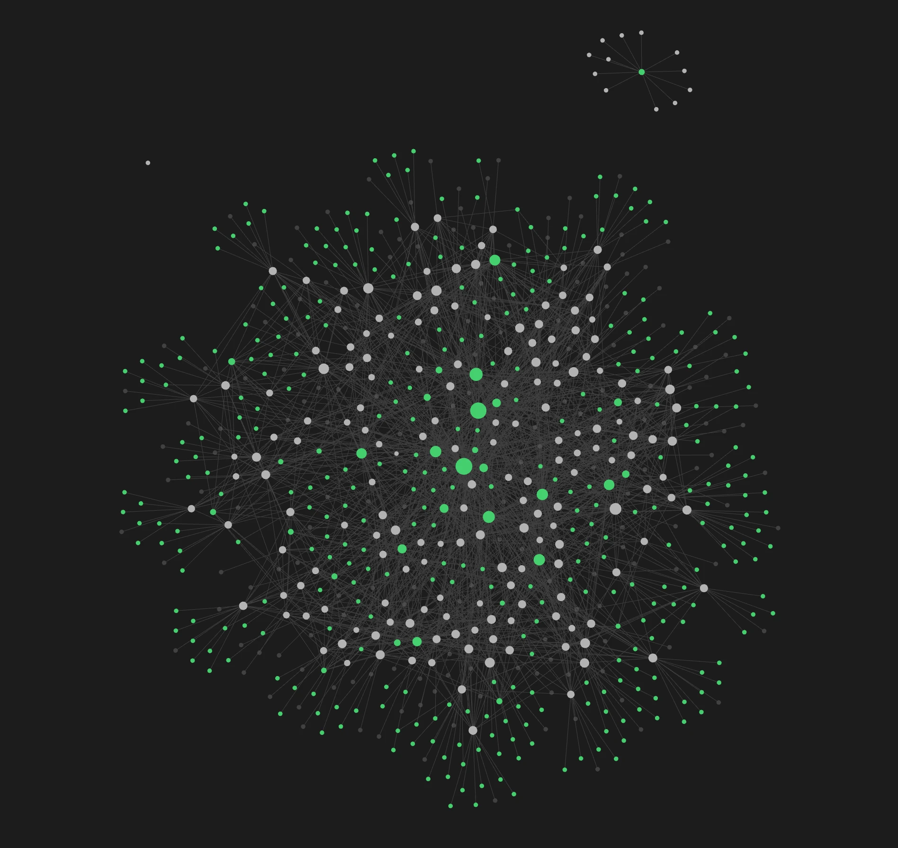

# bookmark-ingestion

A self-updating **design-inspiration system**. Something you liked — a tweet, a saved
Instagram reel, a link someone sent you — goes in. What comes out is a **design
teardown**: what the site is, what it shows, how it's built, its real palette, fonts
and stack read out of the DOM rather than guessed from a screenshot, a full-page
capture, and a classification that wires it to every related site you've collected.



That picture is the point of the whole thing, and nobody arranged it. Every node is a
site note or a facet tag; the hubs trailing long spokes are the facets many sites
share, and the layout is just what happened when 186 teardowns were classified against
a fixed vocabulary and left to find each other. The dense middle is where verticals
and vibes overlap. The lone cluster adrift at the top right is a corner of the corpus
connected to nothing else, which is as good a picture of a gap as any — and gaps are
what the next version is supposed to go hunting for.

Current corpus: **304 items · 186 site teardowns · 174 full-page screenshots · 63 tests**.

## The idea

Taste is the expensive part and it is already being spent. You bookmark, you save, you
send yourself links — and that judgment evaporates into a feed you will never scroll
back through. This repo treats each of those acts as the beginning of a pipeline
rather than the end of one.

Two things follow from that, and they are what the design is actually organized
around:

**Collecting is not where the work is.** Anything that can produce a URL can feed
this, so the pipeline has exactly one socket and every medium is a producer in front
of it. X bookmarks were first. A text file of links works. And an agent that watched
44 Instagram videos and wrote down the 17 sites worth looking at works too — it has no
access to this Mac, so it opens a pull request instead, and the daemon drains it on
the next fire. None of those producers knows anything about teardowns, screenshots or
taxonomy.

**The output has to be traversable, not just stored.** A folder of 186 Markdown files
is an archive; the facet graph is a tool. Every site is classified against a fixed,
deliberately small vocabulary, so "dark portfolios" and "anything about startups,
whatever kind of site it is" are both one command. The vocabulary grows sparingly and
on purpose, because a taxonomy that accepts every new word stops clustering anything.

## Where inspiration comes from

```
   X bookmarks          a file of URLs        an agent that watched
   (twitter-web-         in ~/Downloads        something this Mac can't
    exporter)                                  (Muse → Instagram reels)
        │                      │                         │
        │                      │                 opens a PR adding
        │                      │                 inspo/_queue/<date>-<slug>.txt
        │                      │                         │
        └──────────────┬───────┴─────────────────────────┘
                       ▼
            one normalized item list
```

All three reduce to the same thing: one URL per line, `#` comments ignored. The agent
route is the newest and the most interesting, because it buys something the local
machine cannot get on its own — somebody has to *watch the video* to know which site
is being demoed, and what the demo showed that a headless screenshot of the homepage
never will. So the agent writes that down as comments next to each URL:

```
https://lenis.dev/
# ^ buttery smooth-scroll js library; the site itself is the demo — scroll feel is the whole pitch
https://terminalindustries.com/
# ^ the entire video is a design breakdown of this site — capture hero, type, and motion
```

The teardown itself still happens here, on this machine, with a real browser. The
remote agent finds and annotates; it never writes design data. That split is
deliberate — see the anti-hallucination rule below.

## How it works

```
      producers (above)
             │
             ▼   launchd daemon fires run.sh: on a ~/Downloads change,
             │   and every 30 min so a merged PR gets noticed too
┌─ sync ─────┴───────────────────────────────────────────────────────┐
│ commit this machine's generated output → fetch origin → fast-      │
│ forward or merge → drain inspo/_queue/ → git rm what landed        │
└──────────────────────────────┬─────────────────────────────────────┘
                               ▼
┌─ deterministic Python (tools/ingest) ──────────────────────────────┐
│ diff against _ledger.json → harvest real URLs (t.co → destination) │
│ → new-items.json, in chunks of 5                                   │
└──────────────────────────────┬─────────────────────────────────────┘
                               ▼
┌─ claude -p enrichment (Sonnet, headless, isolated Playwright) ─────┐
│ per item: title/category/tags · primary-URL judgment · view the    │
│ attached photos, frame-sample the videos, describe them            │
│ per design-worthy site: fullPage screenshot, DOM probe (CSS vars,  │
│ document.fonts, computed colors, meta, framework globals), mobile  │
│ pass, prose analysis, facet classification against taxonomy.json   │
└──────────────────────────────┬─────────────────────────────────────┘
                               ▼
┌─ deterministic writers ────────────────────────────────────────────┐
│ merge into inspo/inspiration.json (source of truth) → regenerate   │
│ inspiration.md + the Obsidian vault → advance ledger → archive →   │
│ commit and push                                                    │
└─────────────────────────────────────────────────────────────────────┘
```

Decisions that carry weight:

- **Deterministic/judgment split.** Everything idempotent and file-mutating is plain
  Python with tests. The model is asked only for what a script cannot do: pick the
  subject site, write prose, classify facets, describe a video.
- **Anti-hallucination extraction.** Colors and fonts come from `getComputedStyle`,
  `document.fonts` and CSS custom properties. Never from looking at the screenshot.
  Judging from pixels is allowed for routing a site, never for recording data about it.
- **Chunked and resumable.** Five items per `claude -p` call, ledger advancing per
  chunk, so a rate-limit stop resumes exactly where it left off. A failure never
  advances the ledger. Corrupt or empty exports are skipped rather than wedging
  anything.
- **One source of truth.** `inspo/inspiration.json`. The Markdown digest and the whole
  vault are generated views and are rewritten without ceremony; hand-editing a
  generated note loses the edit on the next rebuild.
- **Hand edits are sacred.** The daemon commits and pushes unattended, so it owns
  `inspo/` and `screenshots/` and nothing else. If any other path is dirty it commits
  nothing and skips the sync, rather than sweeping work in progress into a robot commit.
- **Visible.** macOS notifications for run start, per-chunk progress, failures, and
  "Done ✓ — vault updated".

## How it's organized

| Path | What it is |
|---|---|
| `inspo/inspiration.json` | **Source of truth** — every item (`items[]`) and every teardown (`site_designs{}`, schema in its `_schema` key) |
| `inspo/vault/` | **Generated Obsidian vault** — one note per site, plus `INDEX.md` (the facet map) and `ITERATIONS.md` (hand-written history; survives rebuilds) |
| `inspo/_queue/` | The in-repo inbox a remote agent fills by PR; drained and emptied each run |
| `inspo/inspiration.md` | Generated human-readable digest |
| `inspo/_ledger.json` | Processed ids and provenance — the dedup authority |
| `inspo/_archive/` | Raw exports, kept forever |
| `screenshots/` | Full-page PNG per torn-down site |
| `tools/ingest/` | The pipeline: `ingest.py` (diff/harvest) · `add_urls.py` (the universal URL adapter) · `drain_queue.py` + `sync_repo.py` (the PR medium) · `enrich.sh` + `enrich_prompt.md` (the model SOP) · `writers.py` / `apply_enriched.py` (merge) · `render_vault.py` · `taxonomy.json` · `classify_facets.py` · `backfill.py` · launchd plist + `INSTALL.md` |
| `run.sh` | Daemon entrypoint: lock → sync → guard → chunk loop → queue drain → vault rebuild → archive → publish |
| `tests/` | pytest suite covering every deterministic stage |

## Using the inspiration

**In Obsidian:** open `inspo/vault/` as a vault (File → *Open folder as vault*, pick
that exact folder) and turn **Tags** on in Graph view. That is the picture at the top.
Sites connect through four controlled facets:

- `#vertical/…` — what the site **is** (portfolio, startup-product, tool-app, studio-agency, …)
- `#vibe/…` — how it **feels** (minimal, editorial, technical, playful, brutalist, luxury, …)
- `#topic/…` — what it's **about** (design, ai, startups, music, …). Topics bridge
  clusters: a personal blog about startups links into the startup world.
- `#mode/dark` · `#mode/light`

Each note carries the full teardown and a **Related sites** list that prints its own
reasoning — `[[kmk0.com]] — shared: portfolio, playful, light`.

**From a terminal or an agent:**

```bash
cat inspo/vault/INDEX.md                        # the vocabulary, with counts

rg -l '#vertical/portfolio' inspo/vault | xargs rg -l '#mode/dark'   # dark portfolios

rg -l '#topic/startups' inspo/vault             # any kind of site, about startups
```

Read the handful of notes that come back (~4 KB each) rather than the 1 MB JSON. A
global Claude Code skill, `design-inspiration`, teaches agents this traversal; the raw
JSON stays as the fallback for queries the facets can't express.

## Adding more

**From X.** Bookmark things — it works when the tweet is only a video or image, since
media gets viewed and described. Export with
[twitter-web-exporter](https://github.com/prinsss/twitter-web-exporter) (on your
bookmarks page, **Bookmarks as JSON**) and save to `~/Downloads`. The daemon notices
the file and processes only what it has never seen.

**From anywhere, by hand.**

```bash
# right now, directly
.venv/bin/python -m tools.ingest.add_urls https://some-cool-site.com https://another.com

# or as a drop-file the daemon watches
echo "https://some-cool-site.com" >> ~/Downloads/inspo-urls.txt
```

Other mediums reduce to that drop-file:

```bash
grep -oE 'HREF="[^"]*"' bookmarks.html | cut -d'"' -f2 > ~/Downloads/inspo-urls.txt  # browser export
cut -d, -f2 raindrop-export.csv | tail +2 > ~/Downloads/inspo-urls.txt               # Raindrop/Pocket CSV
```

**From an agent.** It opens a PR adding one file to `inspo/_queue/`; merge it and the
daemon takes it from there. The format and house rules are in
[`inspo/_queue/README.md`](inspo/_queue/README.md).

Dedup is by URL hash and by domain against existing teardowns, so re-adding something
is harmless. A specific page is torn down as that page, not as its homepage.

Manual controls:

```bash
./run.sh                                          # the whole pipeline, now
.venv/bin/python -m tools.ingest.render_vault     # regenerate the vault only
.venv/bin/python -m tools.ingest.classify_facets  # classify any sites missing facets
.venv/bin/python -m pytest -q                     # tests
```

### Setting up fresh

`tools/ingest/INSTALL.md` has the full walkthrough — the launchd agent, the dedicated
`neoud-bash` interpreter that gets around macOS TCC, and the isolated headless
Playwright config. The short list: a Python 3.9+ venv with pytest, **Node ≥ 20** on
the daemon's PATH (`@playwright/mcp` refuses anything older), Claude Code at
`~/.local/bin/claude`, and the plist loaded with `launchctl`. The plist is **copied**
into `~/Library/LaunchAgents`, not symlinked, so editing it in the repo changes
nothing until you copy it over and reload.

## Project history

Every iteration, dead end and macOS fight is written down in
[`inspo/vault/ITERATIONS.md`](inspo/vault/ITERATIONS.md), including the ones that
turned out to be wrong and had to be retracted. It is updated as part of the work
rather than afterwards.

## Where it might go

[`docs/autonomous-growth.md`](docs/autonomous-growth.md) is an idea dump — nothing
decided, nothing built — about the one manual step left: letting the corpus discover
its own inputs, and the larger idea of a public search engine over design
characteristics. The honest problem it names is that discovery is cheap and taste is
not, so the hard part is the quality gate, not the crawling. The most promising thread
is gap-driven discovery: read the thin facets out of the taxonomy and go looking for
those specifically, which makes the graph above its own crawl planner.
