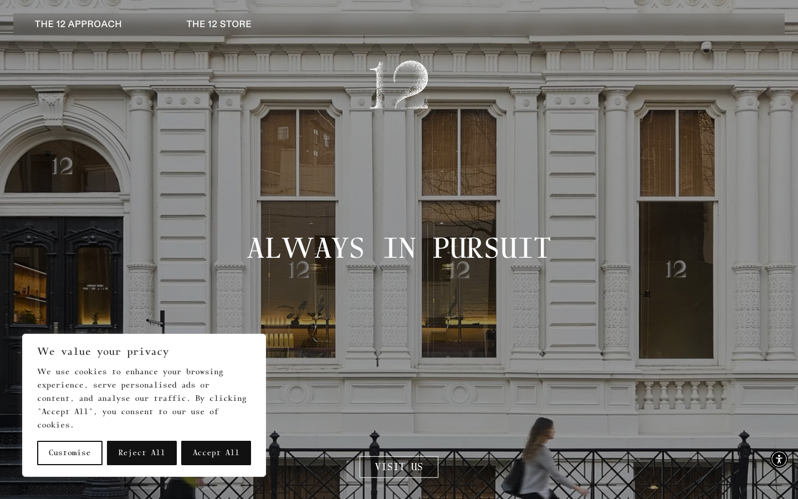

# 12 Matcha — Forever in Pursuit of Exquisite Matcha
>   ·  [12matcha.com](https://12matcha.com)

## What it is
The brand and commerce site for 12 Matcha, a matcha and dessert boutique in NoHo, New York. It's a refined direct-to-consumer storefront that leads with mood and craft rather than products — the matcha equivalent of a fashion house homepage.

## What it shows
A full-bleed photographic hero of an elegant white European-style storefront, overlaid with a centered serif wordmark '12' and the line 'ALWAYS IN PURSUIT'. A minimal top nav (THE 12 APPROACH, THE 12 STORE) and a privacy/cookie banner. Scrolling down (the page is ~4,650px tall) moves through brand story, video, and store sections.

## How it works
A long, vertical, scroll-driven brand narrative — full-screen photographic and video sections (5 videos) you move through top to bottom, ending in the store. Navigation is sparse and editorial; the experience is about scrolling through atmosphere before you reach commerce. Includes an accessibility menu and a full cookie-consent customiser.

## How it's designed
Quiet luxury editorial: a near-white/cream and black palette lets large architectural photography carry the page. The display face is a distinctive monospace-serif ('gc16') used for the big 'ALWAYS IN PURSUIT' headline, paired with abcDiatype as a clean grotesque for body — a fashion-editorial pairing that signals taste and restraint. Generous negative space, centered composition, almost no UI chrome.

## Design data
- **Palette:** Cream/near-white (#eeede7, #fff) and near-black (#111) with white text over photography; color comes entirely from the imagery.
- **Fonts:** gc16 (monospace-serif display), abcDiatype (grotesque body)
- **Extracted:** 2026-06-04 · playwright-mcp @ 1440x900

## Related sites
[[animations.dev]] [[asekachov.com]] [[christophlocher.com]] [[claude.com]] [[contralabs.com]] [[daviskeene.com]]

## Tags
#category/design #aesthetic/editorial #aesthetic/luxury #aesthetic/developer-product #pattern/editorial #pattern/luxury #pattern/scrollytelling #pattern/full-bleed-photo #pattern/video-hero #pattern/ecommerce #pattern/monospace-serif #pattern/negative-space #color/warm
