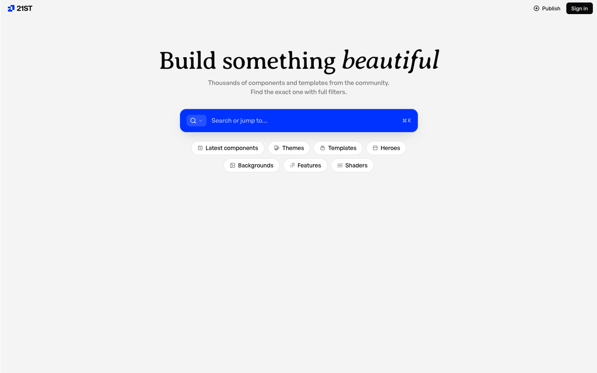

# 21st.dev - Crafted React components and templates, not AI slop | 21st
> A community registry of hand-crafted React components and templates. Start from real, polished UI instead of the bland AI average, and ship products that look like you, not everyone else.  ·  [21st.dev](https://21st.dev/)

## What it is
The gallery the tweet links to. Its h1 is 'Build something beautiful' and its meta description reads 'A community registry of hand-crafted React components and templates. Start from real, polished UI instead of the bland AI average, and ship products that look like you, not everyone else.' — a marketplace/registry of React UI you can preview, then copy as a prompt for an AI coding agent to recreate.

## What it shows
A light hero with an Averia-Serif-Libre display headline over a very media-dense wall of live component and section previews — 122 , 59 <video> and 274 inline <svg> — arranged in horizontal 'View all' carousels of bento cards, notification stacks, dashboards and marketing sections, each previewable and copyable as a prompt.

## How it works
A React application served from 21st.dev; no meta-framework global (__NEXT_DATA__/__NUXT__ etc.) was exposed to the probe, but auth runs through Clerk (clerk.21st.dev), affiliate tracking through Tolt (cdn.tolt.io), plus Google Tag Manager, a Twitter/X Ads pixel and jsDelivr. The homepage renders inside a fixed 900px app shell with an internal scroll region.

## How it's designed
A bright, editorial light theme. getComputedStyle reports a white body background oklch(1 0 0) with near-black body text oklch(0.141 0.004 285.824); the h1 renders at 60px in 'Averia Serif Libre' (loaded 400, normal + italic) — a quirky display serif that sets the 'crafted, not slop' tone — while body/UI type is 'General Sans' (loaded 500) with a mono stack for code. The only exposed :root colour token is the blue selection accent --color-selected #008fe9; General Sans and the mono stack are declared as --font-sans / --font-mono.

## Design data
- **Palette:** White canvas with near-black text (oklch 0.141) and a single blue selection/accent (--color-selected #008fe9); all the colour comes from the component previews themselves.
- **Palette tokens:** --color-selected: #008fe9 (var), body background: oklch(1 0 0) (rendered), body text: oklch(0.141 0.004 285.824) (rendered), h1: oklch(0.141 0.004 285.824) (rendered)
- **Fonts:** General Sans (loaded 500) for UI/body and Averia Serif Libre (loaded 400, roman + italic) as the display serif for the h1; a mono stack (--font-mono) for code snippets.
- **Fonts loaded:** General Sans 500, Averia Serif Libre 400, Averia Serif Libre 400 italic
- **Tech stack:** React (meta-framework global not exposed), Clerk (auth), Tolt (affiliate), Google Tag Manager, Twitter/X Ads pixel, jsDelivr
- **Media mix:** img 122 · video 59 · svg 274
- **Page height:** 900px (single-screen: False)
- **Responsive:** At 390x844 the top nav collapses to a burger menu and the component grid reflows to a single 342px column with no horizontal overflow; the document height stays viewport-locked because the gallery scrolls inside an internal app-shell container.
- **Headings:** Build something beautiful
- **Weight:** None requests; hosts: 21st.dev, clerk.21st.dev, cdn.tolt.io, cdn.jsdelivr.net, www.googletagmanager.com, static.ads-twitter.com
- **Extracted:** 2026-07-08 · Playwright MCP, 1440x900 fullPage + 390x844 mobile probe; logged_out: true. The homepage is a single-screen app shell with an internal scroll container, so document scrollHeight (and the fullPage capture) is viewport-height rather than the full gallery length.

## Related sites
[[eko.lumaris.works]] [[animations.dev]] [[contralabs.com]] [[coolsites.ai]] [[designengineer.tools]] [[designrebuilds.vercel.app]]

## Tags
#category/tools-build #aesthetic/light #aesthetic/editorial #pattern/component-registry #pattern/directory #pattern/react #pattern/shadcn-adjacent #pattern/copy-as-prompt #pattern/ai-tooling #pattern/light #pattern/serif-display #pattern/general-sans #pattern/video-heavy-previews #tech/react-meta-framework-global-not-exposed #tech/clerk-auth #tech/tolt-affiliate #tech/google-tag-manager #tech/twitter-x-ads-pixel #tech/jsdelivr #color/light #color/cool #font/general-sans #font/averia-serif-libre #font/averia-serif-libre-400-italic
