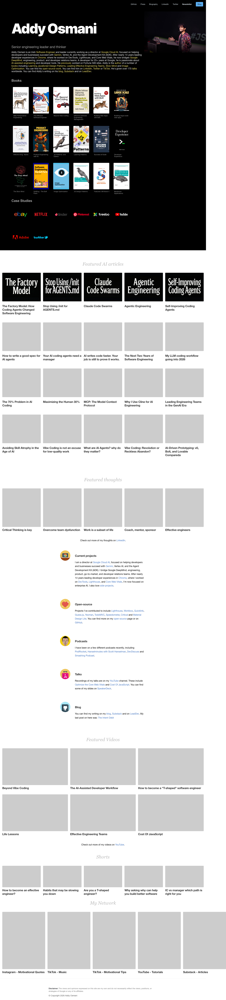

# Addy Osmani
> Addy Osmani is a Software Engineer at Google working on Google Cloud and Gemini.  ·  [addyosmani.com](https://addyosmani.com/)

**Vertical:** #vertical/portfolio  ·  **Vibe:** #vibe/minimal #vibe/editorial  ·  **Topics:** #topic/engineering #topic/ai  ·  **Mode:** #mode/mixed

## What it is
The personal homepage and link hub of Addy Osmani — a software engineer at Google (working on Google Cloud and Gemini, long known for Chrome/web performance) and a prolific author. The only h1 is simply his name, “Addy Osmani”; rather than a marketing landing page it is a dense, sectioned index of everything he makes: books, articles, talks and videos.

## What it shows
It opens on a black hero band with a live-stage photo of Addy, his name set huge, a short bio and social links. Below, on a white ground, run titled sections: a Books grid of cover thumbnails (JS Design Patterns, Learning Patterns, Image Optimization, Success at Scale and other Smashing Magazine titles); a Case Studies row of company logos (eBay, Netflix, Tinder, Pinterest, Treebo, YouTube, Adobe, Twitter); a black “Featured AI articles” band of article cards (The Factory Model, Stop Using Just for READMEs, Claude Code Swarms, Agentic Engineering, Self-Improving Coding Agents); Featured thoughts cards; a row of contact/section cards (Personal projects, Open source, Premium, Talks, Blog); a Featured Videos and Shorts thumbnail grid; and a My Network footer. It is image-heavy (68 , no inline SVG).

## How it works
A static, scroll-driven single page (~6988px tall on desktop). There are no interactive widgets — navigation is scroll plus outbound links, each card linking to its book, article, video or external profile, with a newsletter/contact path via his Substack and socials. No client-side framework is present (no Nuxt/Next/React/Svelte/Gatsby globals) — a classic statically-generated site; Google Tag Manager + Google Analytics are the only third-party scripts and images are served from Cloudinary.

## How it's designed
Monochrome and editorial: alternating light and dark bands — a white content ground bookended by a pure-black hero and a black “Featured AI articles” section (rendered backgrounds rgb(0,0,0)). The display name is set in Inter at weight 900 and 96px, white on black; everything else falls back to the system Helvetica Neue stack — only Inter 900 is actually loaded as a webfont (an 'icons' icon-font is declared but unloaded), so there is essentially no body webfont payload. Links on the dark hero are a light blue-grey (rgb(217,227,234)). The full-color company logos in the Case Studies row supply the only saturated color against the otherwise black-and-white scheme; hierarchy comes from the oversized name and tidy card grids rather than decorative type.

## Design data
- **Palette:** Monochrome — white content ground, pure-black hero and AI-articles bands (rgb 0/0/0), black body text; light blue-grey links on dark (rgb 217/227/234); full-color company logos as the only accents.
- **Palette tokens:** hero-bg: rgb(0, 0, 0) (rendered), body-text: rgb(0, 0, 0) (rendered), hero-h1: rgb(255, 255, 255) (rendered), link-on-dark: rgb(217, 227, 234) (rendered)
- **Fonts:** Inter 900 for the oversized display name; system Helvetica Neue stack for body/UI (no body webfont); an 'icons' icon-font declared but unloaded.
- **Fonts loaded:** Inter 900
- **Tech stack:** Static site (no JS framework), Google Tag Manager, Google Analytics, Cloudinary, self-hosted
- **Keywords:** personal-hub, portfolio, author-site, books-grid, case-study-logos, light-dark-bands, oversized-display-type, system-fonts, section-index, static-page, link-rich
- **Media mix:** img 68
- **Page height:** 6988px (single-screen: False)
- **Responsive:** At 390x844 the multi-column book/case-study/article/video grids collapse toward a single column (page grows ~6988→16665px) and the hero name scales from 96px to 80px; the layout stays a vertical stack of the same sections.
- **Headings:** Addy Osmani / Web Performance Engineering / The Effective Software Engineer / Beyond Vibe Coding / Effective Software Engineering Management / Building Web Apps with Bolt / Building large-scale web apps / Effective Eng. Teams / Product Engineering with AI / JS Patterns: 2nd Edition / Learning Patterns / Success at Scale / Developer Experience / The Stoic Mind / SoftEng - The Soft Parts / Image Optimization / JS Design Patterns / Featured: SM Book 4 / Backbone Applications / eBay / Netflix / Tinder / Pinterest / Treebo / YouTube / Adobe / Twitter / Featured AI articles / Featured thoughts / Featured Videos / Shorts / My Network
- **Links out:** [Newsletter (Substack)](https://addyo.substack.com/) · [GitHub](https://github.com/addyosmani) · [Twitter/X](https://twitter.com/addyosmani) · [LinkedIn](https://www.linkedin.com/in/addyosmani/)
- **Extracted:** 2026-06-05 · playwright-mcp @ 1440x900 (+ 390x844 mobile), logged_out: true

## Related sites
- [[arneshbanerjee.github.io]] — shared: portfolio, minimal, engineering, ai
- [[daviskeene.com]] — shared: portfolio, minimal, editorial, engineering
- [[jib.design]] — shared: portfolio, minimal, editorial, engineering
- [[spyrosigma.in]] — shared: portfolio, minimal, engineering, ai
- [[21st.dev]] — shared: minimal, editorial, engineering, ai
- [[alisawuffles.github.io]] — shared: portfolio, minimal, ai
