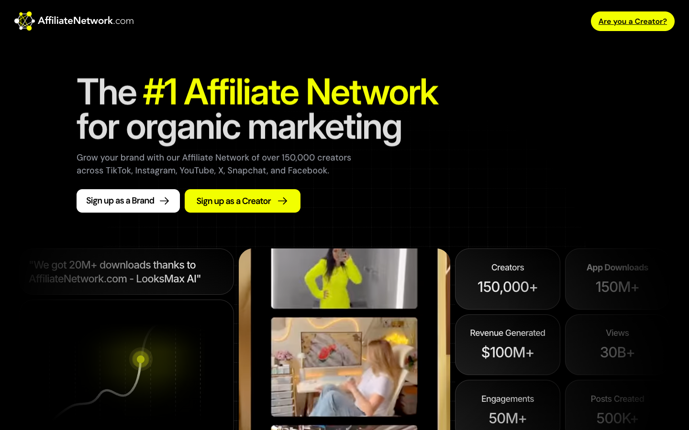

# AffiliateNetwork.com
> The #1 Affiliate Network for organic marketing.  ·  [affiliatenetwork.com](https://affiliatenetwork.com/)

**Vertical:** #vertical/startup-product  ·  **Vibe:** #vibe/corporate-clean  ·  **Topics:** #topic/marketing  ·  **Mode:** #mode/dark

## What it is
The marketing site for AffiliateNetwork.com, a performance-based influencer/creator marketing platform — headlined 'The #1 Affiliate Network for organic marketing' and described in meta as 'a performance-based influencer marketing platform that helps brands scale through viral creators, AI-powered campaigns, and guaranteed results.' Bella's (@growthsuck) bookmark has no tweet text, so the site is the entire showcase.

## What it shows
A dark conversion landing page leading with 'The #1 Affiliate Network for organic marketing' and dual 'Sign up as a brand' / 'Sign up as a Creator' CTAs (plus a yellow 'Are you a Creator?' nav button), followed by oversized trust stats (150k+ creators, 150M+ app downloads, $100M+ revenue generated, 30B+ views, 50M+ engagements, 500K+ posts), 'How it works' and 'Why choose us' sections, a 'Trusted by leading brands worldwide' logo wall, and case-study cards for Rizz App, LooksMax AI and Memix.

## How it works
Built in Framer: the public domain (affiliatenetwork.com) is a thin shell that embeds the real Framer site via a cross-origin iframe at frame.affiliatenetwork.com — assets load from framerusercontent.com and telemetry from events.framer.com (no Next/Nuxt/Vue/Svelte global). It is heavily vector-driven (149 inline SVGs and 44 images) over a tall ~5541px desktop page, and contact/footer links resolve to socialreachly.com (mailto) and brands.affiliatenetwork.com (terms/privacy).

## How it's designed
A near-black canvas (rendered rgb(0,0,0)) with light-grey headline text (rgb(222,222,222)) lit by a single electric chartreuse-yellow accent (#f2ff00, rendered rgb(242,255,0)) on the primary buttons (black labels). Type is a stack of geometric sans served by Framer — Inter Display for big headings (hero h1 at 75px), Inter for body, plus DM Sans and Satoshi — giving a modern, high-contrast startup-landing look built around oversized stat numbers and rounded case-study cards.

## Design data
- **Palette:** Black background, light-grey #dedede headlines, electric chartreuse #f2ff00 CTA
- **Palette tokens:** body-background: rgb(0, 0, 0) (rendered), h1-color: rgb(222, 222, 222) (rendered), button-background: rgb(242, 255, 0) (rendered), button-text: rgb(0, 0, 0) (rendered)
- **Fonts:** Inter Display + Inter (with DM Sans & Satoshi), Framer-hosted
- **Fonts loaded:** Inter Display 400, Inter Display 500, Inter Display 600, Inter Display 700, Inter 400, Inter 500, Inter 600, Inter 700, DM Sans 500, DM Sans 600, Satoshi 500
- **Tech stack:** Framer, framerusercontent.com CDN, events.framer.com analytics
- **Keywords:** framer, dark-theme, landing-page, marketing, saas, stats-heavy, neon-accent
- **Media mix:** img 44 · svg 149 · iframe 2
- **Page height:** 5541px (single-screen: False)
- **Responsive:** At 390x844 the hero h1 scales from 75px down to 30px, the layout reflows to a single column, and the page grows from ~5541px to ~8737px.
- **Headings:** The #1 Affiliate Network for organic marketing / How it works / Why choose us / 30B+ / 150k+ / 150M+ / Trusted by leading brands worldwide / Case Studies / Launch Your First Campaign Today. / Rizz App / LooksMax AI / Memix
- **Links out:** [Register](https://frame.affiliatenetwork.com/) · [hello@AffiliateNetwork.com](mailto:hello@socialreachly.com) · [Terms of use](https://brands.affiliatenetwork.com/terms) · [Privacy policy](https://brands.affiliatenetwork.com/privacy)
- **Extracted:** 2026-06-06 · Playwright MCP, 1440x900 + 390x844, logged_out: true; page content is served via a cross-origin Framer iframe (frame.affiliatenetwork.com) and was probed directly

## Related sites
- [[linkeddit.com]] — shared: startup-product, corporate-clean, marketing
- [[cavalry.studio]] — shared: startup-product, corporate-clean, dark
- [[daytona.io]] — shared: startup-product, corporate-clean, dark
- [[flowstate.com]] — shared: startup-product, corporate-clean, dark
- [[langchain.com]] — shared: startup-product, corporate-clean, dark
- [[palmier.io]] — shared: startup-product, corporate-clean, dark
