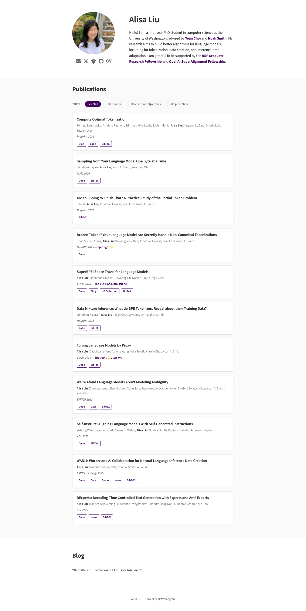

# Alisa Liu — PhD student, University of Washington
> PhD student at the University of Washington.  ·  [alisawuffles.github.io](https://alisawuffles.github.io/)

**Vertical:** #vertical/portfolio  ·  **Vibe:** #vibe/minimal  ·  **Topics:** #topic/ai #topic/education  ·  **Mode:** #mode/light

## What it is
Alisa Liu's academic homepage — a final-year CS PhD student at the University of Washington (advised by Yejin Choi and Noah Smith), an NSF Graduate Research Fellow and OpenAI SuperAlignment Fellow. She's the 'she's joining OpenAI' subject of the tweet, whose free LLM interview-prep notes ('Alisa's book of LLMs', math notes, job-search blog) are what's being shared.

## What it shows
A compact three-section academic page: a bio hero ('Hello! I am a final-year PhD student in computer science at the University of Washington… My research aims to build better algorithms for language models, including for tokenization, data creation, and inference-time adaptation.'), a Publications list, and a Blog (where her job-search post lives). A 'Click to copy CV' affordance sits at the top.

## How it works
A static site generated with Astro v6.0.4 (per the meta generator), self-hosting its CSS alongside Google-Fonts webfonts and Google Tag Manager analytics. It's lightweight — 1 img, 5 svg, no video — and 2,874px tall.

## How it's designed
Clean minimal-academic, grounded in an explicit CSS custom-property system read from :root: white background (--bg #fff), dark-grey body text (--text #2c2c2c) with a muted secondary (--text-muted #666), hairline borders (--border #e0e0e0), and a distinctive deep-purple accent (--accent #40045c, --accent-light #6b2d8b). Type is Source Sans 3 (weights 300–700 loaded; the h1 renders 40px/600) for text, with Roboto Mono (--mono) reserved for code and metadata.

## Design data
- **Palette:** White (#fff) with dark-grey text (#2c2c2c) and a deep-purple accent (#40045c / #6b2d8b); #e0e0e0 hairline borders.
- **Palette tokens:** --accent: #40045c (var), --accent-light: #6b2d8b (var), --text: #2c2c2c (var), --text-muted: #666 (var), --bg: #fff (var), --border: #e0e0e0 (var), h1 color: rgb(44, 44, 44) (rendered)
- **Fonts:** Source Sans 3 (300–700) for text; Roboto Mono for monospace.
- **Fonts loaded:** Source Sans 3 300, Source Sans 3 400, Source Sans 3 600, Source Sans 3 700, Roboto Mono 400
- **Tech stack:** Astro v6, Google Fonts, Google Tag Manager
- **Keywords:** academic, minimalist, astro, purple-accent, source-sans, personal-site, research
- **Media mix:** img 1 · svg 5
- **Page height:** 2874px (single-screen: False)
- **Responsive:** At 390x844 the single column reflows and stacks (page grows to ~4,013px); the 40px h1 is retained.
- **Headings:** Alisa Liu / Publications / Blog
- **Extracted:** 2026-07-05 · Playwright MCP, 1440x900 + 390x844 mobile pass, logged_out: true

## Related sites
- [[arneshbanerjee.github.io]] — shared: portfolio, minimal, ai, light
- [[debarghyadas.com]] — shared: portfolio, minimal, ai, light
- [[farza.com]] — shared: portfolio, minimal, ai, light
- [[spyrosigma.in]] — shared: portfolio, minimal, ai, light
- [[addyosmani.com]] — shared: portfolio, minimal, ai
- [[asekachov.com]] — shared: portfolio, minimal, light
