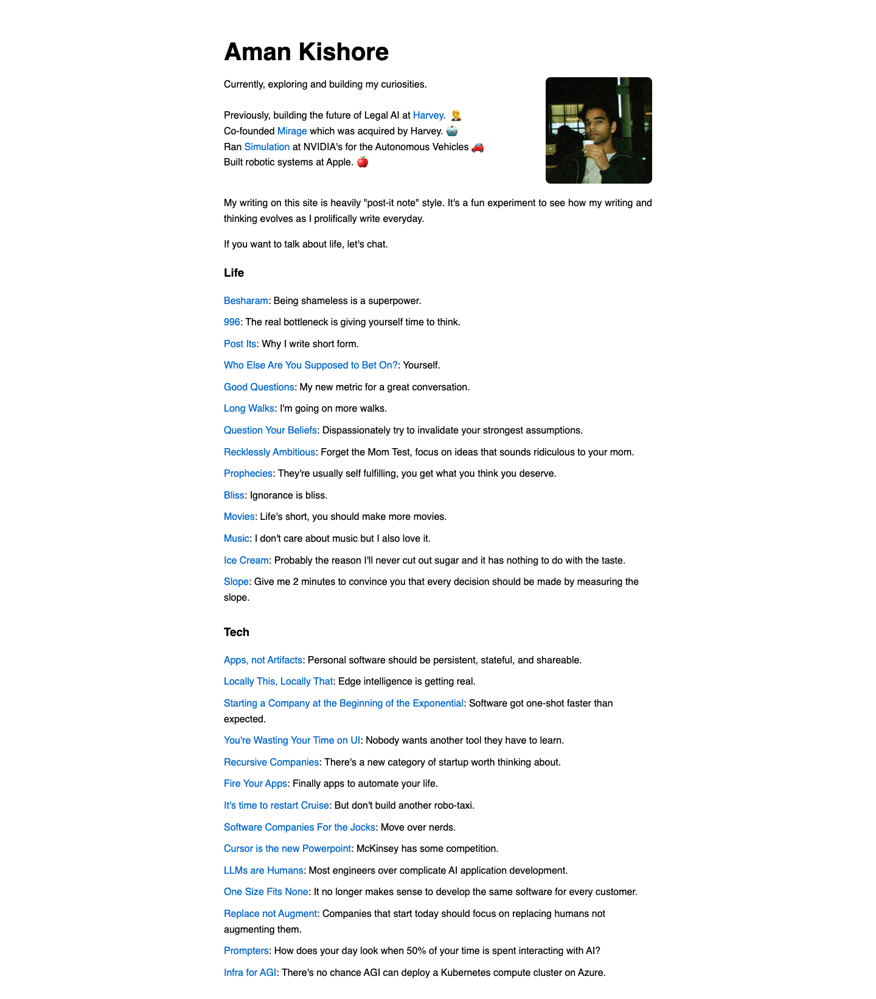

# Aman Kishore
> Currently, exploring and building my curiosities.  ·  [amanml.com](https://amanml.com/)

**Vertical:** #vertical/personal-blog  ·  **Vibe:** #vibe/minimal  ·  **Topics:** #topic/ai #topic/engineering  ·  **Mode:** #mode/light

## What it is
The personal homepage and writing collection of Aman Kishore — previously building Legal AI at Harvey, co-founder of Mirage (acquired by Harvey), ex-NVIDIA (autonomous-vehicle simulation) and ex-Apple robotics. He describes the site's writing as deliberately 'post-it note' style.

## What it shows
A short bio paragraph linking out to Harvey, Mirage and NVIDIA, then a long single-column index of bite-size essays split across themes — a 'Life' set (Besharam, 996, Post Its, Long Walks, Question Your Beliefs) and a dense run of AI/startup takes (Apps not Artifacts, Cursor is the new Powerpoint, LLMs are Humans, Replace not Augment, Infra for AGI, Recursive Companies).

## How it works
An ultra-light static HTML page — one image, no framework, a single same-origin stylesheet, with only Google Tag Manager added for analytics. Each essay is its own flat .html file (besharam.html, 996.html, cursor.html …), classic hand-authored static-site structure.

## How it's designed
Bare-bones document styling: transparent/white canvas, black text set in Inter, a centered ~800px max-width column, and a single classic-web blue rgb(0,102,204) for links. No CSS variables, no webfont payload beyond the system Inter stack — the design is intentionally close to an unstyled, readable text document.

## Design data
- **Palette:** White background, black text, classic-web blue #0066cc links
- **Palette tokens:** body text: rgb(0, 0, 0) (rendered), link/accent: rgb(0, 102, 204) (rendered)
- **Fonts:** Inter (system/sans stack); no webfont loaded
- **Fonts loaded:** system only (no webfont)
- **Tech stack:** static HTML, Google Tag Manager
- **Keywords:** minimalist, text-only, blog-index, post-it, static, centered-column
- **Media mix:** img 1
- **Page height:** 1643px (single-screen: False)
- **Responsive:** At 390×844 the 800px-max-width column simply fills the viewport and the page grows to ~2.5k px; no layout reflow.
- **Headings:** Aman Kishore
- **Links out:** [Harvey](https://www.harvey.ai/) · [Mirage](https://twitter.com/mirage_ml)
- **Extracted:** 2026-06-06 · Playwright Chromium @ 1440×900 + 390×844 mobile pass; logged_out: true

## Related sites
- [[emilkowal.ski]] — shared: personal-blog, minimal, ai, engineering, light
- [[anyblockers.com]] — shared: personal-blog, minimal, engineering, light
- [[nehasharma.dev]] — shared: personal-blog, ai, engineering, light
- [[nicolasbustamante.com]] — shared: personal-blog, minimal, ai, light
- [[performance.dev]] — shared: personal-blog, minimal, engineering, light
- [[21st.dev]] — shared: minimal, ai, engineering, light
