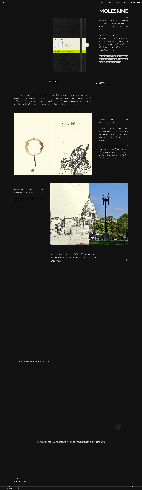

# Ankit Rai®
> MOLESKINE — Observations in ink  ·  [ankit-rai.com](https://www.ankit-rai.com/moleskine)

**Vertical:** #vertical/portfolio  ·  **Vibe:** #vibe/minimal #vibe/editorial  ·  **Topics:** #topic/art #topic/travel-places  ·  **Mode:** #mode/dark

## What it is
The 'Moleskine' project page inside the Framer-built portfolio of Ankit Rai, a Design & Construction Technologist. It reframes his personal travel sketchbook as an interactive web exhibit, and is the page Matt (@Matthias_Oel) points to as the live home of his Flipbook 3D component.

## What it shows
A near-black page whose pitch headline is the single word 'MOLESKINE'. The centerpiece is a 3D page-turning book of finely detailed architectural pen-and-ink sketches (US Capitol, MIT Stata Center, figure studies), flanked by italic journal copy ('As an architect, I can't help noticing corners, light, shadows…'). Below it the page continues through sections titled OBSERVATIONS IN INK, FIRST LINES, BEHIND THE LINES, TERRAINS and Reflections.

## How it works
A long vertical scroll page (~4,950px). The hero interaction is the flipbook: arrows on either side page you through ~30 spreads with a realistic curl animation, while the prose invites you to 'slow down, look closer.' It's an image-driven 3D widget (no canvas/video — CSS-transformed images) rather than a heavy WebGL scene.

## How it's designed
Restrained, gallery-like dark layout: a #121212 ground with white display headings set in Josefin Sans and delicate italic Lato body text (weight 300), so the monochrome ink drawings carry all the color. Built on Framer; a small smartarget widget and Framer's own analytics are the only third-party payloads.

## Design data
- **Palette:** Near-black ground (#121212) with white (#fff) headings and grey secondary text (#a7a7a7); a green token (#0bde66) and a red link-hover accent appear in the theme.
- **Palette tokens:** ground: #121212 (var), white: #fff (var), secondary-grey: #a7a7a7 (var), green-accent: #0bde66 (var), link-hover: red (var), body-bg-rendered: rgb(18, 18, 18) (rendered), h1-rendered: rgb(255, 255, 255) (rendered), button-bg-rendered: rgba(255, 255, 255, 0.9) (rendered)
- **Fonts:** Josefin Sans (display headings) + Lato (italic 300 body)
- **Fonts loaded:** Josefin Sans 300, Josefin Sans 400, Josefin Sans 600, Lato 300, Lato 400
- **Tech stack:** Framer, Framer Analytics, smartarget (widget)
- **Keywords:** flipbook, 3d, page-turn, dark, portfolio, case-study, monochrome, architectural-illustration, long-scroll, framer
- **Media mix:** img 10 · svg 14 · iframe 1
- **Page height:** 4954px (single-screen: False)
- **Responsive:** At 390px the multi-column layout stacks into a single column and page height balloons (~4,954 → ~20,400px); no persistent nav bar.
- **Headings:** MOLESKINE / OBSERVATIONS IN INK / FIRST LINES / BEHIND THE LINES / TERRAINS / Reflections
- **Weight:** None requests; hosts: framerusercontent.com, events.framer.com, smartarget.online
- **Extracted:** 2026-06-06 · playwright-mcp @ 1440x900 (+390x844 mobile), logged_out: true

## Related sites
- [[davekrugman.com]] — shared: portfolio, editorial, art, dark
- [[addyosmani.com]] — shared: portfolio, minimal, editorial
- [[asekachov.com]] — shared: portfolio, minimal, editorial
- [[christophlocher.com]] — shared: portfolio, minimal, editorial
- [[daviskeene.com]] — shared: portfolio, minimal, editorial
- [[joonasvirtanen.com]] — shared: portfolio, minimal, editorial
