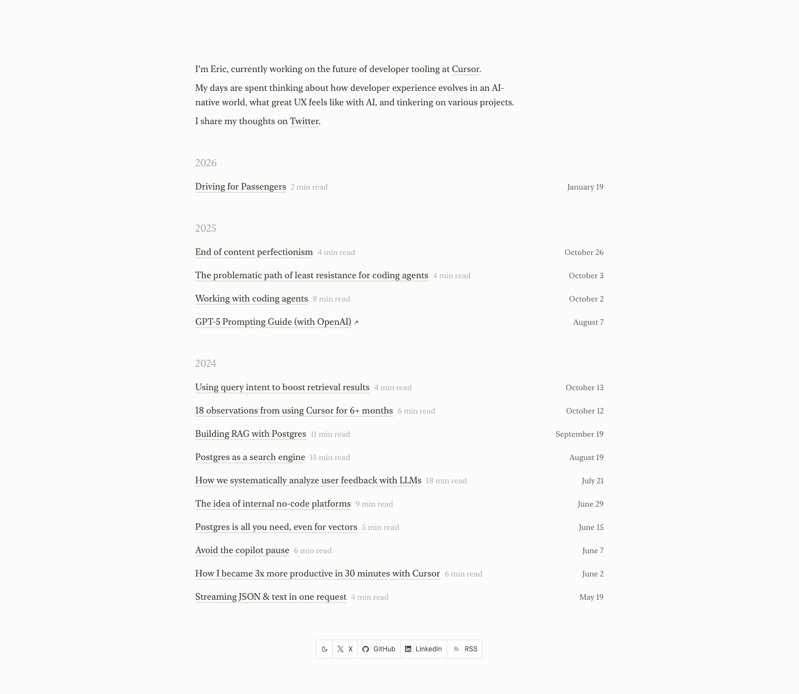

# anyblockers
> I'm Eric, currently working on the future of developer tooling at Cursor.  ·  [anyblockers.com](https://anyblockers.com/)

## What it is
The personal site / writing blog of eric zakariasson, the author of the tweet — a developer at Cursor. The opening line is the whole identity: 'I'm Eric, currently working on the future of developer tooling at Cursor. My days are spent thinking about how developer experience evolves in an AI-native world.' This is the author's portfolio, not the subject of the bookmark; it's a reverse-chronological essay index.

## What it shows
A narrow, centered single column: a three-paragraph intro (with inline links to Cursor and Twitter) followed by a year-grouped list of posts (2026, 2025, 2024). Each entry is a serif title plus a read-time and a right-aligned date — e.g. 'Working with coding agents' (8 min read), 'GPT-5 Prompting Guide (with OpenAI)', 'How we systematically analyze user feedback with LLMs' (18 min read), 'Postgres as a search engine', 'Building RAG with Postgres'. A small footer toolbar holds theme toggle, X, GitHub, LinkedIn and RSS.

## How it works
A pure index-and-read blog: scroll the chronological list and click a title to read the essay. Outbound chrome is minimal — the footer toolbar links to social profiles and the RSS feed, and a theme toggle switches light/dark. A newsletter is wired in via an embedded beehiiv widget. There's no nav bar beyond the inline intro links; the page is one quiet ~1,252px scroll.

## How it's designed
An intentionally bookish, almost-no-chrome reading layout: a warm off-white paper ground (#fdfcfb) with soft near-black ink (rgba(26,24,15,0.8)) set in Apple's 'New York' serif (the only loaded webface) for a literary, print-essay feel. There are zero images in the body (img: 0; the 6 SVGs are footer icons) — text carries everything. Built on Tailwind (full --tw-* token set present) with Shiki for code highlighting (--shiki-dark-bg / --code-gutter-width vars), PostHog for analytics, and a beehiiv newsletter embed. The serif + generous measure + year headers make it read like a quiet digital garden.

## Design data
- **Palette:** Warm off-white paper (#fdfcfb) with soft near-black ink (rgba(26,24,15,0.8)); grey hairline borders (rgb(229,231,235)); no chromatic accent.
- **Palette tokens:** body background: rgb(253,252,251) (rendered), body text: rgba(26,24,15,0.8) (rendered), button border: rgb(229,231,235) (rendered), --tw-ring-color: rgb(59 130 246 / .5) (var)
- **Fonts:** Apple 'New York' serif (system-served) for everything; no display face.
- **Fonts loaded:** New York 400
- **Tech stack:** Tailwind CSS, Shiki (code highlighting), PostHog, beehiiv (newsletter embed)
- **Media mix:** svg 6
- **Page height:** 1252px (single-screen: False)
- **Responsive:** At 390x844 the already-narrow centered column simply fills the 390px width (single column throughout); scrollHeight grows to ~1,722px.
- **Links out:** [Cursor](https://www.cursor.com/) · [Twitter / X](https://x.com/ericzakariasson) · [GitHub](https://github.com/ericzakariasson) · [LinkedIn](https://www.linkedin.com/in/ericzakariasson)
- **Extracted:** 2026-06-05 · playwright-mcp @ 1440x900 (+390x844 mobile pass), logged_out: true

## Related sites
[[amanml.com]] [[axiaisacat.indiehacker.bio]] [[daryl.cv]] [[designrebuilds.vercel.app]] [[noahzender.com]] [[richzou.com]]

## Tags
#category/tutorial #aesthetic/editorial #aesthetic/light #aesthetic/minimal #pattern/personal-blog #pattern/digital-garden #pattern/serif-editorial #pattern/chronological-index #pattern/read-time-labels #pattern/light-mode #pattern/minimalist #pattern/text-only #pattern/newsletter-embed #tech/tailwind-css #tech/shiki-code-highlighting #tech/posthog #tech/beehiiv-newsletter-embed #color/light #color/warm #font/new-york
