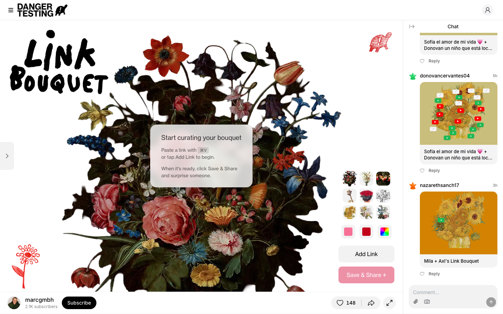

# Link Bouquet by marcgmbh · Danger Testing
> Create and share beautiful bouquets of your favorite links  ·  [appdrop.com](https://www.appdrop.com/marcgmbh/link-bouquet)

**Vertical:** #vertical/tool-app  ·  **Vibe:** #vibe/playful #vibe/organic-warm  ·  **Topics:** —  ·  **Mode:** #mode/light

## What it is
A mini-app hosted on AppDrop (a platform for small personal web apps/"makers"), built by marcgmbh, that turns a list of favorite links into a generative floral bouquet.

## What it shows
A single hero screen: a hand-lettered "LINK BOUQUET" wordmark beside a botanical bouquet collaged from Old-Master flower paintings, with small link-preview cards (clipart.studio, the Chinese Cigarette Museum) blooming as individual flowers, plus a right-hand rail of image variants, color swatches, and "Add Link"/"Save & Share" actions.

## How it works
A Next.js app (Geist Sans/Mono font tokens) carrying a large shadcn/ui-style CSS custom-property system in lab() color space, plus an embedded Privy wallet/auth widget and unrelated "maker" design tokens (birth-time dial, gender colors) that leak in from AppDrop's shared component library used across its many mini-apps.

## How it's designed
Warm editorial-illustration style: a real flower-painting bouquet cut up and re-collaged, black hand-lettered display type over a plain white ground, small link cards pinned into the flowers like chat bubbles; the surrounding chrome (rail, buttons) is a plain light UI set in Inter.

## Design data
- **Palette:** White ground, black hand-lettering, natural bouquet colors (rose pink, deep green, indigo) inside the illustration, utilitarian light-grey UI chrome around it
- **Palette tokens:** --background: lab(100% 0 0) (var), --foreground: lab(2.75% 0 0) (var), --primary: lab(7.78% 0 0) (var), --maker-color-primary-action: lab(77.2% -31.79 -35.26) (var)
- **Fonts:** Geist Mono/Inter for the app chrome; the "LINK BOUQUET" wordmark itself is a hand-drawn marker illustration, not a webfont
- **Fonts loaded:** Inter 100-900
- **Tech stack:** Next.js (Geist font), shadcn/ui token system, Privy (wallet/auth)
- **Keywords:** generative, collage, mini-app, playful, directory-of-links
- **Media mix:** img 26 · video 12 · svg 11 · iframe 1
- **Page height:** 900px (single-screen: True)
- **Responsive:** At 390px the reported scrollHeight (844px) exactly equals the viewport height, so the bouquet canvas appears to scale/clip to fit rather than reflow into a scrolling column.
- **Headings:** Chat / Replace him / Anna's Garden / Neue Blumen / Youuutube / Songs That Hold Memories / Celestune / East Asian Graphics Archive / Criterion Wrapped / NYC Eats
- **Extracted:** 2026-09-22 · 1440x900 desktop viewport capture (fullPage timed out) + 390x844 mobile pass, logged_out: true

## Related sites
- [[clipart.studio]] — shared: tool-app, playful, organic-warm, light
- [[lelezhang.design]] — shared: tool-app, playful, organic-warm, light
- [[cafe.endofday.studio]] — shared: tool-app, playful, organic-warm
- [[cig-index.vercel.app]] — shared: tool-app, playful, light
- [[drawably.dev]] — shared: tool-app, playful, light
- [[coolsites.ai]] — shared: playful, organic-warm, light
