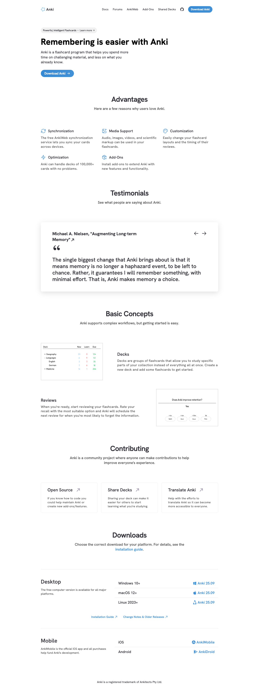

# Anki - powerful, intelligent flashcards
> Anki — a program which makes remembering things easy.  ·  [apps.ankiweb.net](https://apps.ankiweb.net/)

## What it is
The official homepage for Anki, the free and open-source spaced-repetition flashcard program. Its own pitch is the hero line 'Remembering is easier with Anki' — software that schedules card reviews so you study what you're about to forget. The page funnels to the desktop downloads plus the broader ecosystem (AnkiWeb sync, the paid AnkiMobile iOS app, and the free AnkiDroid Android app).

## What it shows
A compact (~3.8k px), single-column page: a short hero, an 'Advantages' row (Synchronization, Media Support, Customization, Optimization, Add-Ons), a single highlighted testimonial (Michael A. Nielsen on long-term memory), a 'Basic Concepts' section explaining Decks and Reviews with small UI screenshots, a 'Contributing' row (Open Source / Share Decks / Translate Anki), and a 'Downloads' block with a platform table (Windows 10+, macOS 12+, Linux 2023+ — Anki 25.09) and Mobile rows for iOS and Android.

## How it works
A plain anchor-navigated marketing/docs page. The top nav links out to Docs, Forums, AnkiWeb, Add-Ons and Shared Decks; the testimonial has prev/next arrows; download buttons point straight at the GitHub release binaries (github.com/ankitects/anki/releases/.../25.09). No app shell — it's a static informational page that hands off to GitHub and the app stores.

## How it's designed
Clean and documentation-like, almost austere. One self-hosted webfont does all the work: Hanken Grotesk Variable (axis 100–900), with the h1 at 48px/700 in pure black and body copy in a dark slate (rgb(48,47,55)) on white. Iconography is 21 inline SVGs for the feature rows; only 8 raster images (product screenshots and store badges); no canvas or video. The stack is featherweight — a single self-hosted stylesheet and just the Cloudflare insights beacon, no third-party analytics or marketing tags.

## Design data
- **Palette:** White ground, dark-slate body text (#302f37), black headings — near-monochrome and restrained.
- **Palette tokens:** body-bg: rgb(255, 255, 255) (rendered), body-text: rgb(48, 47, 55) (rendered), h1-color: rgb(0, 0, 0) (rendered)
- **Fonts:** Hanken Grotesk Variable (weights 100–900), self-hosted.
- **Fonts loaded:** Hanken Grotesk Variable 100 900
- **Tech stack:** Static / self-hosted, Cloudflare (insights)
- **Media mix:** img 8 · svg 21
- **Page height:** 3825px (single-screen: False)
- **Responsive:** At 390px it stays a single column (no separate mobile nav or hamburger detected) and grows to ~5.1k px.
- **Headings:** Remembering is easier with Anki / advantages / testimonials / basic concepts / contributing / downloads
- **Links out:** [Docs](https://docs.ankiweb.net/) · [Forums](https://forums.ankiweb.net/) · [AnkiWeb](https://ankiweb.net/) · [Change Notes & Older Releases](https://github.com/ankitects/anki/releases) · [AnkiMobile (iOS)](https://itunes.apple.com/us/app/ankimobile-flashcards/id373493387) · [AnkiDroid (Android)](https://play.google.com/store/apps/details?id=com.ichi2.anki)
- **Extracted:** 2026-06-06 · playwright-mcp @ 1440x900 + 390x844 mobile; logged_out: true

## Related sites
[[fey.com]]

## Tags
#category/favorites #aesthetic/light #aesthetic/minimal #pattern/open-source-homepage #pattern/documentation-clean #pattern/feature-grid #pattern/single-testimonial #pattern/download-table #pattern/self-hosted-fonts #pattern/lightweight #pattern/near-monochrome #tech/static-self-hosted #tech/cloudflare-insights #color/light #color/monochrome #font/hanken-grotesk-variable-100
