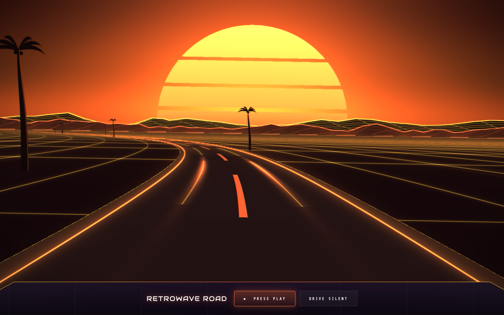

# Retrowave Road: Infinite Synthwave Night Drive
> Retrowave Road generates an endless synthwave highway — seeded neon worlds, a generative 80s soundtrack. Like, totally tubular. Awesome!  ·  [arcade.pirillo.com](https://arcade.pirillo.com/retrowave-road.html)

**Vertical:** #vertical/experiment-art  ·  **Vibe:** #vibe/retro #vibe/experimental  ·  **Topics:** #topic/gaming  ·  **Mode:** #mode/dark

## What it is
A browser toy/game in Chris Pirillo's "arcade" collection of seeded mini-games: an endless, procedurally generated synthwave night drive.

## What it shows
A single-screen canvas game with a "Record the Drive" capture feature, plus an FAQ section and repeated "Retrowave Road" heading blocks below the fold.

## How it works
A from-scratch canvas renderer (1 canvas, 8 svg icons, 0 img/video) seeded by a URL query param; the only third-party scripts are Google Tag Manager and Cloudflare Insights — no game-engine globals exposed.

## How it's designed
Deep-purple/near-black ground (#0a0416) with a neon orange-to-yellow gradient accent (--a #fa6e38 → --b #fac738) and lavender-white text (#e9e4ff), glassy dark panels (rgba(12,6,26,.86)), Audiowide for the display wordmark and Share Tech Mono for UI/labels — a straightforward synthwave/retro-arcade visual language.

## Design data
- **Palette:** Near-black purple ground (#0a0416), neon orange→yellow gradient accent (#fa6e38→#fac738), lavender-white text (#e9e4ff)
- **Palette tokens:** --a: rgb(250,110,56) (var), --b: rgb(250,199,56) (var), --ink: #0a0416 (var), --tx: #e9e4ff (var)
- **Fonts:** Audiowide (display/wordmark) + Share Tech Mono (UI/labels) — both classic retro-arcade webfont picks
- **Fonts loaded:** Audiowide 400, Share Tech Mono 400
- **Tech stack:** Vanilla Canvas/JS, Google Tag Manager, Cloudflare
- **Keywords:** synthwave, canvas-game, seeded-generative, single-screen, retro
- **Media mix:** canvas 1 · svg 8
- **Page height:** 900px (single-screen: True)
- **Responsive:** At 390px the reported scrollHeight (844px) equals the viewport height; the game canvas fills a fixed single screen at both sizes rather than reflowing.
- **Headings:** Retrowave Road: Infinite Synthwave Night Drive / Record the Drive / Retrowave Road / FAQ
- **Extracted:** 2026-09-22 · 1440x900 desktop + 390x844 mobile pass, logged_out: true

## Related sites
- [[zzz.zoomquilt.org]] — shared: experiment-art, retro, experimental, dark
- [[iacopoapps.appspot.com]] — shared: experiment-art, experimental, dark
- [[ytch.tv]] — shared: experiment-art, retro, dark
- [[poolsuite.net]] — shared: experiment-art, retro
