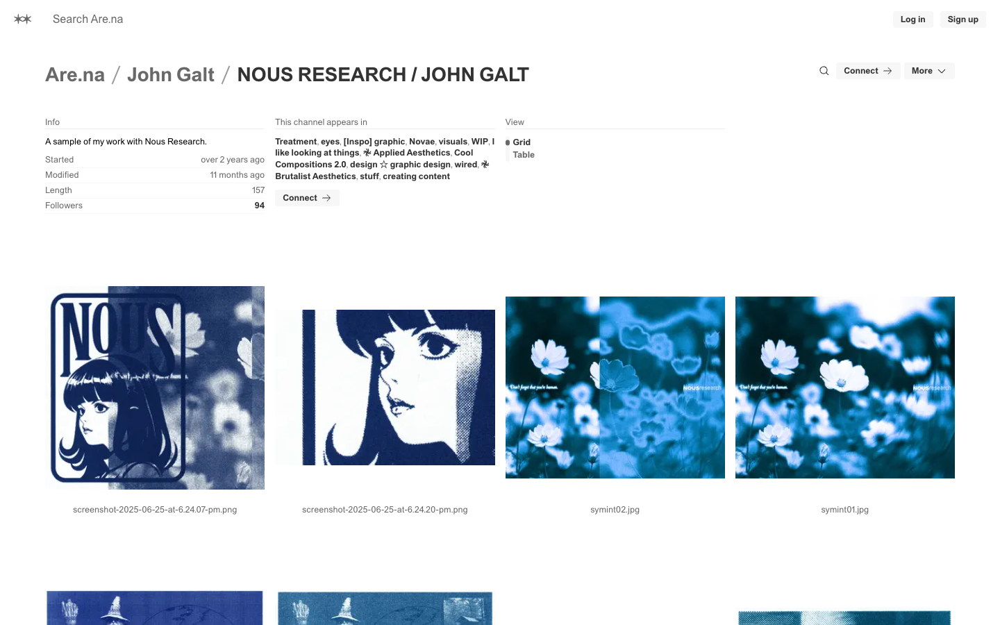

# NOUS RESEARCH / JOHN GALT | Are.na
> A sample of my work with Nous Research.  ·  [are.na](https://www.are.na/john-galt/nous-research-john-galt)

**Vertical:** #vertical/directory-gallery  ·  **Vibe:** #vibe/minimal #vibe/editorial  ·  **Topics:** #topic/ai #topic/art  ·  **Mode:** #mode/light

## What it is
A single channel on Are.na, the research-style bookmarking/moodboard platform. This channel, 'NOUS RESEARCH / JOHN GALT', is curator john-galt's collection — self-described as 'A sample of my work with Nous Research' — and is the source the tweet credits for StudioMilitary's aesthetic.

## What it shows
A dense masonry grid of 157 saved blocks: electric-blue dithered/halftone faces, anime and manga portraits, poppy flowers, staff-wielding wizard figures, purple 'HERMES 3' imagery and ritual-poster artwork. A left Info rail lists the description, 'Started over 2 years ago', 'Length 157', 'Followers 18', the channels it appears in (Applied Aesthetics, Brutalist Aesthetics), and a Grid/Table view toggle. The channel is marked CLOSED (read-only) and was viewed logged out.

## How it works
Standard Are.na channel view: a breadcrumb header (Are.na / John Galt / NOUS RESEARCH / JOHN GALT) with Follow / Connect / More actions, then a lazy-loading block grid that streams in as you scroll (documentElement scrollHeight ~16,670px at 1440 wide). Clicking a block opens it; Connect adds it to your own channels.

## How it's designed
Utilitarian Swiss/editorial chrome that gets out of the artwork's way: a plain white ground with black text and muted grey controls, the custom 'areal' grotesque for headings, and almost no decoration so the saturated blue-and-purple thumbnails carry all the color. The grid itself is the design.

## Design data
- **Palette:** White ground (rgb(255,255,255)), black body text, dark-grey heading (rgb(51,51,51)) and muted grey controls (rgb(105,105,105)); all color comes from the saved image blocks.
- **Palette tokens:** body background: rgb(255,255,255) (rendered), body text: rgb(0,0,0) (rendered), heading color: rgb(51,51,51) (rendered), muted control: rgb(105,105,105) (rendered)
- **Fonts:** Custom 'areal' grotesque for headings (with an areal fallback); body resolves to a Times serif fallback.
- **Fonts loaded:** areal 400, areal Fallback 400
- **Tech stack:** Next.js, React, Fathom Analytics
- **Keywords:** moodboard, channel, masonry-grid, lazy-load, research-archive, swiss, minimal-chrome, bookmark-gallery
- **Media mix:** img 24 · svg 53
- **Page height:** 16670px (single-screen: False)
- **Responsive:** At 390x844 the block grid reflows to two columns (~177.5px each) and the breadcrumb header stacks; total scrollHeight grows to ~21,000px.
- **Headings:** NOUS RESEARCH / JOHN GALT
- **Links out:** [Are.na (home)](https://www.are.na) · [John Galt (profile)](https://www.are.na/john-galt)
- **Extracted:** 2026-06-05 · playwright-mcp @ 1440x900 (viewport screenshot; fullPage timed out on the 157-block lazy-loaded grid) + mobile 390x844

## Related sites
- [[21st.dev]] — shared: directory-gallery, minimal, editorial, ai, light
- [[ciggies.app]] — shared: directory-gallery, minimal, editorial, light
- [[designtools.fyi]] — shared: directory-gallery, minimal, editorial, light
- [[type.lol]] — shared: directory-gallery, minimal, editorial, light
- [[contralabs.com]] — shared: editorial, ai, art, light
- [[addyosmani.com]] — shared: minimal, editorial, ai
