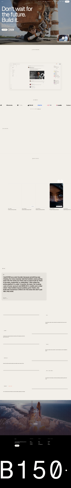

# B150 — The professional social network for Gen AI builders and creators
> Don't wait for the future. Build it.  ·  [b150.ai](https://b150.ai/)

**Vertical:** #vertical/startup-product  ·  **Vibe:** #vibe/experimental #vibe/playful  ·  **Topics:** #topic/ai #topic/startups  ·  **Mode:** #mode/light

## What it is
A Webflow-built marketing site for B150, pitched as “the professional network reimagined for Gen AI builders; where creators connect, learn, and launch real products together” — a LinkedIn-style network for AI makers. The real <h1> is the rallying cry “Don't wait for the future. Build it.” Note the bookmarked tweet (Apr 2026) sold b150.ai as a free Wispr Flow clone; the domain has since pivoted to this social network.

## What it shows
A tall (~9.8k px) landing page that opens on a dark hero, then runs a wall of product/community imagery (145 ) interleaved with embedded demo clips (5 <video> plus a YouTube iframe), sections teasing Events, Jobs and a Marketplace, and a “Start building the future” CTA — closing on a giant “B150” wordmark footer.

## How it works
A static Webflow build (assets from cdn.prod.website-files.com, based on the byq-studio template); no SPA framework global was detected. The functioning product is gated behind app.b150.ai (“Join Beta” / “Login”), so the marketing site is purely a funnel to the beta signup. Analytics and pixels run through Google Tag Manager, Amplitude, the Meta pixel, and a Twitter ads pixel; jQuery and YouTube load from CDNs.

## How it's designed
A warm off-white canvas (#f2efe9) with near-black ink (#1f1915), punched up by a bright lime/chartreuse accent (#d4fd80) and coral/red highlights (#fa4149 / #fa725a). Big, very tightly-tracked Geist display type carries the hierarchy — a 120px <h1> with -8px letter-spacing — paired with Fragment Mono for labels and secondary text. A full Webflow design-token system defines the type scale, spacing, radii, and even a separate dark-mode “apps” palette for the product UI.

## Design data
- **Palette:** Warm off-white #f2efe9 canvas, near-black #1f1915 ink, lime/chartreuse accent #d4fd80, coral/red highlights #fa4149/#fa725a
- **Palette tokens:** --_colors---color--bg-2: #f2efe9 (var), --_colors---color--bg-3: #f7f5f1 (var), --_colors---color--bg-1: #e6e3dd (var), --_colors---color--dark: #1f1915 (var), --_colors---color--light: #fffdf6 (var), --_colors---color--accent: #d4fd80 (var), --_colors---color--red: #fa4149 (var), --coral: #fa725a (var), body bg: rgb(242, 239, 233) (rendered), body text: rgb(31, 25, 21) (rendered), h1 text (on dark hero): rgb(247, 245, 241) (rendered)
- **Fonts:** Geist (display + body, very tight tracking) + Fragment Mono (labels/secondary); LT Superior defined in tokens but not loaded
- **Fonts loaded:** Geist 400, Geist 500, Fragment Mono 400
- **Tech stack:** Webflow, Google Tag Manager, Amplitude, Meta Pixel, Twitter Ads Pixel, YouTube embed, CloudFront/jQuery CDN
- **Keywords:** landing-page, social-network, gen-ai, webflow, lime-accent, tight-tracked-display-type, mono-labels, design-tokens, beta-waitlist
- **Media mix:** img 145 · video 5 · svg 54 · iframe 1
- **Page height:** 9794px (single-screen: False)
- **Responsive:** At 390px the top nav collapses to a hamburger (.w-nav-button), the Geist <h1> scales from 120px down to 53px, and the page reflows to a single column at ~8438px tall.
- **Headings:** Don't wait for the future. Build it. / Start building the future
- **Links out:** [Join Beta](https://app.b150.ai/auth/signup) · [Login](https://app.b150.ai/) · [Events](https://app.b150.ai/events) · [Jobs](https://app.b150.ai/jobs) · [Marketplace](https://app.b150.ai/marketplace) · [Contact us](mailto:support@b150.ai)
- **Extracted:** 2026-06-05 · Playwright Chromium @ 1440×900 + 390×844 mobile pass; logged_out: true

## Related sites
- [[shipper.now]] — shared: startup-product, playful, ai, startups, light
- [[backdoorai.app]] — shared: startup-product, ai, startups, light
- [[creao.ai]] — shared: startup-product, ai, startups, light
- [[photon.codes]] — shared: startup-product, playful, ai, light
- [[cofounder.co]] — shared: startup-product, ai, startups
- [[crustdata.com]] — shared: startup-product, experimental, ai
