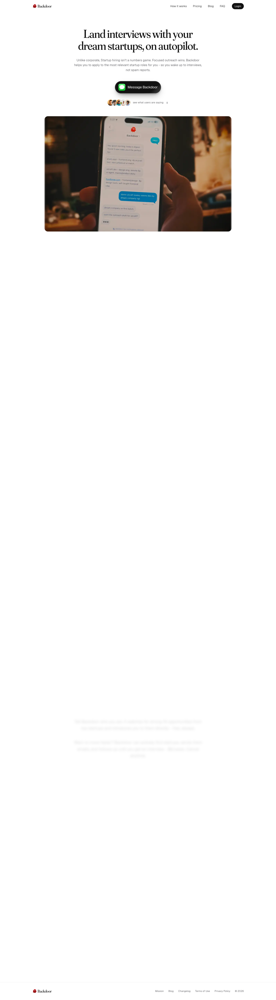

# Backdoor — Book startup interviews on autopilot.
> Land interviews with your dream startups, on autopilot.  ·  [backdoorai.app](https://backdoorai.app)

**Vertical:** #vertical/startup-product  ·  **Vibe:** #vibe/minimal #vibe/organic-warm  ·  **Topics:** #topic/startups #topic/ai  ·  **Mode:** #mode/light

## What it is
A landing page for Backdoor, an AI “startup hiring agent” you operate entirely over text message. Per its own copy it “learns your background, researches high-fit startups, drafts founder outreach, and helps you land roles at early-stage companies — all over text,” under the h1 “Land interviews with your dream startups, on autopilot.” The thesis line is “Startup hiring isn't a numbers game. Focused outreach wins.”

## What it shows
A clean light hero with a serif headline, a sub-paragraph, and a single dark pill CTA — “Message Backdoor” — plus avatar social proof, over a hero photo of a hand holding an iPhone mid-conversation with the agent. Below (revealed on scroll) come the section sequence its headings name: “How it works,” a “Wall of Love” testimonial block, “Two ways in.” (pricing/entry options), a “Questions, answered.” FAQ, and a closing “Backdoor, your unfair advantage.” The footer links About, Blog, Changelog, Terms and Privacy.

## How it works
The entire conversion path is an SMS deep link: the “Message Backdoor” CTA is an href of `sms:+13123666518?&body=Hey Backdoor, I want to work at a startup.` — tapping it opens your texts pre-filled, so the product itself runs in the messaging thread, not a web app. The marketing page is a single scroll with reveal-on-scroll animations (sections fade/translate in, which is why much of the page reads blank in a static full-page capture). It's an info+trust funnel: hero → how it works → testimonials → entry options → FAQ → CTA repeat.

## How it's designed
Editorial-product minimalism on white (--background #fff, text #111) with a warm peach as the only accent (--accent and --highlight both #ffd0c4) and a muted grey for secondary text (#6e6e72). Type is a tasteful two-family system loaded for real: Fraunces (the soft serif) sets the 44px headline, with Geist (and Geist Mono) carrying body and UI — the same Vercel-native Geist that, with a Vercel deploy id baked into the favicon path, points to a Vercel-hosted build (the JS framework isn't exposed on window, but the shadcn-style token set — --card/--popover/--ring/--chart-* — and #111 primary read as a Tailwind/shadcn setup). Imagery is photographic (a real phone-in-hand hero), and visitors.now handles analytics. Restrained: 27 imgs, no video.

## Design data
- **Palette:** White ground (#fff), near-black text/primary (#111), warm peach accent (--accent #ffd0c4), muted grey secondary text (#6e6e72).
- **Palette tokens:** --background: #fff (var), --foreground: #111 (var), --primary: #111 (var), --accent: #ffd0c4 (var), --highlight: #ffd0c4 (var), --muted-foreground: #6e6e72 (var), h1-color: rgb(255, 255, 255) (rendered)
- **Fonts:** Fraunces serif for the headline (44px/450), Geist + Geist Mono for body and UI (all loaded).
- **Fonts loaded:** Geist 100–900, Geist Mono 100–900, Fraunces 100–900
- **Tech stack:** Vercel-hosted (Geist + deploy id in favicon), Tailwind / shadcn token system, visitors.now analytics
- **Keywords:** light-minimal, serif-headline, sms-deep-link-cta, reveal-on-scroll, single-page-landing, wall-of-love, phone-in-hand-hero, shadcn-tokens, vercel-hosted, agent-product
- **Media mix:** img 27 · svg 24
- **Page height:** 5205px (single-screen: False)
- **Responsive:** At 390x844 most desktop nav links drop (4 of 5 hidden, collapsing to logo + primary action), the page stacks into one tall column (scrollHeight ~5205→7439), and the serif headline holds at 44px.
- **Headings:** Land interviews with your dream startups, on autopilot. / Startup hiring isn't a numbers game. Focused outreach wins. / How it works / Wall of Love / Two ways in. / Questions, answered. / Backdoor, your unfair advantage.
- **Links out:** [Message Backdoor (SMS deep link)](sms:+13123666518?&body=Hey%20Backdoor%2C%20I%20want%20to%20work%20at%20a%20startup.)
- **Extracted:** 2026-06-06 · playwright-mcp @ 1440x900 (+ 390x844 mobile), logged_out: true

## Related sites
- [[cofounder.co]] — shared: startup-product, organic-warm, startups, ai
- [[rork.com]] — shared: startup-product, minimal, startups, ai
- [[b150.ai]] — shared: startup-product, startups, ai, light
- [[creao.ai]] — shared: startup-product, startups, ai, light
- [[manus.im]] — shared: startup-product, minimal, ai, light
- [[printingpress.dev]] — shared: startup-product, organic-warm, ai, light
