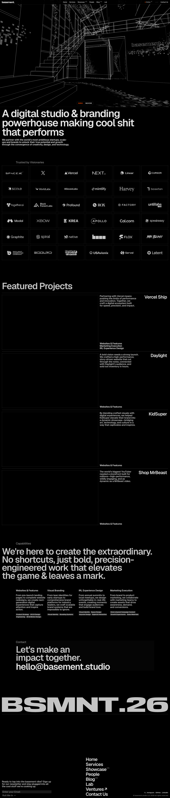

# basement.studio | We make cool shit that performs.
> We make cool shit that performs.  ·  [basement.studio](https://basement.studio/)

**Vertical:** #vertical/studio-agency  ·  **Vibe:** #vibe/experimental #vibe/luxury  ·  **Topics:** #topic/design  ·  **Mode:** #mode/dark

## What it is
Digital studio and branding agency site for basement.studio, which sells brand, web, 3D and product work.

## What it shows
The pitch is the h1 'A digital studio & branding powerhouse making cool shit that performs', followed by client logos (Trusted by Visionaries), Featured Projects, Capabilities and Contact.

## How it works
A long single-page scroll (6714px at 1440 wide) with 3 canvas elements for WebGL moments and 40 images. No Nuxt, Next or Vue globals were detected; the only third-party script host is Ahrefs analytics.

## How it's designed
Pure black ground (body rgb(0,0,0)) with white text; the 87px h1 is Geist at weight 600 in rgb(230,230,230). Geist and Geist Mono variable fonts carry the whole UI, with a custom face 'flauta' loaded for display accents. Heavy type, no brand colour in the DOM, so the imagery and 3D do the colour work.

## Design data
- **Palette:** Black ground, white and light-grey (230) text, no accent colour
- **Palette tokens:** body bg: rgb(0, 0, 0) (rendered), body color: rgb(255, 255, 255) (rendered), h1 color: rgb(230, 230, 230) (rendered)
- **Fonts:** Geist (100-900), Geist Mono, flauta
- **Fonts loaded:** Geist 100-900, Geist Mono 100-900, flauta normal
- **Tech stack:** Custom (framework unidentified), WebGL canvas, Ahrefs Analytics
- **Keywords:** dark studio, big sans h1, webgl canvas, client logo wall, 3d showcase
- **Media mix:** img 40 · canvas 3 · svg 11
- **Page height:** 6714px (single-screen: False)
- **Responsive:** At 390px the h1 drops from 87px to 46px, the nav collapses to a single visible link, and the page shortens from 6714px to 5335px with no horizontal overflow.
- **Headings:** A digital studio & branding powerhouse making cool shit that performs / Trusted by Visionaries / Featured Projects / Capabilities / Contact
- **Extracted:** 2026-10-17 · Playwright 1440x900 full-page + DOM probe; 390x844 text probe; logged_out: true

## Related sites
- [[ddlabstudio.com]] — shared: studio-agency, luxury, design, dark
- [[hex.inc]] — shared: studio-agency, luxury, design, dark
- [[vanschneider.com]] — shared: studio-agency, luxury, design, dark
- [[northgarden.com]] — shared: studio-agency, experimental, design
- [[ribbit.dk]] — shared: studio-agency, experimental, design
- [[animejs.com]] — shared: experimental, design, dark
