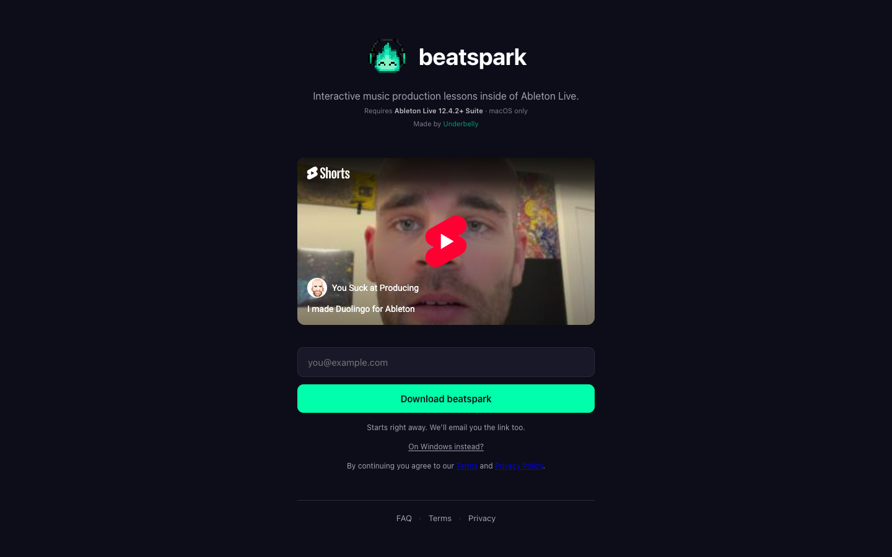

# beatspark — step-by-step Ableton lessons
> Interactive music production lessons inside of Ableton Live.  ·  [beatspark.com](https://beatspark.com/)

**Vertical:** #vertical/startup-product  ·  **Vibe:** #vibe/minimal #vibe/technical  ·  **Topics:** #topic/music #topic/education  ·  **Mode:** #mode/dark

## What it is
A single-screen landing page for beatspark, a desktop app that teaches music production through interactive step-by-step lessons inside Ableton Live.

## What it shows
A wordmark h1 'beatspark', the one-line description, a neon-green 'Download beatspark' button, and an email waitlist form with confirmation states ('Check your inbox.', 'Downloading now.', 'You're on the list.').

## How it works
A static page of exactly 900px (one screen at 1440x900) with one image, one iframe and no SVGs, canvas or video. The only external host is Cloudflare analytics, and the DOM shows no webfont payload.

## How it's designed
Dark navy #0d0d1a with white text, a raised panel colour #181828, dim text #a0a0b0, and a single neon mint accent #00ffaa (rendered as the button background rgb(0,255,170)). The system font stack (-apple-system / SF Pro) is used throughout. The h1 is 38px 700. It reads as a minimal dev-made product page with one strong colour accent.

## Design data
- **Palette:** Navy #0d0d1a, panel #181828, neon mint #00ffaa, white
- **Palette tokens:** --bg: #0d0d1a (var), --bg-elev: #181828 (var), --text-dim: #a0a0b0 (var), --accent: #00ffaa (var), --accent-dim: #00cc88 (var), --border: #2a2a3e (var), button bg: rgb(0, 255, 170) (rendered)
- **Fonts:** System fonts only (-apple-system, SF Pro Text, Helvetica Neue); no webfont payload
- **Fonts loaded:** system only (no webfont)
- **Tech stack:** Cloudflare Web Analytics
- **Keywords:** dark, single-screen, neon-accent, system-fonts, waitlist-form, music-production
- **Media mix:** img 1 · iframe 1
- **Page height:** 900px (single-screen: True)
- **Responsive:** At 390px the single screen simply fits the 844px viewport (scrollHeight 844, no overflow); there is no nav to collapse.
- **Headings:** beatspark / Check your inbox. / Downloading now. / You're on the list.
- **Weight:** None requests; hosts: static.cloudflareinsights.com
- **Extracted:** 2026-10-17 · 1440x900 full-page screenshot + 390x844 DOM pass (no mobile screenshot); Playwright, logged_out: true

## Related sites
- [[apps.ankiweb.net]] — shared: startup-product, minimal, education
- [[getartcraft.com]] — shared: startup-product, minimal, technical
- [[todesktop.com]] — shared: startup-product, minimal, technical
- [[crustdata.com]] — shared: startup-product, technical, dark
- [[daytona.io]] — shared: startup-product, technical, dark
- [[flowstate.com]] — shared: startup-product, minimal, dark
