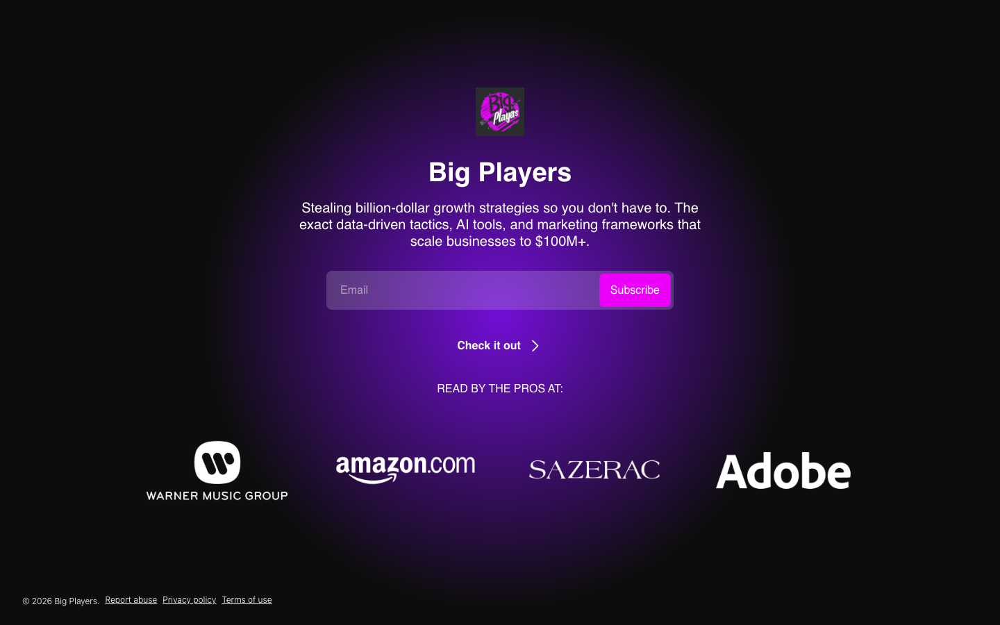

# Subscribe | Big Players
> Steal billion-dollar growth strategies from the world's top companies.  ·  [bigplayers.co](https://www.bigplayers.co/subscribe)

## What it is
The beehiiv subscribe page for 'Big Players,' a weekly growth-marketing newsletter — the meta description pitches it as 'Steal billion-dollar growth strategies from the world's top companies. Get data-driven tactics, AI tools, and proven playbooks delivered weekly to scale your business faster.' Matthew Berman's tweet about his free OpenClaw 'Meta Ads Kit' funnels readers here to subscribe.

## What it shows
A dark, centered email-capture page headed simply 'Big Players,' with an email field and a magenta subscribe button set against the publication's brand thumbnail — the standard beehiiv hosted subscribe layout, no marketing long-form below it.

## How it works
Hosted entirely on beehiiv — the favicon, og:image and footer (Report abuse / Privacy / Terms) all resolve to beehiiv, and styling is driven by beehiiv's '--wt-*' theme tokens rather than a custom framework (no Next/Nuxt/Vue/Svelte/React global). The page carries a heavy marketing/measurement stack: Google Tag Manager, the Meta/Facebook pixel (connect.facebook.net), PerimeterX bot defense (client.px-cloud.net), Birdie (app.birdie.so) and Cloudflare Insights. Notably no webfont is actually downloaded — the configured header/body fonts fall back to system Helvetica.

## How it's designed
A dark charcoal canvas (--wt-background-color #292d2e) with off-white text (--wt-text-on-background-color #f9fafb) and a single hot-magenta brand accent (--wt-primary-color #ec00fb, rendered rgb(236,0,251)) on the subscribe button, with corners rounded at --wt-border-radius 8px. Type is plain system Helvetica (the beehiiv default header stack names 'Helvetica Neue Condensed Black' but no webfont loads), so the magenta CTA and the brand thumbnail do all the visual work.

## Design data
- **Palette:** Charcoal #292d2e background, off-white #f9fafb text, hot-magenta #ec00fb CTA
- **Palette tokens:** --wt-primary-color: #ec00fb (var), --wt-background-color: #292d2e (var), --wt-text-on-background-color: #f9fafb (var), --wt-secondary-color: #000000 (var), button-background: rgb(236, 0, 251) (rendered), h1-color: rgb(255, 255, 255) (rendered)
- **Fonts:** System Helvetica only — no webfont payload (beehiiv defaults)
- **Fonts loaded:** system only (no webfont)
- **Tech stack:** beehiiv, Google Tag Manager, Meta Pixel, PerimeterX, Birdie, Cloudflare Insights
- **Media mix:** img 5 · svg 1 · iframe 2
- **Page height:** 900px (single-screen: True)
- **Responsive:** At 390x844 it stays a single centered subscribe card; page height grows from 900px to ~1073px as the card stacks, and the 'Big Players' heading holds at 16px.
- **Headings:** Big Players
- **Links out:** [Privacy policy](https://beehiiv.com/privacy?utm_source=big_players) · [Terms of use](https://beehiiv.com/tou?utm_source=big_players)
- **Extracted:** 2026-06-06 · Playwright MCP, 1440x900 + 390x844, logged_out: true

## Related sites
[[letters.thedankoe.com]] [[systematiclongshort.com]] [[theprohuman.ai]] [[affiliatenetwork.com]] [[ashpreetbedi.com]] [[crsanchez.es]]

## Tags
#category/product #aesthetic/dark #pattern/newsletter #pattern/subscribe-page #pattern/beehiiv #pattern/dark-theme #pattern/email-capture #pattern/template #tech/beehiiv #tech/google-tag-manager #tech/meta-pixel #tech/perimeterx #tech/birdie #tech/cloudflare-insights #color/dark #font/system-fonts
