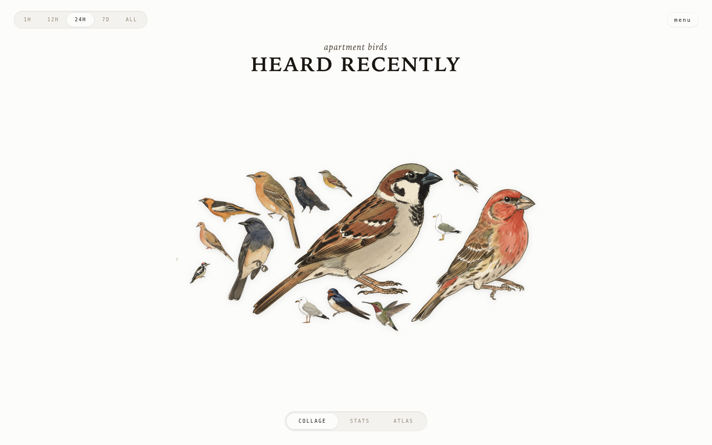

# apartment birds
> A tiny microphone on my apartment balcony listens around the clock — realtime bird recognition via Cornell's BirdNET. NVIDIA ShadowPlay, but for birdsong.  ·  [bird.onethreenine.net](https://bird.onethreenine.net)

**Vertical:** #vertical/experiment-art  ·  **Vibe:** #vibe/organic-warm  ·  **Topics:** #topic/art  ·  **Mode:** #mode/light

## What it is
The live front-end of Teddy Warner's 'Avian Visitors' project — a balcony microphone running Cornell's BirdNET that recognises passing birds in realtime and assembles them into a collage. The companion writeup lives at theodore.net/projects/AvianVisitors/ and the code at github.com/Twarner491/AvianVisitors.

## What it shows
A single-screen 'apartment birds / HEARD RECENTLY' collage of watercolor bird illustrations whose prominence tracks how often each species was heard (e.g. 'House Sparrow — 1,121 calls today'), with a 1H / 12H / 24H / 7D / ALL time-range filter and COLLAGE / STATS / ATLAS tabs. Species are listed by common and Latin name (House Sparrow / Passer domesticus, House Finch, Hooded Oriole, Western Kingbird, Mourning Dove, Bullock's Oriole, American Crow…).

## How it works
A vanilla-JS single-screen app (no framework global), served behind Cloudflare. The tab row swaps between the collage, a STATS view and an ATLAS, the time pills rescope the feed, and a 'menu' offers a password-gated tools panel ('enter password to unlock tools'). Data comes from the BirdNET pipeline running on the author's hardware.

## How it's designed
A warm paper-and-ink scheme defined entirely in CSS variables — --paper #fcfcfb, --ink #1a1612, soft --ink-soft #908576 and a brown --accent #4a3f31 — with layered inset/raised box-shadow tokens for a tactile, letterpressed feel. Type is system-only: a serif display stack (ui-serif / Iowan Old Style / Bookman) for the 40px bold h1 and ui-monospace for the small 10px labels, with no webfont payload at all (document.fonts is empty). The 29 hand-painted watercolor bird illustrations are the entire visual identity.

## Design data
- **Palette:** Warm paper (#fcfcfb) with near-black ink (#1a1612) and a brown accent (#4a3f31)
- **Palette tokens:** --paper: #fcfcfb (var), --paper-2: #f3f2ee (var), --paper-3: #e8e6df (var), --ink: #1a1612 (var), --ink-2: #4a3f31 (var), --ink-soft: #908576 (var), --accent: #4a3f31 (var)
- **Fonts:** System only — serif display (Iowan Old Style) + ui-monospace labels; no webfonts loaded
- **Fonts loaded:** system only (no webfont)
- **Tech stack:** Vanilla JS (no framework), Cloudflare, BirdNET (Cornell)
- **Keywords:** single-screen, generative, live-data, collage, watercolor, system-fonts, iot, birdwatching
- **Media mix:** img 29 · svg 20
- **Page height:** 900px (single-screen: True)
- **Responsive:** At 390x844 it stays a single screen (scrollHeight 844); the h1 scales down 40px → 24px and the bird collage shrinks to fit.
- **Headings:** Heard Recently / System / — / The birds outside my window
- **Links out:** [Writeup (Avian Visitors)](https://theodore.net/projects/AvianVisitors/) · [Source](https://github.com/Twarner491/AvianVisitors)
- **Extracted:** 2026-06-06 · Playwright MCP, 1440x900 + 390x844, logged_out: true

## Related sites
- [[evebouffard.com]] — shared: experiment-art, organic-warm, art, light
- [[clipart.studio]] — shared: organic-warm, art, light
- [[iacopoapps.appspot.com]] — shared: experiment-art, art
- [[lelezhang.design]] — shared: organic-warm, art, light
- [[zzz.zoomquilt.org]] — shared: experiment-art, art
