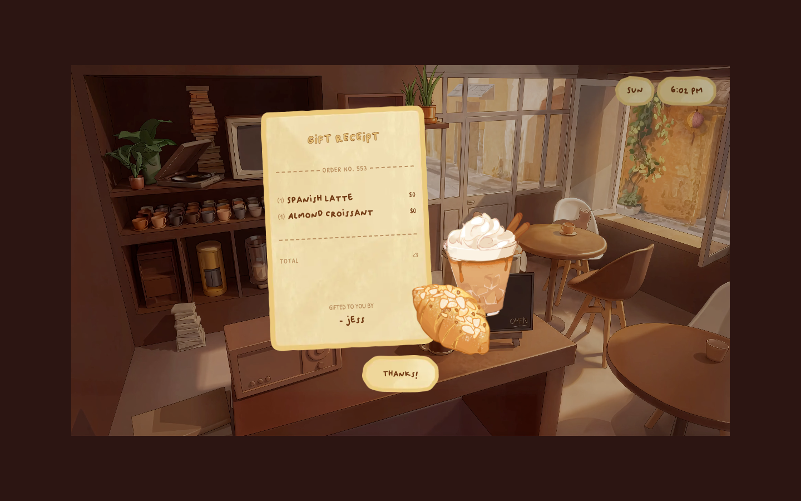

# Idle Cafe — a cosy lofi café to work in
> A warm, illustrated virtual café with a timer, lofi music and a leave-someone-a-coffee gift mechanic.  ·  [cafe.endofday.studio](https://cafe.endofday.studio/)

**Vertical:** #vertical/tool-app  ·  **Vibe:** #vibe/organic-warm #vibe/playful  ·  **Topics:** #topic/productivity #topic/music  ·  **Mode:** #mode/dark

## What it is
'Idle Cafe' (by endofday.studio) — a cosy, hand-illustrated virtual café you sit in to focus, with a Pomodoro-style timer and looping lofi music. It's the 'online lofi café' from Jonas's list.

## What it shows
A warm, dimly-lit café interior (record player, plants, mugs, a latte and sandwich) built from stacked illustration layers, with a live day/time clock ('SUN 6:02 PM'), a Timer, a YouTube music toggle, and a sweet 'GIFT RECEIPT' guestbook where other visitors leave you a free virtual order ('(1) Spanish Latte $0 · (1) Almond Croissant $0 · TOTAL <3 · GIFTED TO YOU BY – jess · Thanks!').

## How it works
A single-screen static build (no client-framework global exposed) that layers 48 illustration images plus one ambient <video> and plays lofi through an embedded YouTube iframe; type comes from Google Fonts and analytics from Cloudflare Insights. It's a fixed full-viewport scene (scrollHeight 0).

## How it's designed
Snug, storybook warmth. From getComputedStyle the stage is a deep warm brown (body rgb(44,21,18)) that reads as candle-lit café dusk, with the café's amber lamplight and cream paper receipts supplying the glow. Text sits in a hand-lettered face — Patrick Hand — with a display companion 'Oliver', which is what gives the receipts and labels their diary-like charm. There is no meta description/og and no design-token system; the mood is carried entirely by the illustration and the handwriting.

## Design data
- **Palette:** A deep warm-brown ambiance (rgb(44,21,18)) lit by amber lamplight and cream paper — the illustration provides all the colour.
- **Palette tokens:** body background: rgb(44, 21, 18) (rendered), body color: rgb(0, 0, 0) (rendered)
- **Fonts:** Patrick Hand (handwriting, used for receipts/labels) with a display face 'Oliver' — both via Google Fonts.
- **Fonts loaded:** Patrick Hand 400, Oliver 400
- **Tech stack:** Static site (no framework global), YouTube (lofi audio), Google Fonts, Cloudflare
- **Keywords:** lofi, cosy, illustrated, virtual-cafe, pomodoro, handwriting-font, warm, ambient, single-screen
- **Media mix:** img 48 · video 1 · iframe 1
- **Page height:** 900px (single-screen: True)
- **Responsive:** At 390x844 it stays a single full-viewport café scene (scrollHeight 0); the illustration scales to fit rather than reflowing.
- **Extracted:** 2026-07-05 · Playwright MCP, 1440x900 + 390x844 mobile pass, logged_out: true

## Related sites
- [[lelezhang.design]] — shared: tool-app, organic-warm, playful
- [[tryponcho.com]] — shared: tool-app, productivity, dark
- [[zendex.spyrosigma.in]] — shared: tool-app, productivity, dark
- [[everynoise.com]] — shared: tool-app, music
- [[spencer.place]] — shared: organic-warm, playful, dark
