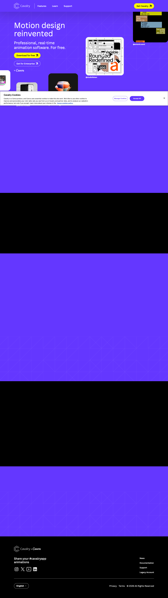

# Free 2D animation & motion graphics software for Mac and Windows | Cavalry
> Motion design reinvented  ·  [cavalry.studio](https://cavalry.studio/en/)

**Vertical:** #vertical/startup-product  ·  **Vibe:** #vibe/corporate-clean #vibe/playful  ·  **Topics:** #topic/design #topic/film-video  ·  **Mode:** #mode/dark

## What it is
The product site for Cavalry, a real-time 2D animation and motion design app for Mac and Windows with data-driven workflows. The site's CSS carries Canva branding (Canva Sans font, canva.com sales links).

## What it shows
The h1 is 'Motion design reinvented', followed by 'Move faster. Scale further.', a brands band, 'Professional 2D animation software, built for depth', a download section, 'Learn motion design with Cavalry' and an FAQ. 11 video elements carry the demos.

## How it works
Anchor navigation (#download, #features, #learn) plus Support. Download buttons link directly to Cavalry.dmg and Cavalry.msi; enterprise goes to a Canva contact-sales form. A OneTrust cookie banner is present. Total page height is 5097px.

## How it's designed
A saturated purple page ground (body rgb(100,55,255), #6437ff) with white type, backed by a token set of grey, black, green (#4ffd7a), yellow (#ff0), pink (#ff24e0) and purple. Type is Canva Sans at 400/600/700 with a 64px h1. A 1280px max section width and a spacing scale of 8/16/24/40px, with 48 root custom properties in total.

## Design data
- **Palette:** Electric purple #6437ff ground, white type, neon green #4ffd7a / yellow #ff0 / pink #ff24e0 accents, black and #2d2d2d greys
- **Palette tokens:** --color-purple: #6437ff (var), --color-green: #4ffd7a (var), --color-yellow: #ff0 (var), --color-pink: #ff24e0 (var), --color-dark-grey: #2d2d2d (var), --color-grey: #c8c8c8 (var), body background: rgb(100, 55, 255) (rendered), body color: rgb(255, 255, 255) (rendered)
- **Fonts:** Canva Sans (400/600/700) only
- **Fonts loaded:** Canva Sans 400, Canva Sans 600, Canva Sans 700
- **Tech stack:** OneTrust, Canva
- **Keywords:** video-demos, anchor-nav, saturated-background, neon-accents, direct-download-cta
- **Media mix:** img 22 · video 11 · svg 44 · iframe 1
- **Page height:** 5097px (single-screen: False)
- **Responsive:** At 390px the h1 drops from 64px to 36px, a menu button appears, there is no horizontal overflow, and page height grows from 5097px to 6464px.
- **Headings:** Motion design reinvented / Move faster. Scale further. / Trusted by some of the world’s biggest brands / Professional 2D animation software, built for depth / Download Cavalry today / Learn motion design with Cavalry / Frequently asked questions
- **Links out:** [Get for macOS](https://cavalry.studio/downloads/latest/Cavalry.dmg) · [Get for Windows](https://cavalry.studio/downloads/latest/Cavalry.msi) · [Contact sales](https://www.canva.com/contact-sales/?ctaSource=cavalry-contact-sales)
- **Weight:** None requests; hosts: cdn-au.onetrust.com, cavalry.studio
- **Extracted:** 2026-10-17 · Playwright MCP, fullPage 1440x900 + 390x844 mobile text pass, DOM probe; logged_out: true

## Related sites
- [[palmier.io]] — shared: startup-product, corporate-clean, film-video, dark
- [[www.unicorn.studio]] — shared: startup-product, corporate-clean, design, dark
- [[fabra.com]] — shared: startup-product, corporate-clean, design
- [[gatheros.co]] — shared: startup-product, corporate-clean, design
- [[linkeddit.com]] — shared: startup-product, corporate-clean, playful
- [[mo1.app]] — shared: startup-product, playful, design
