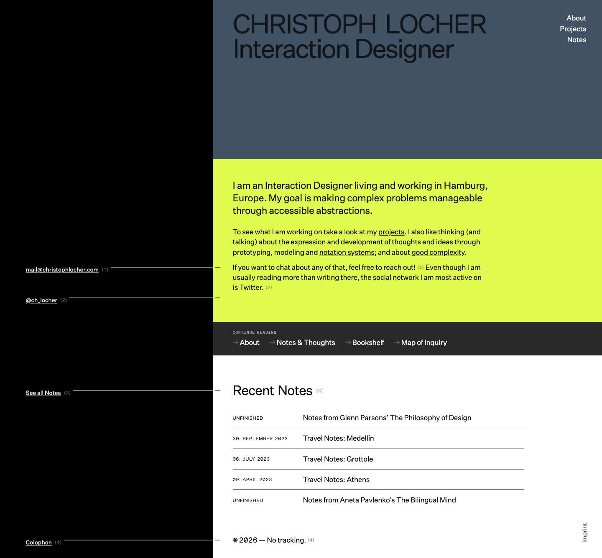

# Christoph Locher — Interaction Designer (a bold split-screen editorial portfolio)
> I am an Interaction Designer living and working in Hamburg, Europe. My goal is making complex problems manageable through accessible abstractions.  ·  [christophlocher.com](https://christophlocher.com/)

**Vertical:** #vertical/portfolio  ·  **Vibe:** #vibe/editorial #vibe/minimal  ·  **Topics:** #topic/design  ·  **Mode:** #mode/light

## What it is
The personal site of Christoph Locher, an interaction designer based in Hamburg — the destination this design-inspiration-app tweet's export metadata resolves to (his own hub). The rendered h1 reads 'Christoph Locher / Interaction Designer', and the site is where his work, notes and the file-system-based inspiration app shown in the video presumably live. It is deliberately un-instrumented: the footer literally reads '2026 — No tracking.'

## What it shows
A split-screen editorial homepage: a slate blue-grey hero panel carrying the black 'CHRISTOPH LOCHER / Interaction Designer' wordmark, a chartreuse/lime intro block ('I am an Interaction Designer living and working in Hamburg…'), a black left rail with thin connector lines pointing to contact labels (mail@christophlocher.com, @ch_locher, See all Notes, Colophon), a dark 'Continue reading' bar (About / Notes & Thoughts / Bookshelf / Map of Inquiry), and a 'Recent Notes' table (Notes from Glenn Parsons' The Philosophy of Design; Travel Notes: Medellín / Grottole / Athens; The Bilingual Mind).

## How it works
A fully self-hosted static site — every <script> and stylesheet is served from christophlocher.com itself, with no third-party host. No app-framework global is present (Next / Nuxt / Vue / Svelte / React all absent) and there is no analytics at all (the footer states 'No tracking'). It is media-light: 0 , 4 inline <svg>, 0 canvas/video/iframe, over a compact 1,336px page.

## How it's designed
Crisp Swiss/editorial layout with an unusually confident colour block. The palette is declared explicitly in :root — --yellow #e1fa4d (the chartreuse intro block), --blue-gray #415264 (the hero panel), --red #ff4c43 (accent), --black #000 and --white #fff, plus a full grayscale ramp (rgba(0,0,0,.03) → .9). getComputedStyle confirms body text is rgb(0,0,0) and the h1 renders at 63px/400 in near-black rgb(18,22,26). Type comes from two self-hosted, loaded faces (document.fonts): 'Untitled Sans' (--font-family-sans) for display and body, and 'iA Writer Duospace' (--font-family-mono) for the mono labels/metadata — a designerly grotesque-plus-monospace pairing carrying a nearly image-free page.

## Design data
- **Palette:** Slate blue-grey hero (#415264) beside a chartreuse/lime intro block (#e1fa4d) on black/white, with a warm red accent (#ff4c43) — high-contrast editorial.
- **Palette tokens:** --yellow: #e1fa4d (var), --blue-gray: #415264 (var), --red: #ff4c43 (var), --black: #000 (var), --white: #fff (var), body text: rgb(0, 0, 0) (rendered), h1: rgb(18, 22, 26) (rendered)
- **Fonts:** Untitled Sans (display & body) + iA Writer Duospace (mono labels) — both self-hosted and loaded; no icon font.
- **Fonts loaded:** Untitled Sans 400, iA Writer Duospace 400
- **Tech stack:** Self-hosted static (no JS framework detected), No analytics / no tracking
- **Keywords:** portfolio, interaction-designer, editorial, swiss, split-screen, chartreuse, monospace-accent, self-hosted, no-tracking, minimalist
- **Media mix:** svg 4
- **Page height:** 1336px (single-screen: False)
- **Responsive:** At 390x844 the split-screen hero stacks vertically, the h1 scales 63px → 23.6px, and the page reflows to a single column (scrollHeight ~1,429px); the top nav (About / Projects / Notes) stays visible.
- **Headings:** Christoph Locher Interaction Designer / Recent Notes / See all Notes
- **Extracted:** 2026-07-08 · Playwright MCP, 1440x900 fullPage + 390x844 mobile probe; logged_out: true

## Related sites
- [[asekachov.com]] — shared: portfolio, editorial, minimal, design, light
- [[joonasvirtanen.com]] — shared: portfolio, editorial, minimal, design, light
- [[daryl.cv]] — shared: portfolio, minimal, design, light
- [[daviskeene.com]] — shared: portfolio, editorial, minimal, light
- [[designrebuilds.vercel.app]] — shared: portfolio, minimal, design, light
- [[gaspardhedde.fr]] — shared: portfolio, minimal, design, light
