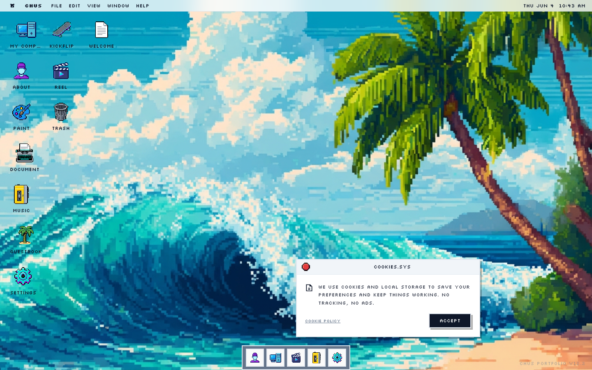

# Chus Margallo Portfolio | Interactive Desktop Experience
> A retro operating system-inspired portfolio. Explore projects and experience a unique web-based desktop interface.  ·  [chusmargallo.space](https://chusmargallo.space/)

## What it is
A portfolio for designer Chus Margallo built as a fully interactive retro operating system. Instead of a scrolling page, the site boots you into a fake desktop OS where the work lives inside windows, folders, and clickable desktop icons.

## What it shows
A pixel-art desktop: a vivid 8-bit ocean-wave/beach wallpaper (palm tree, breaking wave) filling the screen, a classic top menu bar ('Chus.exe' · File / Edit / View / Window / Help with a clock top-right), a column of labelled desktop icons down the left (My Work, About, Trash…), and a bottom dock. A cookie-policy notice appears as a system dialog window sitting on the desktop.

## How it works
A desktop metaphor, not a webpage — the viewport is fixed (body overflow:hidden, nothing scrolls); you navigate by clicking desktop icons and menu-bar items to open windows. Interaction is OS-style: open, drag, close. The ~18 buttons stand in for files and apps, so movement through the portfolio is spatial and skeuomorphic rather than linear.

## How it's designed
Wall-to-wall retro-computing nostalgia, rendered entirely in the Silkscreen pixel font over clean near-white system chrome. The centerpiece is a hand-pixelled beach scene that reads like a CRT desktop wallpaper, and every UI element commits to the bit — menu bar, dialogs, dock and iconography all mimic a vintage GUI. Visuals are raster pixel-art sprites (~25 , no canvas or video), which keeps the whole thing feeling like a real old operating system rather than a slick modern site.

## Design data
- **Palette:** Near-white system chrome (#fafafa / #fff), dark slate text (#0f1729) with muted slate secondary (#65758b); all the saturated color comes from the pixel-art beach wallpaper.
- **Fonts:** Silkscreen (pixel display + body), Inter fallback
- **Extracted:** 2026-06-04 · playwright-mcp @ 1440x900

## Related sites
[[jessyin.world]] [[ditther.com]] [[gaspardhedde.fr]] [[jessa.art]] [[kmk0.com]] [[lelezhang.design]]

## Tags
#category/personal #aesthetic/retro #aesthetic/playful #pattern/retro-os #pattern/desktop-metaphor #pattern/skeuomorphic #pattern/pixel-art #pattern/windowed-ui #pattern/dock #pattern/menu-bar #pattern/no-scroll #pattern/nostalgia #pattern/playful #color/neutral
