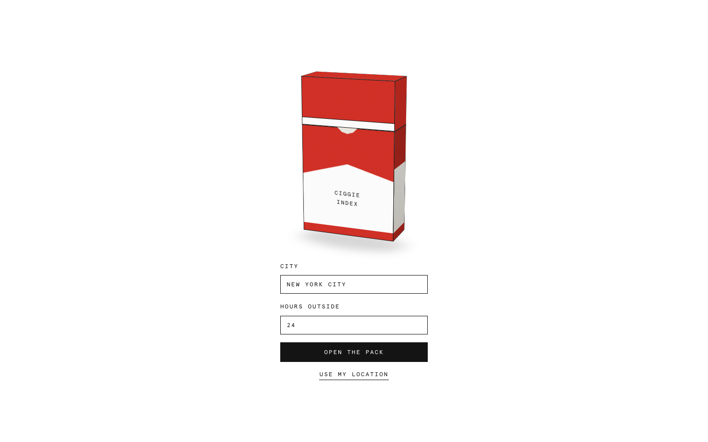

# ciggie index
> your air quality index, but in ciggies  ·  [cig-index.vercel.app](https://cig-index.vercel.app/)

**Vertical:** #vertical/tool-app  ·  **Vibe:** #vibe/playful #vibe/minimal  ·  **Topics:** #topic/health  ·  **Mode:** #mode/light

## What it is
A single-purpose novelty calculator, per its own meta description "your air quality index, but in ciggies" — it converts a city's air pollution exposure over a chosen number of hours into an equivalent number of cigarettes smoked.

## What it shows
A minimal form: a CITY search field (defaulting to New York City), an "HOURS OUTSIDE" number spinner (24), and two buttons, "OPEN THE PACK" and "USE MY LOCATION" — framed as a literal cigarette pack, with CSS variables for pack width/height/depth/lid/base suggesting the result renders as an illustrated pack opening.

## How it works
Next.js-adjacent (hosted on Vercel) with Google Tag Manager for analytics; no canvas/SVG/video on the initial form screen — the pack visualization is presumably deferred markup that renders after a city/hours submission.

## How it's designed
A literal, illustrative concept execution: CSS variables model an actual cigarette pack's geometry (--W: 196px, --H: 322px, --D: 74px, --lid: 98px, --base: 224px) with a red/tan Marlboro-esque palette, set entirely in Apercu Mono for a deadpan, spec-sheet tone that plays against the absurd premise.

## Design data
- **Palette:** White paper background (#fff) with near-black ink (#141414), red (#d33127) and tan (#d8a75f) pack-branding accents
- **Palette tokens:** --ink: #141414 (var), --paper: #fff (var), --red: #d33127 (var), --tan: #d8a75f (var)
- **Fonts:** Apercu Mono (400) — the only loaded font, used throughout
- **Fonts loaded:** Apercu Mono 400
- **Tech stack:** Next.js, Vercel, Google Tag Manager
- **Keywords:** single-purpose-tool, novelty, monospace, data-viz
- **Media mix:** 
- **Page height:** 900px (single-screen: True)
- **Responsive:** Form stays single-screen and single-column at 390px with no scroll growth (844px viewport = 844px scroll height).
- **Extracted:** 2026-09-22 · 1440x900 desktop + 390x844 mobile pass, logged_out: true

## Related sites
- [[drawably.dev]] — shared: tool-app, playful, minimal, light
- [[humanatlas.quest]] — shared: tool-app, minimal, health, light
- [[akira.sachi.dev]] — shared: tool-app, minimal, light
- [[appdrop.com]] — shared: tool-app, playful, light
- [[clipart.studio]] — shared: tool-app, playful, light
- [[itshover.com]] — shared: tool-app, minimal, light
