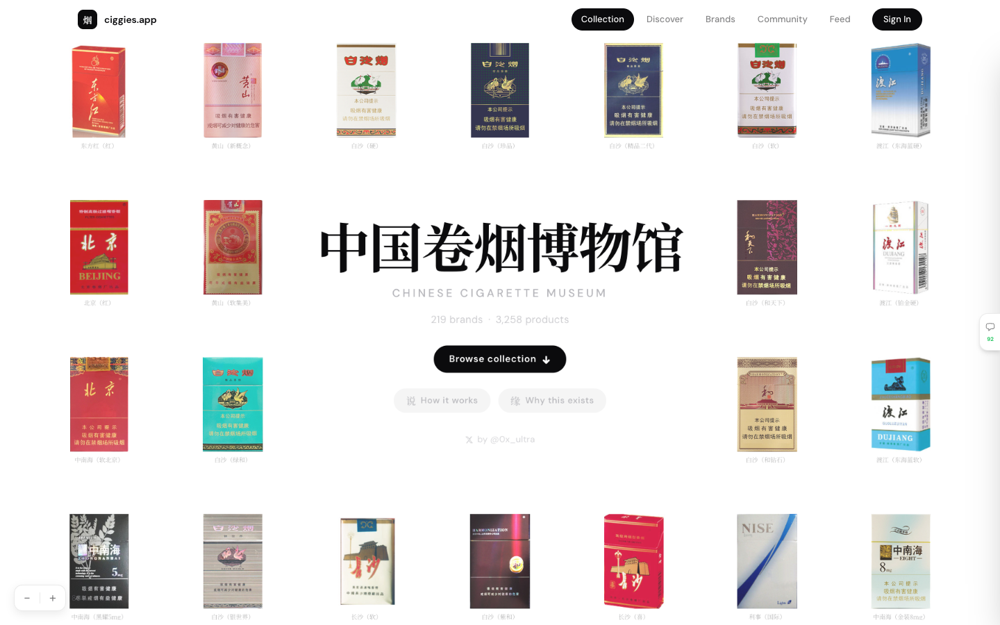

# 中国卷烟博物馆 · Chinese Cigarette Museum
> The only comprehensive English-language archive of Chinese cigarettes — 3,200+ SKUs across 200+ brands with pack imagery, specs, pricing, and ratings.  ·  [ciggies.app](https://www.ciggies.app/)

**Vertical:** #vertical/directory-gallery  ·  **Vibe:** #vibe/editorial #vibe/minimal  ·  **Topics:** —  ·  **Mode:** #mode/light

## What it is
An exhaustive bilingual digital museum/archive cataloguing thousands of Chinese cigarette pack designs by brand, credited to @0x_ultra.

## What it shows
A dense photographic grid of cigarette packs (SOBRANIE, Beijing, Baisha, Dujiang, Zhongnanhai, and more) surrounding a centered hero panel with the Chinese title "中国卷烟博物馆" / "CHINESE CIGARETTE MUSEUM," a "218 brands · 3,258 products" stat line, a "Browse collection" CTA, and "How it works"/"Why this exists" links.

## How it works
A straightforward image-catalog site (110 img, 14 svg, no canvas/video on the landing view) with Collection/Discover/Brands/Community/Feed navigation and Sign In, built with a Tailwind CSS custom-property system and Cloudflare Insights as the only third-party script.

## How it's designed
Clean white ground with near-black ink and a single loud red accent (--color-gold, oddly named but rendered rgb(255,59,48)); DM Sans for Latin UI text paired with Noto Serif SC for the museum's Chinese wordmark — an editorial-archive look that makes a huge product grid read like a gallery wall. No semantic h1/h2 was found in the DOM; the pitch copy is rendered via styled divs.

## Design data
- **Palette:** White ground, near-black ink, single red accent (--color-gold, rgb(255,59,48))
- **Palette tokens:** --color-gold: rgb(255,59,48) (var), --color-ink: rgb(255,255,255) (var), --color-ash: rgb(11,11,13) (var)
- **Fonts:** DM Sans (UI/body) + Noto Serif SC (Chinese display serif for the museum wordmark)
- **Fonts loaded:** DM Sans 400, DM Sans 500, DM Sans 600, DM Sans 700, Noto Serif SC 500, Noto Serif SC 700
- **Tech stack:** Tailwind CSS, Cloudflare
- **Keywords:** archive, product-grid, bilingual, editorial, directory-gallery
- **Media mix:** img 110 · svg 14
- **Page height:** 3705px (single-screen: False)
- **Responsive:** At 390px scrollHeight grows to 8104px as the pack grid collapses into a narrower, taller column layout.
- **Extracted:** 2026-09-22 · 1440x900 desktop viewport capture (fullPage timed out) + 390x844 mobile pass, logged_out: true

## Related sites
- [[21st.dev]] — shared: directory-gallery, editorial, minimal, light
- [[are.na]] — shared: directory-gallery, editorial, minimal, light
- [[designtools.fyi]] — shared: directory-gallery, editorial, minimal, light
- [[type.lol]] — shared: directory-gallery, editorial, minimal, light
- [[designengineer.tools]] — shared: directory-gallery, minimal, light
- [[humanoid-index.com]] — shared: directory-gallery, minimal, light
