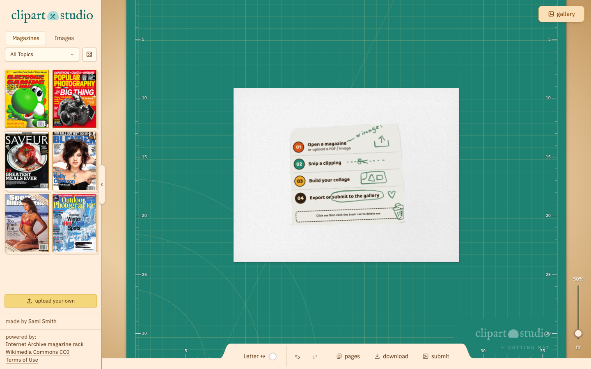

# clipart.studio — magazine collage maker
> Digital collage studio. Pick a magazine from the Internet Archive, clip the pieces you want, arrange them on the page.  ·  [clipart.studio](https://clipart.studio/)

**Vertical:** #vertical/tool-app  ·  **Vibe:** #vibe/organic-warm #vibe/playful  ·  **Topics:** #topic/art  ·  **Mode:** #mode/light

## What it is
A free digital collage-making tool that lets you cut clippings from real vintage magazines (sourced from the Internet Archive's magazine rack) and Wikimedia Commons CC0 images and arrange them on a virtual cutting mat.

## What it shows
A left rail of magazine covers by category ("Tech & Science": Popular Science, Macworld, Science Illustrated…) plus an "Images" tab and upload option; the main canvas is a teal cutting mat with a magazine photo open, complete with a knife cursor and cut guides for clipping.

## How it works
A canvas-based editor (1 canvas, 36 svg tool icons, 12 img) with custom knife/rotate cursors defined as inline SVG data-URIs; credited "made by Sami Smith," powered by the Internet Archive magazine rack + Wikimedia Commons CC0, with Cloudflare as the only third-party script host.

## How it's designed
A literal analog-craft-desk aesthetic: warm cream paper background (--paper #fffaeb), warm brown ink (--ink #5e3a1a), a mustard-butter accent (--butter #f3d77a), and a teal cutting mat (--mat #1e8273); IM Fell English (old-book serif) for display type, IBM Plex Sans for UI/body, plus a subtle SVG paper-grain texture overlay.

## Design data
- **Palette:** Cream paper background (#fffaeb), warm brown ink (#5e3a1a), mustard-butter accent (#f3d77a), teal cutting mat (#1e8273)
- **Palette tokens:** --paper: #fffaeb (var), --ink: #5e3a1a (var), --butter: #f3d77a (var), --mat: #1e8273 (var)
- **Fonts:** IM Fell English (old-book serif display) + IBM Plex Sans (UI/body)
- **Fonts loaded:** IBM Plex Sans 400
- **Tech stack:** Vanilla Canvas/JS, Cloudflare
- **Keywords:** collage, craft-desk, magazine-clippings, canvas-editor, organic-warm
- **Media mix:** img 12 · canvas 1 · svg 36
- **Page height:** 900px (single-screen: True)
- **Responsive:** At 390px the reported scrollHeight (844px) equals the viewport height; the cutting-mat editor is a fixed single-screen canvas rather than a scrolling page.
- **Headings:** clipart studio — magazine collage
- **Extracted:** 2026-09-22 · 1440x900 desktop + 390x844 mobile pass, logged_out: true

## Related sites
- [[lelezhang.design]] — shared: tool-app, organic-warm, playful, art, light
- [[appdrop.com]] — shared: tool-app, organic-warm, playful, light
- [[cafe.endofday.studio]] — shared: tool-app, organic-warm, playful
- [[cig-index.vercel.app]] — shared: tool-app, playful, light
- [[drawably.dev]] — shared: tool-app, playful, light
- [[spencer.place]] — shared: organic-warm, playful, art
