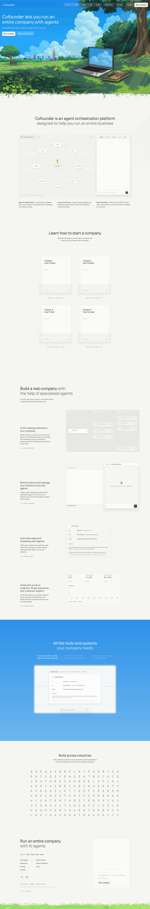

# Cofounder lets you run an entire company with agents
> Run an entire company with AI agents.  ·  [cofounder.co](https://cofounder.co/)

## What it is
The product site for Cofounder, by the General Intelligence Company of New York — “an agent orchestration platform designed to help you run an entire business” across engineering, sales, marketing, design, finance and ops (meta description: “Run engineering, sales, marketing, design, finance, and ops.”). The bookmark (andrew pignanelli) singles out its new section — the h2 “Learn how to start a company” — as “literally a step-by-step guide on how to start a company… written by experts and u can download it.”

## What it shows
A warm off-white page (var/rendered background #f5f5f2) with a dark hero where the h1 — “Cofounder lets you run an entire company with agents” — renders white (rgb 255,255,255) at 46px over imagery and a canvas. Scrolling moves through “Cofounder is an agent orchestration platform…,” “Learn how to start a company,” “Build a real company with the help of specialized agents,” “All the tools and systems your company needs,” and “Run an entire company with AI agents.” It's icon-dense (144 svg) with 49 img and a single canvas.

## How it works
A single-scroll marketing site (~8653px) funnelling to the app at app.cofounder.co — “Log in” and repeated “Run a company” CTAs all point there. Docs live at docs.cofounder.co, careers at generalintelligencecompany.com, and the build is credited to Altalogy. It's instrumented with PostHog, Meta Pixel and Google Tag Manager, and served from Vercel (the favicon carries a dpl_ deployment id).

## How it's designed
An editorial-tech aesthetic on warm paper #f5f5f2 with ink text (rendered body rgb 23,23,23; var --color-ink #262323cc and a strong/strongest ramp). The face is a custom “neoris” sans for both display and body (white 46px h1 on the dark hero), with “departureMono” and IBM Plex Mono carrying code/mono accents (Inter sits only in the fallback stack). Accent tokens are a brown --color-accent-brown #a76451, a vivid --color-lime-300 and success #34a853. It's a Tailwind v4 build (lab() values, --color-* tokens); no __NEXT_DATA__ or #__next is exposed, though the Vercel dpl_ favicon and /og image route suggest a Next.js app-router setup (asserted cautiously).

## Design data
- **Palette:** Warm paper #f5f5f2 with near-black ink (rendered rgb 23/23/23, var --color-ink #262323cc); white hero headline; brown (--color-accent-brown #a76451) and lime (--color-lime-300) accents, success green #34a853.
- **Palette tokens:** --background: #f5f5f2 (var), --color-ink: #262323cc (var), --color-ink-strongest: #262323e6 (var), --color-accent-brown: #a76451 (var), --color-feature-success: #34a853 (var), body-text: rgb(23, 23, 23) (rendered), h1-color: rgb(255, 255, 255) (rendered)
- **Fonts:** Custom 'neoris' sans for display + body (h1 46px), 'departureMono' and IBM Plex Mono for mono/code (all loaded); Inter in the fallback stack.
- **Fonts loaded:** neoris, departureMono, IBM Plex Mono 400, IBM Plex Mono 500
- **Tech stack:** Tailwind v4, PostHog, Meta Pixel, Google Tag Manager, Vercel
- **Media mix:** img 49 · canvas 1 · svg 144
- **Page height:** 8653px (single-screen: False)
- **Responsive:** At 390x844 the h1 drops 46px→34px, a hamburger appears, and the layout collapses to one column (scrollHeight 8653→11619).
- **Headings:** Cofounder lets you run an entire company with agents / Cofounder is an agent orchestration platformdesigned to help you run an entire business / Learn how to start a company / Build a real company with the help of specialized agents / All the tools and systems your company needs / Run an entire company with AI agents
- **Links out:** [Run a company (app)](https://app.cofounder.co/) · [Docs](https://docs.cofounder.co/) · [Careers](https://generalintelligencecompany.com/careers) · [X / @intelligenceco](https://x.com/intelligenceco) · [Built by Altalogy](https://www.altalogy.com/?rel=gic-cofounder)
- **Extracted:** 2026-06-06 · playwright-mcp @ 1440x900 (+ 390x844 mobile), logged_out: true

## Related sites
[[hofai.io]] [[printingpress.dev]] [[recent.design]] [[todesktop.com]] [[eko.lumaris.works]] [[fantasypresidentcareer.com]]

## Tags
#category/uncategorized #aesthetic/developer-product #pattern/product-landing #pattern/agent-orchestration #pattern/warm-paper #pattern/custom-sans #pattern/mono-accent #pattern/icon-heavy #pattern/single-scroll #pattern/tailwind-v4 #pattern/startups #tech/tailwind-v4 #tech/posthog #tech/meta-pixel #tech/google-tag-manager #tech/vercel #color/warm #color/cool #font/neoris #font/departuremono #font/ibm-plex-mono
