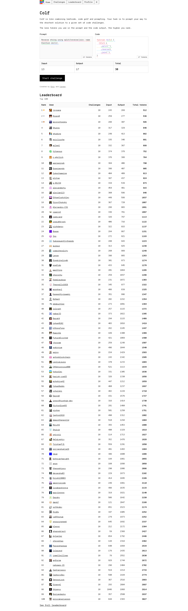

# Colf
> Prompt solutions to algorithmic problems with the fewest tokens.  ·  [colf.dev](https://colf.dev/)

**Vertical:** #vertical/tool-app  ·  **Vibe:** #vibe/technical #vibe/retro  ·  **Topics:** #topic/ai #topic/engineering  ·  **Mode:** #mode/light

## What it is
A browser game from Eric Zakariasson (who works on Cursor) that mashes up LeetCode, code golf and prompting: "Colf is like combining leetcode, code golf and prompting. Your task is to prompt your way to the shortest solution to a given set of code challenges." You don't write the code — you write the prompt that makes a model emit it, and the fewer tokens you spend (prompt + output) the higher you rank.

## What it shows
A light, single-column page. Up top the title "Colf" and the one-line pitch sit above a two-pane challenge card (a Prompt box on the left holding a sample task — "Reverse string using split/reverse/join; name function rev(s)." — and a Code/output pane on the right) with Input / Output / Tries counters (13 / 17 / 38) and a "Start challenge" button. Below it the whole rest of the page is a "Leaderboard" — a Top 100 table of ranked players with avatars and columns for challenges solved, input/output token counts and totals.

## How it works
It's a real tool, not a marketing page: pick a challenge, type a prompt, the model returns code, and you're scored on total tokens used. A persistent top nav (Home / Challenges / Leaderboard / Profile) plus a Twitter/Cursor footer frame the experience. The long leaderboard is the main draw below the fold — a live ranking that turns prompt-efficiency into a competitive sport.

## How it's designed
Confident retro-terminal look done in a light theme: white background (#fff), near-black text (#171717), tidy neutral-gray Tailwind scale, and a single blue focus ring (#3b82f6). The signature move is typography — the entire UI is set in DepartureMono, a pixel/typewriter monospace, which makes a dense data table and a code game read as one coherent "terminal" artifact. Tailwind v4 tokens (oklch color scale) drive the spacing and color system.

## Design data
- **Palette:** White bg (#fff), near-black text (#171717), neutral Tailwind grays, muted accent (#f3f4f6), blue focus ring (#3b82f6), light border (#d4d4d4).
- **Palette tokens:** --background: #fff (var), --foreground: #171717 (var), --color-ring: #3b82f6 (var), --accent: #f3f4f6 (var), --border: #d4d4d4 (var), body background: rgb(255,255,255) (rendered), body text: rgb(23,23,23) (rendered)
- **Fonts:** DepartureMono (pixel monospace) for everything; Arial/Helvetica fallback.
- **Fonts loaded:** DepartureMono 400
- **Tech stack:** Next.js (inferred from /opengraph-image route), Tailwind CSS v4, DepartureMono (self-hosted)
- **Keywords:** light-mode, monospace-ui, pixel-font, terminal-aesthetic, leaderboard, data-table, gamified, tool-app, tailwind
- **Media mix:** img 99 · svg 4
- **Page height:** 4673px (single-screen: False)
- **Responsive:** At 390x844 the layout largely holds (scrollHeight ~4,979px): the Prompt/Code panes stack and the wide Top-100 leaderboard table scrolls horizontally rather than reflowing.
- **Headings:** Colf / Leaderboard
- **Links out:** [Eric (author)](https://x.com/ericzakariasson) · [Cursor](https://cursor.com/)
- **Extracted:** 2026-06-05 · playwright-mcp @ 1440x900 + mobile 390x844, logged_out: true

## Related sites
- [[akira.sachi.dev]] — shared: tool-app, technical, engineering, light
- [[itshover.com]] — shared: tool-app, technical, engineering, light
- [[printingpress.dev]] — shared: technical, ai, engineering, light
- [[spyrosigma.in]] — shared: technical, ai, engineering, light
- [[stitch.withgoogle.com]] — shared: tool-app, technical, ai
- [[tryponcho.com]] — shared: tool-app, technical, ai
