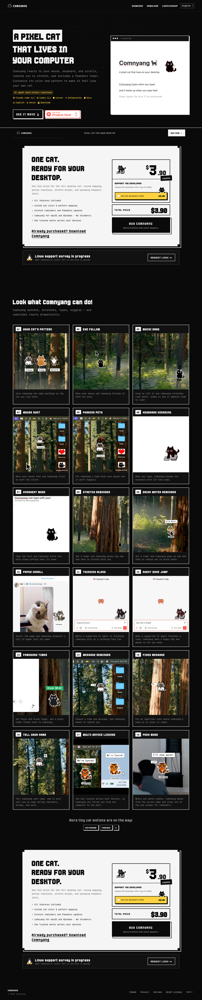

# Comnyang, the pixel cat in your computer
> A pixel cat that follows your cursor, reacts to your keystrokes, and nudges you to stretch  ·  [comnyang.com](https://comnyang.com/en)

**Vertical:** #vertical/startup-product  ·  **Vibe:** #vibe/retro #vibe/playful  ·  **Topics:** —  ·  **Mode:** #mode/dark

## What it is
The product landing page for Comnyang, a desktop-pet app: a tiny pixel cat that lives on your macOS or Windows desktop, follows your cursor, reacts to keystrokes, and nudges you to stretch.

## What it shows
A hero ("A PIXEL CAT THAT LIVES IN YOUR COMPUTER"), a "Look what Comnyang can do!" demo section with looping clips of the cat's behaviors, a "ONE CAT. READY FOR YOUR DESKTOP." pitch repeated near a waitlist/purchase flow (Tally form, Lemon Squeezy checkout).

## How it works
A static/vanilla site with no exposed SPA framework globals; 19 short looping videos carry the product demos (no canvas/svg used for that), backed by TikTok Pixel, Google Tag Manager, and Cloudflare Insights analytics, a Tally embedded form, and a Lemon Squeezy checkout widget.

## How it's designed
Dark pixel-terminal styling: near-black ground (--bg #0a0a0a) with off-white text (--fg #f5f5f5) and one loud accent-pop yellow (--accent-pop #ffd23f), hard-edged white drop shadows (4px 4px 0 #fff) instead of blur, a pixel display face (Born2bSporty FS / Cafe24ProUp) for headings, JetBrains Mono for UI labels, and VT323 loaded as a retro-terminal accent.

## Design data
- **Palette:** Near-black ground (#0a0a0a), off-white text (#f5f5f5), one loud accent-pop yellow (#ffd23f), hard-edged white drop shadows
- **Palette tokens:** --bg: #0a0a0a (var), --fg: #f5f5f5 (var), --accent-pop: #ffd23f (var), --line: #1f1f1f (var)
- **Fonts:** Pixel display face (Born2bSporty FS / Cafe24ProUp) for headings, JetBrains Mono for UI text, VT323 loaded as a retro-terminal accent
- **Fonts loaded:** Born2bSporty FS 400, JetBrains Mono 400, JetBrains Mono 600, VT323 400
- **Tech stack:** Static/vanilla JS, TikTok Pixel, Google Tag Manager, Cloudflare, Tally, Lemon Squeezy
- **Keywords:** pixel-art, desktop-pet, retro, dark-mode, product-landing
- **Media mix:** img 13 · video 19
- **Page height:** 7114px (single-screen: False)
- **Responsive:** Single-column stack at 390px; scrollHeight roughly doubles from 7114px to 14980px as sections restack.
- **Headings:** A PIXEL CAT THAT LIVES IN YOUR COMPUTER / ONE CAT. READY FOR YOUR DESKTOP. / Look what Comnyang can do!
- **Extracted:** 2026-09-22 · 1440x900 desktop + 390x844 mobile pass, logged_out: true

## Related sites
- [[cavalry.studio]] — shared: startup-product, playful, dark
- [[b150.ai]] — shared: startup-product, playful
- [[linkeddit.com]] — shared: startup-product, playful
- [[mo1.app]] — shared: startup-product, playful
- [[photon.codes]] — shared: startup-product, playful
- [[shipper.now]] — shared: startup-product, playful
