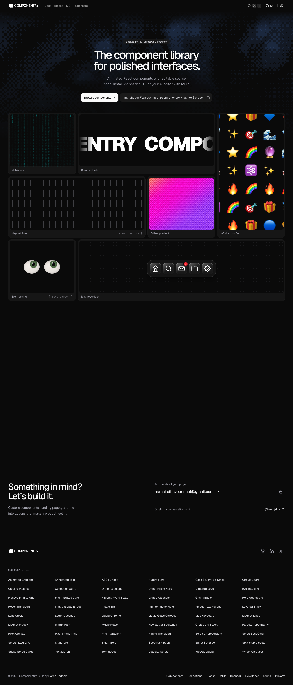

# Componentry — Beautiful Animated UI Components for React
> The component library for polished interfaces.  ·  [componentry.dev](https://componentry.dev/)

**Vertical:** #vertical/docs-resource  ·  **Vibe:** #vibe/minimal #vibe/technical  ·  **Topics:** #topic/design #topic/engineering  ·  **Mode:** #mode/dark

## What it is
Landing page for Componentry, a library of 54 animated React UI components built on Tailwind CSS, TypeScript and Framer Motion.

## What it shows
The h1 is 'The component library for polished interfaces.' It shows live component previews, a 'Loved by builders with taste' testimonial section, and a 'Something in mind? Let's build it.' contact CTA.

## How it works
A Next.js site (Next script bundles present) with PostHog and Umami analytics. 87 inline SVGs and 4 canvases drive the previews; it is a short page at 3357px.

## How it's designed
Dark shadcn-style theme: body and html rgb(10,10,10) with near-white text lab(98.26 0 0), Geist 500 at 56px for the h1 and JetBrains Mono for code. The :root tokens are the shadcn set (--primary #171717, --muted-foreground #686868, --destructive #e40014, --radius .625rem); the stylesheet defines the light values and the page renders its dark variant.

## Design data
- **Palette:** Near-black ground, near-white text, neutral greys, no accent colour
- **Palette tokens:** --primary: #171717 (var), --muted-foreground: #686868 (var), --destructive: #e40014 (var), --radius: .625rem (var), body bg: rgb(10, 10, 10) (rendered), body color: lab(98.26 0 0) (rendered)
- **Fonts:** Geist, JetBrains Mono
- **Fonts loaded:** Geist 100-900, JetBrains Mono 100-800
- **Tech stack:** Next.js, React, Tailwind CSS, Framer Motion, PostHog, Umami
- **Keywords:** shadcn tokens, component showcase, dark minimal, geist type
- **Media mix:** img 28 · canvas 4 · svg 87
- **Page height:** 3357px (single-screen: False)
- **Responsive:** At 390px the h1 drops from 56px to about 33px and the page grows from 3357px to 5264px as columns stack; no horizontal overflow.
- **Headings:** The component library for polished interfaces. / Loved by builders with taste / Something in mind? Let's build it. / COMPONENTS 54
- **Extracted:** 2026-10-17 · Playwright 1440x900 full-page + DOM probe; 390x844 text probe; logged_out: true

## Related sites
- [[motion.dev]] — shared: docs-resource, minimal, technical, design, engineering, dark
- [[transitions.dev]] — shared: docs-resource, minimal, technical, design, engineering
- [[animejs.com]] — shared: docs-resource, technical, design, engineering, dark
- [[gsap.com]] — shared: docs-resource, technical, design, engineering, dark
- [[animations.dev]] — shared: docs-resource, minimal, design, engineering
- [[lab01.dev]] — shared: minimal, technical, design, engineering, dark
