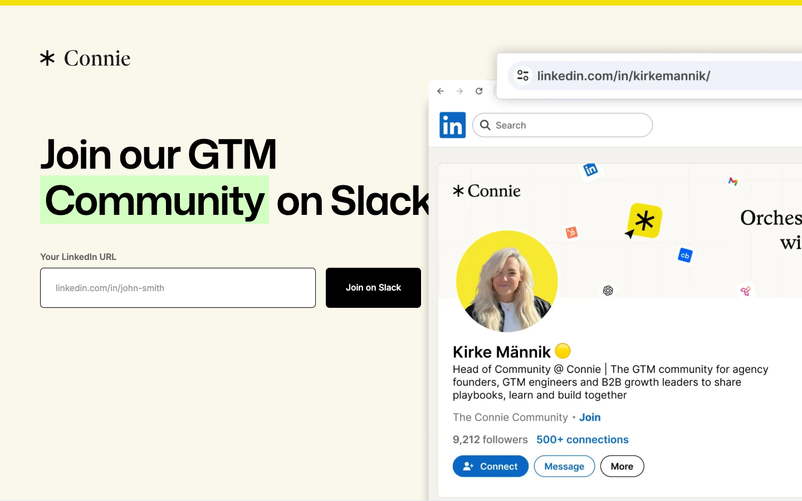

# Join the Conigma GTM Community
> Join our GTM Community on Slack  ·  [conigma.com](https://www.conigma.com/community)

## What it is
This is the signup gate for Conigma's go-to-market (GTM) Slack community — the landing the tweet's free Claude Co-work course routes to. The <h1> is the whole ask: "Join our GTM Community on Slack", behind a short form asking for "Your LinkedIn URL."

## What it shows
A single-screen lead-capture page: headline, a LinkedIn-URL input, and a join CTA, gated by a Cloudflare Turnstile challenge. It's purpose-built as a conversion page for founders/agency owners requesting the GTM/Claude Co-work material, not a full marketing site.

## How it works
Built and hosted on Webflow (assets and stylesheet from cdn.prod.website-files.com, webflow-icons font). It runs Ahrefs analytics, uses Cloudflare Turnstile for bot protection, and pulls a jQuery bundle from CloudFront — a typical Webflow form stack.

## How it's designed
A clean, warm, conversion-first look: a cream/off-white canvas (rgb(250,247,235)) with dark grey body text (#333), a true-black primary button with white label for maximum CTA contrast, and black headings. Typography pairs Mona Sans 600 for the heading with Inter (400/500/600) for body and form — a modern, neutral SaaS pairing kept deliberately minimal.

## Design data
- **Palette:** Warm off-white canvas (rgb(250,247,235)) + dark-grey text (#333), black CTA button.
- **Palette tokens:** body_bg (rendered): rgb(250, 247, 235) (rendered), body_color (rendered): rgb(51, 51, 51) (rendered), btn_bg (rendered): rgb(0, 0, 0) (rendered), btn_color (rendered): rgb(255, 255, 255) (rendered)
- **Fonts:** Mona Sans 600 (heading) + Inter 400/500/600 (body & form).
- **Fonts loaded:** Mona Sans 600, Inter 400, Inter 500, Inter 600
- **Tech stack:** Webflow, Ahrefs Analytics, Cloudflare Turnstile, jQuery (CloudFront)
- **Media mix:** img 2
- **Page height:** 900px (single-screen: True)
- **Responsive:** At 390px the page stays effectively single-screen (scrollHeight ~855px); the form column simply narrows to viewport width.
- **Headings:** Join our GTM Community on Slack
- **Weight:** None requests; hosts: cdn.prod.website-files.com, analytics.ahrefs.com, challenges.cloudflare.com, d3e54v103j8qbb.cloudfront.net
- **Extracted:** 2026-06-06 · Playwright 1440x900 + 390x844, logged_out: true

## Related sites
[[gatheros.co]] [[shanemac.com]] [[akira.sachi.dev]] [[axiaisacat.indiehacker.bio]] [[b150.ai]] [[badmarketing.com]]

## Tags
#category/tutorial #aesthetic/minimal #pattern/webflow #pattern/lead-capture #pattern/single-screen #pattern/community-signup #pattern/turnstile-gated #pattern/warm-minimal #tech/webflow #tech/ahrefs-analytics #tech/cloudflare-turnstile #tech/jquery-cloudfront #color/warm #font/mona-sans #font/inter
