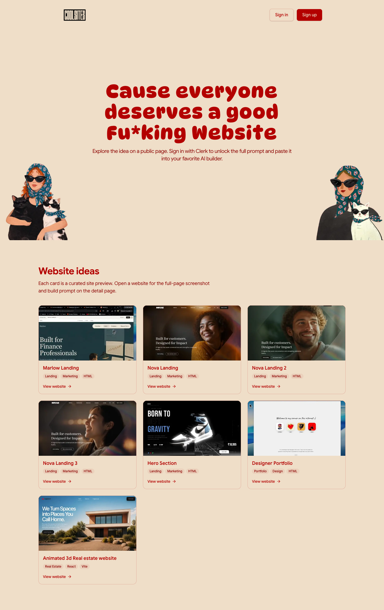

# CoolSites — Website prompts
> Cause everyone deserves a good Fu*king Website  ·  [coolsites.ai](https://www.coolsites.ai/)

**Vertical:** #vertical/directory-gallery  ·  **Vibe:** #vibe/playful #vibe/organic-warm  ·  **Topics:** #topic/design #topic/ai  ·  **Mode:** #mode/light

## What it is
A curated gallery of website design ideas where every entry ships with a copy-pasteable AI build prompt. The pitch is blunt and self-aware — the real <h1> reads “Cause everyone deserves a good Fu*king Website” — and a Clerk sign-in gates the full prompts.

## What it shows
Under the section heading “Website ideas,” a grid of live site previews rendered as embedded iframes (7 on first load), so you scroll a wall of real, running pages rather than static thumbnails.

## How it works
Browse the gallery freely; each card is a live iframe preview. Authentication is handled by Clerk (clerk.coolsites.ai) and unlocks copying the underlying build prompt — “Sign in to copy the full build prompts.” No SPA framework global was detected; the page is a Tailwind v4 build served straight from coolsites.ai.

## How it's designed
A warm, almost analog palette — cream canvas (#efdec8) carrying bold cherry-red foreground type (#b30100) with peach accents (#e9c8b4) — paired with a playful display face. The 72px <h1> is set in DynaPuff (rounded, bouncy), body copy in Google Sans, and Geist Mono is loaded for monospace touches. Tailwind v4 design tokens drive the spacing/radius scale (--radius .625rem).

## Design data
- **Palette:** Warm cream #efdec8 background, bold cherry-red #b30100 foreground/headings, peach accent #e9c8b4
- **Palette tokens:** --background: #efdec8 (var), --foreground: #b30100 (var), --primary: #b30100 (var), --accent: #e9c8b4 (var), --card: #efdec8 (var), --border: #e2ad9c (var), --muted-foreground: #8d0402 (var), --ring: #d47b6e (var), body bg: rgb(239, 222, 200) (rendered), body text: rgb(179, 1, 0) (rendered), h1 text: rgb(179, 1, 0) (rendered)
- **Fonts:** DynaPuff (playful display <h1>) + Google Sans (body/UI) + Geist Mono (mono)
- **Fonts loaded:** DynaPuff 700, Google Sans 400, Google Sans 500, Google Sans 600, Google Sans 700
- **Tech stack:** Tailwind CSS v4, Clerk (auth)
- **Keywords:** directory, gallery, ai-prompts, live-iframe-previews, warm-palette, playful-display-type, tailwind
- **Media mix:** img 3 · svg 7 · iframe 7
- **Page height:** 2286px (single-screen: False)
- **Responsive:** At 390px the preview grid collapses to a single full-width column (~358px), the DynaPuff <h1> scales from 72px to 48px, and the page grows to ~3565px tall (iframe previews lazy-load out of view, so the count reads 0 on first paint).
- **Headings:** Cause everyone deserves a good Fu*king Website / Website ideas
- **Extracted:** 2026-06-05 · Playwright Chromium @ 1440×900 + 390×844 mobile pass; logged_out: true

## Related sites
- [[21st.dev]] — shared: directory-gallery, design, ai, light
- [[canivibecodeit.com]] — shared: directory-gallery, playful, ai, light
- [[jessa.art]] — shared: playful, organic-warm, design, light
- [[lelezhang.design]] — shared: playful, organic-warm, ai, light
- [[motionsites.ai]] — shared: directory-gallery, design, ai
- [[nehasharma.dev]] — shared: playful, organic-warm, ai, light
