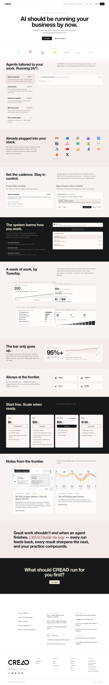

# CREAO AI │ Agents that run your business
> CREAO builds AI agents that run your work — they plug into your existing tools, learn how you operate, and compound your knowledge around the clock.  ·  [creao.ai](https://creao.ai/)

**Vertical:** #vertical/startup-product  ·  **Vibe:** #vibe/corporate-clean #vibe/editorial  ·  **Topics:** #topic/ai #topic/startups  ·  **Mode:** #mode/light

## What it is
The marketing homepage for CREAO, an AI-agent platform that sells 'agents that run your business.' The whole long-scroll page is a pitch: spin up agents tailored to your work that plug into your existing stack and operate 24/7 so 'a week of work' is done 'by Tuesday.'

## What it shows
A tall single-column landing page opening on the oversized claim 'AI should be running your business by now.' From there it walks the value prop in stacked sections — 'Agents tailored to your work. Running 24/7.', an 'Already plugged into your stack.' integrations grid of app logos, 'Set the cadence. Stay in control.', 'The system learns how you work.', a results block ('A week of work, by Tuesday.' with a 95%+ stat), 'Always at the frontier.', a 'Start free. Scale when ready.' pricing/CTA, a 'Notes from the frontier.' blog teaser and a closing FAQ. It ends on a big 'What should CREAO run for you first?' prompt above the wordmark footer.

## How it works
A conventional conversion funnel built in Framer: anchored nav links scroll the one document, product features are illustrated with inline mock UI cards and an integrations logo wall, and repeated 'Start free' CTAs push to sign-up. A heavy analytics/ad-pixel layer (Amplitude, GTM, plus LinkedIn/Facebook/Twitter conversion pixels) instruments the page for paid acquisition.

## How it's designed
Clean, bright SaaS-editorial. A white ground (rgb(255,255,255)) carries near-black text, with one full-bleed dark section breaking the rhythm and soft tinted panels framing the feature mock-ups. Typography pairs a very heavy display sans for headlines — the h1 'AI should be running your business by now.' renders in DM Sans at 80px / weight 900 — against an Inter body, with a Frank Ruhl Libre serif loaded for accent/quote text. Generous whitespace, rounded cards and small inline product screenshots give it the polished, slightly templated feel of a well-funded Framer site.

## Design data
- **Palette:** White ground (rgb(255,255,255)) with near-black text (h1 rgb(22,24,26)); one full-bleed dark section and soft tinted feature panels — restrained, near-monochrome with subtle accent tints.
- **Palette tokens:** body background: rgb(255, 255, 255) (rendered), body text: rgb(0, 0, 0) (rendered), h1: rgb(22, 24, 26) (rendered)
- **Fonts:** DM Sans for the heavy display headlines (h1 80px/900), Inter for body (weights 400/500/700 loaded), and a Frank Ruhl Libre serif loaded for accent text; many other families are declared in Framer's font manifest but left unloaded.
- **Fonts loaded:** Frank Ruhl Libre 400, Frank Ruhl Libre 600, Inter 400, Inter 500, Inter 700
- **Tech stack:** Framer, Amplitude, Google Tag Manager, Cloudflare (Insights), LinkedIn/Facebook/Twitter ad pixels, Google Fonts
- **Keywords:** framer-site, saas-landing, long-scroll, heavy-display-sans, integrations-logo-wall, inline-mock-ui, single-cta-funnel, ai-agents
- **Media mix:** img 34 · svg 48 · iframe 1
- **Page height:** 8986px (single-screen: False)
- **Responsive:** At 390px the multi-column sections collapse to one stacked column — the h1 scales from 80px to 44px and the page roughly redoubles in height (8986px → 14370px).
- **Headings:** AI should be running your business by now. / Agents tailored to your work. Running 24/7. / Already plugged into your stack. / Set the cadence. Stay in control. / The system learns how you work. / A week of work, by Tuesday. / The bar only goes up. / Always at the frontier. / Start free. Scale when ready. / Notes from the frontier. / Frequently asked questions
- **Extracted:** 2026-06-06 · playwright-mcp @ 1440x900 + 390x844, logged_out: true

## Related sites
- [[shipper.now]] — shared: startup-product, corporate-clean, ai, startups, light
- [[cofounder.co]] — shared: startup-product, editorial, ai, startups
- [[b150.ai]] — shared: startup-product, ai, startups, light
- [[backdoorai.app]] — shared: startup-product, ai, startups, light
- [[bigideasdb.com]] — shared: startup-product, corporate-clean, startups, light
- [[contralabs.com]] — shared: startup-product, editorial, ai, light
