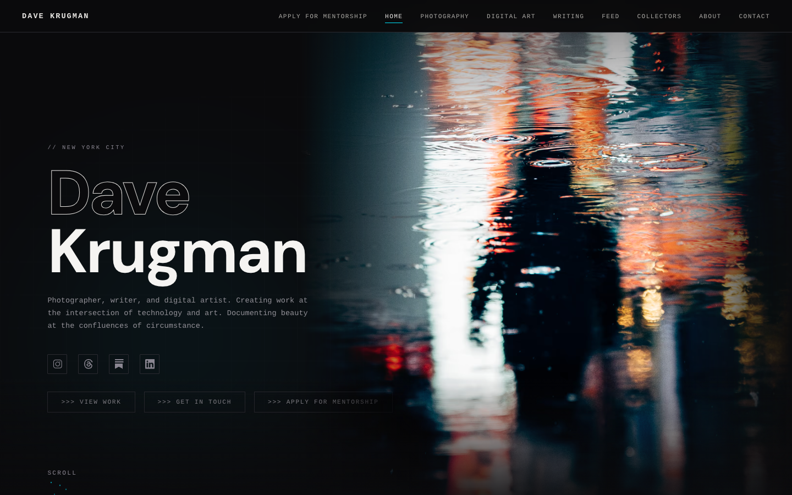

# Dave Krugman | Photographer & Digital Artist
> Photographer, writer, and digital artist. Creating work at the intersection of technology and art.  ·  [davekrugman.com](https://www.davekrugman.com/)

**Vertical:** #vertical/portfolio  ·  **Vibe:** #vibe/technical #vibe/editorial  ·  **Topics:** #topic/photography #topic/art  ·  **Mode:** #mode/dark

## What it is
The personal site of Dave Krugman — photographer, writer and digital artist (the page's own h1 is simply 'DaveKrugman'). It doubles as a hub for his photography, NFT/digital-art work and his current 'WINDOWS' project.

## What it shows
A long single-page scroll broken into About, Photography, Digital Art, Get in Touch and 'Latest from socials' sections, with press credits (New York Times, Bloomberg, Decrypt x META) and a live feed of recent X posts — several themed around 'WINDOWS' / '2026 is the year of window'.

## How it works
A dark, scroll-driven one-pager (~9,950px tall) with anchored nav; two <canvas> elements power the window/glow motif (the CSS exposes --window-amber / --window-amber-glow tokens), and a social feed pulls in his latest tweets. CTAs route to /contact and to Instagram/X.

## How it's designed
Terminal-meets-editorial dark theme: a near-black ground (#0a0a0c) with warm amber as the signature accent (#ffb84d) offset by cool cyan (#00d4ff), Cousine monospace for body copy and DM Sans for display headings. The monospace plus glowing amber windows read like a darkroom console.

## Design data
- **Palette:** Near-black ground (#0a0a0c), off-white text (#e8e6e3), amber accent (#ffb84d), cyan (#00d4ff) and warm orange (#ff6b35).
- **Palette tokens:** --bg: #0a0a0c (var), --bg-card: #16161a (var), --text: #e8e6e3 (var), --accent: #ffb84d (var), --warm: #ff6b35 (var), --cool: #00d4ff (var), --window-amber: #ffb84d (var), body background (rendered): rgb(10,10,12) (rendered), body text (rendered): rgb(232,230,227) (rendered)
- **Fonts:** Cousine (monospace) body + DM Sans (sans) headings.
- **Fonts loaded:** Cousine 400, Cousine 700, DM Sans (400/500 via CSS var)
- **Tech stack:** vanilla / custom build (no JS framework detected), Google Tag Manager
- **Keywords:** dark-mode, one-page-scroll, monospace, canvas-animation, photography-portfolio, social-feed, press-credits, glow-accent
- **Media mix:** img 42 · canvas 2 · svg 13
- **Page height:** 9947px (single-screen: False)
- **Responsive:** At 390x844 the top nav collapses to a burger menu and the sections stack single-column; scrollHeight roughly doubles to ~18,000px.
- **Headings:** DaveKrugman / About / Photography / Digital Art / Get in Touch / Latest from socials
- **Links out:** [Instagram](https://instagram.com/dave.krugman) · [X](https://twitter.com/dave_krugman) · [Contact](https://www.davekrugman.com/contact) · [Email](mailto:dave@davekrugman.com) · [Press: New York Times](https://www.nytimes.com/2014/06/18/arts/design/sharing-cultural-jewels-via-instagram.html)
- **Extracted:** 2026-06-05 · playwright-mcp @ 1440x900 (viewport screenshot; fullPage timed out) + mobile 390x844

## Related sites
- [[ankit-rai.com]] — shared: portfolio, editorial, art, dark
- [[khairallah.xyz]] — shared: portfolio, technical, dark
- [[lab01.dev]] — shared: portfolio, technical, dark
- [[mrdoob.com]] — shared: portfolio, art, dark
- [[nyk.dev]] — shared: portfolio, technical, dark
- [[objectives.md]] — shared: portfolio, technical, dark
