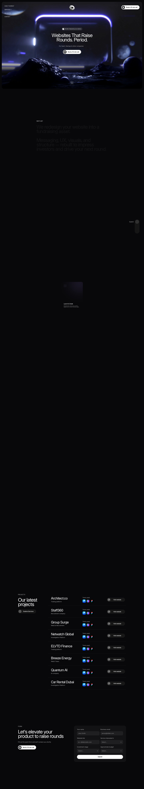

# DD Lab Studio - Websites That Raise Rounds. Period.
> Websites That Raise Rounds. Period.  ·  [ddlabstudio.com](https://ddlabstudio.com/)

**Vertical:** #vertical/studio-agency  ·  **Vibe:** #vibe/luxury #vibe/editorial  ·  **Topics:** #topic/startups #topic/marketing #topic/design  ·  **Mode:** #mode/dark

## What it is
The landing/portfolio site of DD Lab Studio (James Laurent, @jameslaurents), a design studio that redesigns startup and SaaS websites into fundraising assets — and the author home behind the Rebate sign-up-flow work in this bookmark.

## What it shows
A dark hero whose pitch is the blunt 'Websites That Raise Rounds. Period.', subtitled 'We redesign your website into a fundraising asset. Messaging, UX, visuals, and structure — rebuilt to impress investors and drive your next round.' Below sits an 'Our latest projects' grid (Architect.co, Staff360, Group Surge, Netwatch Global, ELVTD Finance, Breeze Energy, Quantum AI, Car Rental Dubai), closing on a 'Let's elevate your product to raise rounds' CTA.

## How it works
A single long-scroll marketing page (~7,840px) with anchor nav (How it works / Projects / Contact). The primary conversion is a 'Book a 15-min call' button wired to Calendly; project cards link out to the live client sites.

## How it's designed
Premium dark agency look: a near-black #08080a ground with white text and white primary buttons (black labels), a blue (#0099ff) link/focus accent. Headlines use the Almarena Neue display face against Inter body copy. Built on Framer and media-rich (63 images, 3 videos, a canvas) to feel high-production.

## Design data
- **Palette:** Near-black ground (rgb(8,8,10)) with white text and white primary buttons (black label); blue link/focus accent (#0099ff).
- **Palette tokens:** ground: #08080a (var), white: #fff (var), --framer-link-text-color: #09f (var), --framer-input-focused-border-color: #09f (var), body-bg-rendered: rgb(8, 8, 10) (rendered), h1-rendered: rgb(255, 255, 255) (rendered), button-bg-rendered: rgb(255, 255, 255) (rendered)
- **Fonts:** Almarena Neue (display headings) + Inter (body)
- **Fonts loaded:** Almarena Neue 400, Inter 400, Inter 500, Inter 600
- **Tech stack:** Framer, Framer Analytics, jsDelivr CDN
- **Keywords:** agency, studio, landing-page, dark, framer, portfolio-grid, case-studies, startup, fundraising, bold-type
- **Media mix:** img 63 · canvas 1 · video 3 · svg 4 · iframe 1
- **Page height:** 7840px (single-screen: False)
- **Responsive:** At 390px the project/feature grids collapse to a single stacked column (~7,840 → ~8,858px).
- **Headings:** Websites That Raise Rounds. Period. / We redesign your website into a fundraising asset.Messaging, UX, visuals, and structure — rebuilt to impress investors and drive your next round. / Our latest projects / Architect.co / Staff360 / Group Surge / Netwatch Global / ELVTD Finance / Breeze Energy / Quantum AI / Car Rental Dubai / Let's elevate your product to raise rounds
- **Links out:** [Book a 15-min call](https://calendly.com/jameslaurentsdesign) · [Architect.co](https://architect.exchange/) · [Staff360](https://staff360.io/)
- **Weight:** None requests; hosts: framerusercontent.com, events.framer.com, cdn.jsdelivr.net
- **Extracted:** 2026-06-06 · playwright-mcp @ 1440x900 (+390x844 mobile), logged_out: true

## Related sites
- [[hex.inc]] — shared: studio-agency, luxury, marketing, design, dark
- [[vanschneider.com]] — shared: studio-agency, luxury, editorial, design, dark
- [[coldiq.com]] — shared: studio-agency, luxury, editorial, marketing
- [[drafts9.com]] — shared: studio-agency, startups, design
- [[ignytlabs.com]] — shared: studio-agency, startups, design
- [[offthewall.studio]] — shared: studio-agency, editorial, design
