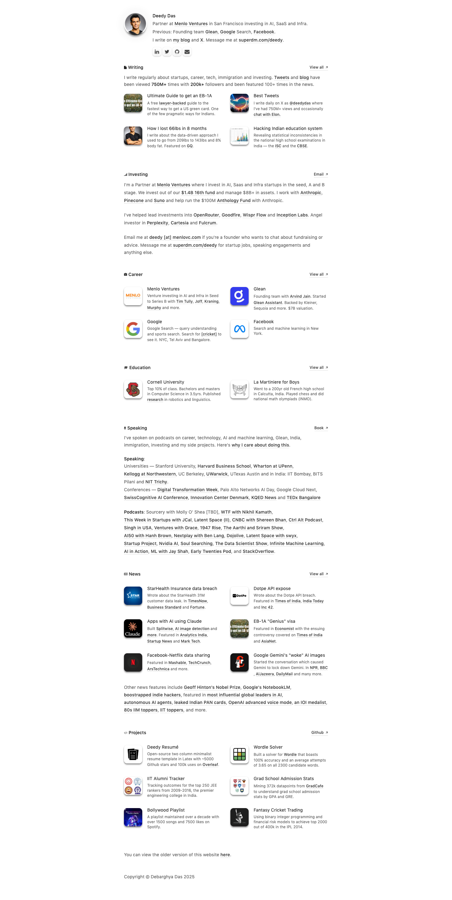

# Deedy Das
> Investing in AI, SaaS and Infra at Menlo Ventures in San Francisco. Formerly, founding team at Glean, tech lead at Google Search. Writes online frequently.  ·  [debarghyadas.com](https://debarghyadas.com/)

**Vertical:** #vertical/portfolio  ·  **Vibe:** #vibe/minimal  ·  **Topics:** #topic/startups #topic/finance #topic/ai  ·  **Mode:** #mode/light

## What it is
A dense single-page personal hub for Deedy Das — the author of the bookmarked SF AI-wealth essay — a partner at Menlo Ventures (ex founding-team Glean, ex Google Search). It's a link-rich index of everything he does rather than a marketing landing page; the only h1 on the page is just his name, “Deedy Das.”

## What it shows
It opens with a centered avatar, his name, a one-line bio (“Partner at Menlo Ventures in San Francisco… I write on my blog and X… SuperDM me”) and a row of social icons. Below run titled sections, each a tidy card grid: Writing (article cards with thumbnails), Investing, Career (Menlo / Glean / Google / Facebook logos), Education (Cornell and others), Speaking, In News (press logos — Times of India, Economic Times, Forbes India, Business Standard, Dot LA…) and Projects (Deedy Resume, Wordle Solver, IIT Alumni Tracker, Grad School Admission Stats, Bollywood Playlist, Fantasy Cricket Trading). It carries 31  and 37 inline <svg> icons.

## How it works
A static, scroll-driven single page (~2860px tall on desktop). Each section has a “View all →” link to a fuller subpage and each card links out to its destination; there are no interactive widgets — navigation is scroll plus outbound links, with a SuperDM contact CTA. React-rendered, self-hosted, with classic Google Analytics the only third-party.

## How it's designed
A clean, system-native look: Apple's SF Pro Text is the only loaded webface (weights 400/500), with FontAwesome for the icon glyphs — no decorative display font. The ground is white, body copy a mid-grey (rgb 96,96,96), headings near-black (rgb 31,31,31) and links a muted near-black (rgb 26,26,26). Notably the h1 is tiny (14px): hierarchy comes from section labels and the density of the card grids rather than big type. Light cards with subtle shadows keep it information-first and unfussy.

## Design data
- **Palette:** White ground (#fff), mid-grey body text (rgb 96/96/96), near-black headings (rgb 31/31/31), muted near-black links (rgb 26/26/26).
- **Palette tokens:** page-bg: rgb(255, 255, 255) (rendered), body-text: rgb(96, 96, 96) (rendered), heading: rgb(31, 31, 31) (rendered), link: rgb(26, 26, 26) (rendered)
- **Fonts:** SF Pro Text (400/500) for body and headings; FontAwesome for icons — no display/serif webfont.
- **Fonts loaded:** SF Pro Text 400, SF Pro Text 500, FontAwesome
- **Tech stack:** React, Google Analytics, self-hosted
- **Keywords:** personal-hub, resume-site, card-grid, section-index, system-fonts, link-rich, portfolio, static-page, information-dense
- **Media mix:** img 31 · svg 37
- **Page height:** 2860px (single-screen: False)
- **Responsive:** At 390x844 the section card grids collapse to a single column (page grows ~2860→ 4385px); the header and bio stay stacked and centered and 14px body text is unchanged.
- **Headings:** Deedy Das
- **Links out:** [SuperDM (contact)](https://superdm.com/deedy)
- **Extracted:** 2026-06-05 · playwright-mcp @ 1440x900 (+ 390x844 mobile), logged_out: true

## Related sites
- [[farza.com]] — shared: portfolio, minimal, startups, ai, light
- [[alisawuffles.github.io]] — shared: portfolio, minimal, ai, light
- [[arneshbanerjee.github.io]] — shared: portfolio, minimal, ai, light
- [[axiaisacat.indiehacker.bio]] — shared: portfolio, minimal, startups, light
- [[julian.ai]] — shared: portfolio, minimal, startups, light
- [[ryancarson.com]] — shared: portfolio, minimal, startups, light
