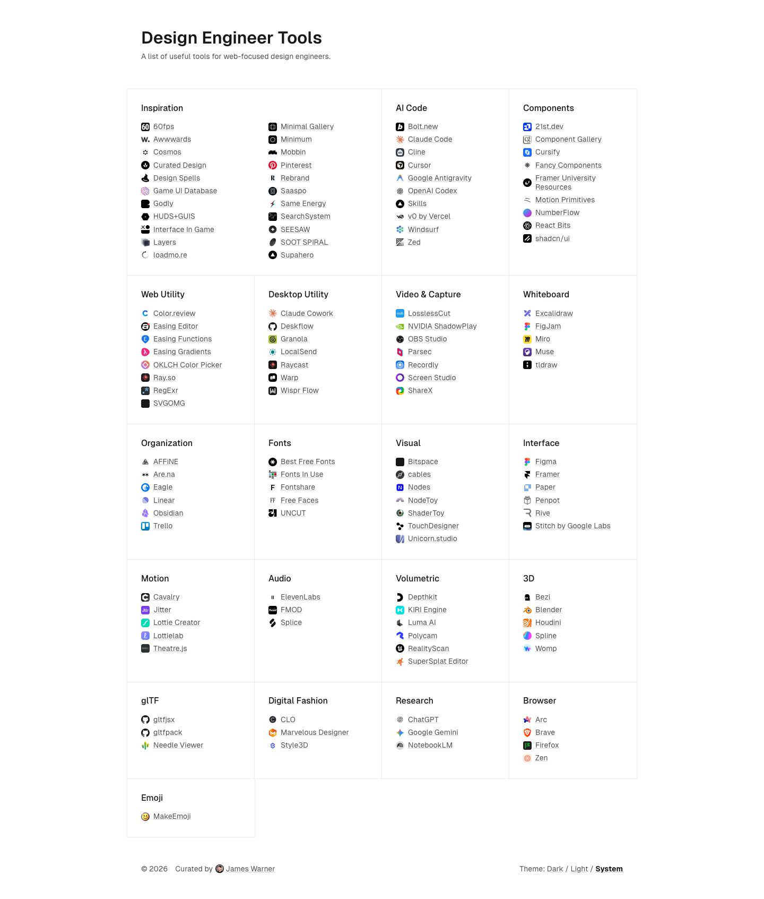

# Design Engineer Tools — James Warner's single-page curated toolbox for web-focused design engineers
> A list of useful tools for web-focused design engineers.  ·  [designengineer.tools](https://designengineer.tools/)

**Vertical:** #vertical/directory-gallery  ·  **Vibe:** #vibe/minimal #vibe/technical  ·  **Topics:** #topic/design #topic/engineering  ·  **Mode:** #mode/light

## What it is
A single, exhaustive directory page whose h1 pitch is simply 'Design Engineer Tools' and whose meta description reads 'A list of useful tools for web-focused design engineers; curated by James Warner.' It is one long, scannable index of the software a modern web design engineer actually reaches for, footered '2026 - Curated by James Warner.' The tweet's author (Dhruv, jdhruv.dev) is sharing it, not the author of the site.

## What it shows
A dense, multi-column grid of ~20 category blocks, each a favicon + name list: Inspiration (60fps, Awwwards, Cosmos, Godly, Game UI Database, Mobbin, Pinterest, SearchSystem, SEESAW, Supahero...), AI Code (Bolt.new, Claude Code, Cline, Cursor, Google Antigravity, OpenAI Codex, v0 by Vercel, Windsurf, Zed), Components (21st.dev, Fancy Components, Motion Primitives, NumberFlow, React Bits, shadcn/ui...), Web Utility (Color.review, OKLCH Color Picker, Ray.so, RegExr, SVGOMG...), Desktop Utility (Claude Cowork, Deskflow, Granola, Raycast, Warp, Wispr Flow...), Video & Capture, Whiteboard (Excalidraw, FigJam, Miro, Muse, tldraw), Organization (AFFiNE, Are.na, Eagle, Linear, Obsidian, Trello), Fonts, Visual (Bitspace, ShaderToy, TouchDesigner, Unicorn.studio...), Interface (Figma, Framer, Paper, Penpot, Rive, Stitch by Google Labs), Motion (Cavalry, Jitter, Lottie Creator, Theatre.js...), Audio (ElevenLabs, FMOD, Splice), Volumetric (Depthkit, KIRI Engine, Luma AI, Polycam, SuperSplat Editor...), 3D (Blender, Houdini, Spline, Womp...), glTF, Digital Fashion (CLO, Marvelous Designer, Style3D), Research (ChatGPT, Google Gemini, NotebookLM), Browser (Arc, Brave, Firefox, Zen) and Emoji.

## How it works
A self-hosted static-feeling page: every <script> and stylesheet is served from designengineer.tools itself plus static.cloudflareinsights.com (Cloudflare Web Analytics). No app-framework global is exposed in the DOM (__NEXT_DATA__ / __NUXT__ / Vue data-v-app / SvelteKit / Gatsby all absent), but it ships Vercel's Geist font pipeline (geistSans loaded, geistMono declared), which typically indicates a Next.js build. It is favicon-heavy but otherwise light: 124  and 126 inline <svg> (the tool logos), 0 canvas/video/iframe, over a compact 1,693px page.

## How it's designed
Deliberately plain, editorial and near-monochrome so the tool list is the whole product. getComputedStyle reports body background rgb(255,255,255) with rgb(23,23,23) (#171717) text and an h1 in Geist Sans at 32px/600; links render as the foreground at 75% opacity. :root declares --background #ffffff, --foreground #171717 and a single teal-blue accent --blue #036a96 (used for hovers/links), plus motion tokens --speed 250ms / --curve cubic-bezier(0,0.55,0.45,1). A footer theme switch offers Dark / Light / System, so the same layout inverts to the black card seen in the tweet.

## Design data
- **Palette:** Light and near-monochrome: white background (#ffffff) with near-black text (#171717) and a single teal-blue link/hover accent (#036a96); inverts to a black card in dark mode.
- **Palette tokens:** --background: #ffffff (var), --foreground: #171717 (var), --blue: #036a96 (var), body background: rgb(255, 255, 255) (rendered), body text: rgb(23, 23, 23) (rendered), h1: rgb(23, 23, 23) (rendered)
- **Fonts:** Geist Sans (loaded, weights 100-900) for everything; Geist Mono declared but reporting unloaded. No icon font - icons are per-tool favicons/SVGs.
- **Fonts loaded:** Geist Sans 100-900
- **Tech stack:** Geist font pipeline (likely Next.js; no framework global exposed), Cloudflare Web Analytics, Self-hosted
- **Keywords:** directory, toolbox, single-page, editorial, minimalist, monochrome, geist, favicon-grid, theme-toggle, design-engineering
- **Media mix:** img 124 · svg 126
- **Page height:** 1693px (single-screen: False)
- **Responsive:** At 390x844 the multi-column grid collapses to a single vertical column (scrollHeight 1,693px -> 5,125px) while the h1 holds at 32px; it becomes one long stacked list of categories.
- **Headings:** Design Engineer Tools / Inspiration / AI Code / Components / Web Utility / Desktop Utility / Video & Capture / Whiteboard / Organization / Fonts / Visual / Interface / Motion / Audio / Volumetric / 3D / glTF / Digital Fashion / Research / Browser / Emoji
- **Weight:** None requests; hosts: designengineer.tools, static.cloudflareinsights.com
- **Extracted:** 2026-07-08 · Playwright MCP, 1440x900 fullPage + 390x844 mobile probe; logged_out: true. Captured in the site's default 'System' theme, which resolved to LIGHT (a Dark / Light / System toggle sits in the footer); the tweet's promo image showed the same page in its dark theme.

## Related sites
- [[21st.dev]] — shared: directory-gallery, minimal, design, engineering, light
- [[humanoid-index.com]] — shared: directory-gallery, minimal, technical, engineering, light
- [[itshover.com]] — shared: minimal, technical, design, engineering, light
- [[transitions.dev]] — shared: minimal, technical, design, engineering, light
- [[designtools.fyi]] — shared: directory-gallery, minimal, design, light
- [[lab01.dev]] — shared: minimal, technical, design, engineering
