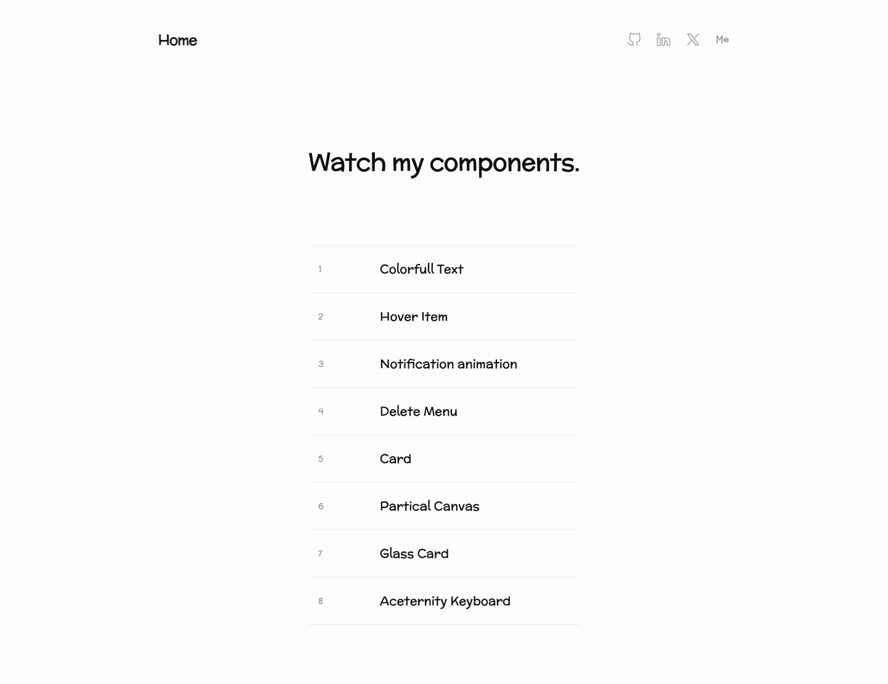

# Design Rebuilds
> Watch my components — a numbered set of UI component rebuilds.  ·  [designrebuilds.vercel.app](https://designrebuilds.vercel.app/)

**Vertical:** #vertical/portfolio  ·  **Vibe:** #vibe/minimal #vibe/playful  ·  **Topics:** #topic/design #topic/engineering  ·  **Mode:** #mode/light

## What it is
A small personal playground of UI component rebuilds (h1: 'Watch my components.') — Devster's own collection where he reconstructs interesting micro-interactions. One of the links in his inspo dump.

## What it shows
A minimal index page: a centered handwritten-style title over a numbered list of eight rebuilds — 1 Colorfull Text, 2 Hover Item, 3 Notification animation, 4 Delete Menu, 5 Card, 6 Partical Canvas, 7 Glass Card, 8 Aceternity Keyboard — each row linking to its own route that demos the live component. Social icons (GitHub, LinkedIn, X, 'Me') sit top-right.

## How it works
A React app built with Vite (vite.svg favicon, React root detected) using client-side routes (/color-text, /hover-item, /notification, /glass-card, /keyboard…) for each demo. The index itself is light and short (~1,111px); no analytics host is loaded.

## How it's designed
Stripped-back and friendly: a white page with near-black text (rgb(17,17,17)) and a single rounded, hand-drawn display face — McLaren — for the 'Watch my components.' title, which gives the otherwise plain typographic list a casual sketchbook tone. A large library of display fonts (Iosevka Charon Mono, Saira Stencil, Libre Bodoni, Peralta, Skranji…) is declared but only McLaren actually loads on the index; the personality lives inside the individual component routes.

## Design data
- **Palette:** White ground with near-black text (rgb(17,17,17)); effectively monochrome on the index, color reserved for the individual component demos.
- **Palette tokens:** body text (rendered): rgb(0,0,0) (rendered), h1 color (rendered): rgb(17,17,17) (rendered)
- **Fonts:** McLaren (rounded handwritten display, the title) is the only webfont that loads on the index; a long list of others (Iosevka Charon Mono, Saira Stencil, Libre Bodoni, Peralta, Quando, Skranji, Roboto Condensed) is declared but unused here.
- **Fonts loaded:** McLaren 400
- **Tech stack:** React, Vite, Vercel, no analytics detected
- **Keywords:** component-gallery, playground, rebuilds, minimalist, light-mode, handwritten-display, react, index-list
- **Media mix:** svg 4
- **Page height:** 1111px (single-screen: False)
- **Responsive:** At 390x844 the list stays a single column and the title drops from 40px to 30px; scrollHeight is ~1,058px (no nav collapse — the header is just text links and social icons).
- **Headings:** Watch my components.
- **Links out:** [6 Partical Canvas (demo route)](https://designrebuilds.vercel.app/partical) · [8 Aceternity Keyboard (demo route)](https://designrebuilds.vercel.app/keyboard)
- **Extracted:** 2026-06-05 · playwright-mcp @ 1440x900 (fullPage) + mobile 390x844, logged_out: true

## Related sites
- [[kmk0.com]] — shared: portfolio, minimal, playful, design, engineering, light
- [[lab01.dev]] — shared: portfolio, minimal, design, engineering
- [[arneshbanerjee.github.io]] — shared: portfolio, minimal, engineering, light
- [[asekachov.com]] — shared: portfolio, minimal, design, light
- [[axiaisacat.indiehacker.bio]] — shared: portfolio, minimal, engineering, light
- [[christophlocher.com]] — shared: portfolio, minimal, design, light
