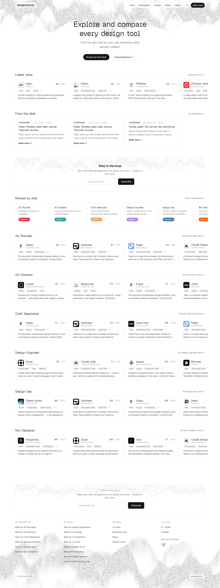

# designtools.fyi — 'Explore and compare every design tool', a role-ranked design-tool comparison directory
> Find the right tool for your role, ranked by what actually matters.  ·  [designtools.fyi](https://designtools.fyi/)

**Vertical:** #vertical/directory-gallery  ·  **Vibe:** #vibe/editorial #vibe/minimal  ·  **Topics:** #topic/design  ·  **Mode:** #mode/light

## What it is
A curated, opinionated comparison directory whose h1 is 'Explore and compare every design tool' and whose meta description reads 'Compare design tools across different capabilities. Find the best tools for designers, design engineers, and non-designers.' It positions itself as a place to 'Browse all 85 tools', read editorial 'dispatches', and find the right tool for your role rather than a flat link dump.

## What it shows
A bright, playful hero (typewriter/pixel display type over a dithered halftone cloud texture) with a nav of Tools / Archetypes / Facets / News / About plus 'Add a tool', and CTAs 'Browse all 85 tools' and 'Read dispatches'. Below the fold (h2s): 'Latest tools' as scored cards - Mobbin (3.5 / 25%), Avnac (3.3 / 50%), Quiver AI - a 'From the desk' editorial strip, and 'Browse by role' broken into archetypes: All Rounder, Art Director, Craft Specialist, Design Engineer, Design Ops, Non Designer. The scores/percentages frame it as a ranked, faceted comparison engine.

## How it works
Fonts and styles are self-hosted (plus fonts.googleapis.com); analytics run through Fathom (cdn.usefathom.com) and Cloudflare (static.cloudflareinsights.com). No app-framework global is exposed in the DOM, but the CSS uses an oklch() color system (Tailwind-style) and a Geist + custom 'Geist Pixel Square' type pairing. Media mix: 56 , 5 <canvas> (the dithered/halftone cloud texture), 1 <iframe>, 6 <svg>, 0 video, over a 3,839px page.

## How it's designed
A crisp editorial 'zine' look on white with a retro pixel-typewriter headline. getComputedStyle reports body background rgb(255,255,255) with near-black text oklch(0.205 0 0); the h1 renders in 'Geist Pixel Square' (monospace, 48px/500) - the blocky typewriter face that gives the hero its character - while body copy is Geist. No :root custom properties are exposed (Tailwind v4-style oklch is applied inline), so colours are read from the rendered page. Grain/dither and generous whitespace keep the dense comparison data feeling light.

## Design data
- **Palette:** White background with near-black text (oklch 0.205), a monochrome grayscale base warmed only by a dithered halftone cloud texture; scores/pills add small hits of contrast.
- **Palette tokens:** body background: rgb(255, 255, 255) (rendered), body text: oklch(0.205 0 0) (rendered), h1: oklch(0.205 0 0) (rendered)
- **Fonts:** Geist (400/500/600, loaded) for body + 'Geist Pixel Square' (loaded, 100-900) as the pixel/typewriter display face used in the hero h1.
- **Fonts loaded:** Geist 400, Geist 500, Geist 600, Geist Pixel Square 100-900
- **Tech stack:** Geist + Geist Pixel Square (self-hosted), Tailwind-style oklch color system, Fathom Analytics, Cloudflare, Google Fonts
- **Keywords:** directory, comparison, role-ranked, editorial, pixel-type, typewriter, halftone, dither, white, geist
- **Media mix:** img 56 · canvas 5 · svg 6 · iframe 1
- **Page height:** 3839px (single-screen: False)
- **Responsive:** At 390x844 the h1 scales 48px -> 30px, the desktop nav collapses behind a hamburger menu, and the tool/role grids reflow to a single column (scrollHeight 3,839px -> 4,524px).
- **Headings:** Explore and compare every design tool / Latest tools / From the desk / Browse by role / All Rounder / Art Director / Craft Specialist / Design Engineer / Design Ops / Non Designer
- **Weight:** None requests; hosts: designtools.fyi, fonts.googleapis.com, cdn.usefathom.com, static.cloudflareinsights.com
- **Extracted:** 2026-07-08 · Playwright MCP, 1440x900 fullPage + 390x844 mobile probe; logged_out: true

## Related sites
- [[21st.dev]] — shared: directory-gallery, editorial, minimal, design, light
- [[type.lol]] — shared: directory-gallery, editorial, minimal, design, light
- [[are.na]] — shared: directory-gallery, editorial, minimal, light
- [[designengineer.tools]] — shared: directory-gallery, minimal, design, light
- [[maxibestof.one]] — shared: directory-gallery, minimal, design, light
- [[nicelydone.club]] — shared: directory-gallery, minimal, design, light
