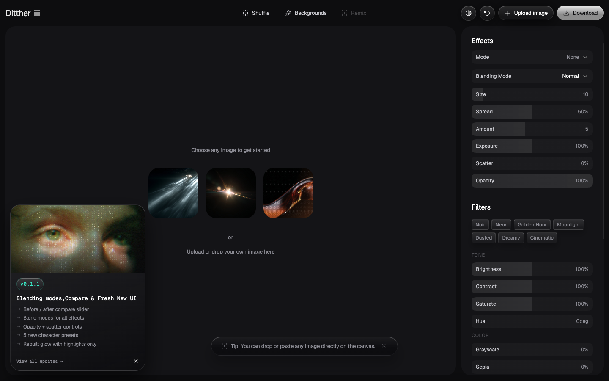

# Ditther — Browser-based Image Editor with Dither Effects
>   ·  [ditther.com](https://ditther.com)

**Vertical:** #vertical/tool-app  ·  **Vibe:** #vibe/technical #vibe/minimal  ·  **Topics:** #topic/art  ·  **Mode:** #mode/dark

## What it is
A free, no-account browser image editor built around retro/cinematic effects — dither, halftone, bayer matrix, lego, pixel, plus film-style color filters. You drop in an image (or pick a generated background) and restyle it live in the browser.

## What it shows
A dark single-screen app. The center is a large canvas workspace ('Choose any image to get started') flanked by a right-hand control panel of Effects, Filters and color Tone sliders (Brightness, Contrast, Saturate, Hue, Grayscale, Sepia). A top bar holds Shuffle / Backgrounds / Remix / Upload image / Download; a small changelog card sits bottom-left. Filter presets read like film stocks: Noir, Neon, Golden Hour, Moonlight, Dusted, Dreamy, Cinematic.

## How it works
It's a real-time editing tool, not a marketing page — ~24 input sliders and ~30 buttons drive a live <canvas> preview. You upload or drag-and-drop an image (or paste), pick an effect/filter, tune the sliders, and Download. No scroll; everything is one workspace. Mode and Blending-Mode dropdowns plus Size/Spread/Amount/Exposure/Scatter/Opacity give fine control over the dithering.

## How it's designed
Confident dark-app aesthetic: near-black panels (#0d0d0f / #141417) with crisp off-white text and a single mint-teal accent (rgb(58,237,201)) for active states. Type is all Geist + Geist Mono, which gives it a clean technical/tool feel. Effect thumbnails preview each look. The restraint (one accent, monospace labels, dense but tidy controls) makes a playful toy read as a serious utility.

## Design data
- **Palette:** Near-black panels (#0d0d0f / #141417), off-white text (#f8f8f8), muted grey labels (#8d8d95), single mint-teal accent (#3aedc9).
- **Fonts:** Geist (UI), Geist Mono (labels/values)
- **Keywords:** dark-mode, tool-app, live-canvas, control-panel, preset-grid, no-scroll, no-signup, monospace-ui, single-accent
- **Extracted:** 2026-06-04 · playwright-mcp @ 1440x900

## Related sites
- [[zendex.spyrosigma.in]] — shared: tool-app, technical, minimal, dark
- [[akira.sachi.dev]] — shared: tool-app, technical, minimal
- [[humanatlas.quest]] — shared: tool-app, technical, minimal
- [[itshover.com]] — shared: tool-app, technical, minimal
- [[shadergradient.co]] — shared: tool-app, art, dark
- [[stitch.withgoogle.com]] — shared: tool-app, technical, dark
