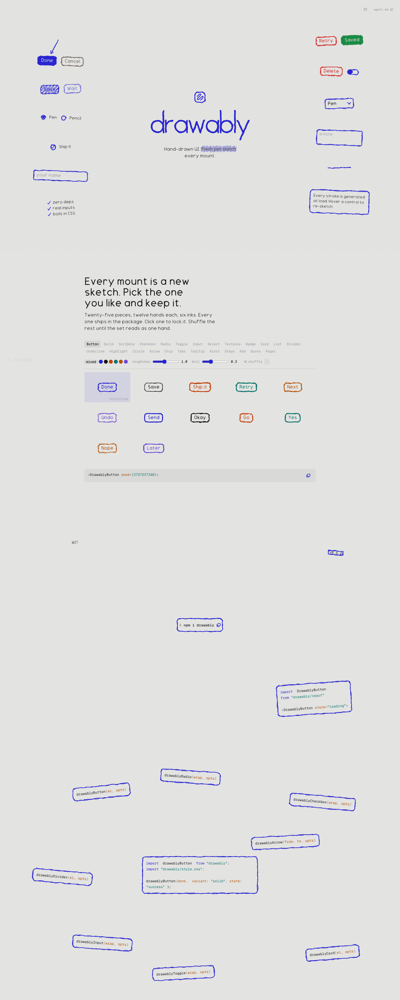

# drawably — hand-drawn UI controls
> A zero-dependency component library that renders real, functional UI controls with a hand-sketched look — a fresh pen stroke generated on every mount  ·  [drawably.dev](https://www.drawably.dev/)

**Vertical:** #vertical/tool-app  ·  **Vibe:** #vibe/playful #vibe/minimal  ·  **Topics:** #topic/design #topic/engineering  ·  **Mode:** #mode/light

## What it is
The marketing/docs site for drawably, an open-source (MIT, v0.4.2) npm package — per its own meta description, "Hand-drawn UI controls. Every mount a fresh pen sketch. Zero dependencies." It ships real, functional buttons/checkboxes/inputs/cards/etc. whose borders are redrawn with a new procedurally-jittered ink stroke each time the component mounts, rather than using a static hand-drawn-style SVG or font.

## What it shows
A hero (`<h1>drawably</h1>`) reading "Hand-drawn UI. Fresh pen sketch every mount." sits above a live-sketching demo panel (Done/Cancel, Save/Wait buttons, Pen/Pencil radio, a "Ship it" checkbox, a name textbox) that visibly re-inks on hover. Below that, a "Pick a sketch" section exposes the full component catalog as tabs — Button, Solid, Scribble, Checkbox, Radio, Toggle, Input, Select, Textarea, Badge, Card, List, Divider, Underline, Highlight, Circle, Arrow, Chip, Tabs, Tooltip, Alert, Steps, Kbd, Quote, Pager — with ink-color radios (mixed/pen/ink/red/teal/amber/violet), roughness and boil sliders, a shuffle button, and a scrollable list of saved random seeds (each an already-drawn button like "Save #1681515469") that can be locked and copied as JSX (`<DrawablyButton seed={...}>`). An Install section shows the `npm i drawably` command plus license/version, and an API section documents the vanilla-JS functions (`drawablyButton`, `drawablyCheckbox`, `drawablyInput`, `drawablyCard`, `drawablyRadio`, `drawablyToggle`, `drawablyDivider`, `drawablyArrow`).

## How it works
A sticky on-page nav (Drawably / Pick / Install / API) anchors to each section. The "Pick a sketch" tool is a full interactive playground — selecting a component tab, ink color, roughness/boil slider, or hitting shuffle regenerates the stroke live and updates the seed list and copyable code snippet; every visible control on the page (56 total across 55 `<svg>` elements) is itself drawn using the library it's demonstrating, so the docs site doubles as the component gallery. No SPA framework globals (`__NUXT__`, `__NEXT_DATA__`, Vue `data-v-app`, `__sveltekit`, `#root`/`#__next`) were detected in the DOM — consistent with the package's own "zero deps" pitch.

## How it's designed
A flat, paper-toned palette driven entirely by CSS custom properties: `--paper: #e3e3e1` (page ground), `--ink: #18181b` (body text), `--ink-2: #474645`, `--ink-3: #a1a1aa`, and a single cobalt `--pen: #2724d1` used for every hand-drawn stroke/outline plus matching code-syntax tokens (`--code-k`, `--code-s`, `--code-o`). The headline and the wordmark render in a custom `Drawably Pen` webfont (confirmed loaded via `document.fonts`) layered over `Inter`/system-ui for body copy — monospace UI chrome (`Geist Mono` 400/500, also confirmed loaded) is used for code blocks and the seed IDs. The page runs long (`scrollHeight` ~3600px against a 900px viewport) rather than single-screen, structured as a documentation-style scroll through demo → catalog → install → API.

## Design data
- **Palette:** Warm paper gray ground (#e3e3e1) with near-black ink text (#18181b) and a single cobalt-blue pen accent (#2724d1) used for every hand-drawn stroke and code keyword.
- **Palette tokens:** --ink: #18181b (var), --ink-2: #474645 (var), --ink-3: #a1a1aa (var), --pen: #2724d1 (var), --paper: #e3e3e1 (var), --code-k: #2724d1 (var), --code-s: #0f766e (var), --code-o: #b45309 (var), body-background: rgb(227, 227, 225) (rendered), body-text: rgb(24, 24, 27) (rendered)
- **Fonts:** A custom hand-drawn display face "Drawably Pen" for the wordmark/headline, Geist Mono (400/500) for code and UI labels, Inter as the system-ui fallback — all confirmed loaded via document.fonts.
- **Fonts loaded:** Geist Mono 400, Geist Mono 500, Drawably Pen 400
- **Tech stack:** No SPA framework detected in DOM globals (consistent with page's own "zero deps" claim), Google Fonts
- **Keywords:** hand-drawn-ui, generative-stroke, component-gallery-as-docs, live-playground, zero-dependency-library, seed-based-randomization, monospace-code-chrome
- **Media mix:** img 1 · svg 55
- **Page height:** 3600px (single-screen: False)
- **Responsive:** At 390×844 the page reflows to a single column but stays nearly the same total length (scrollHeight 3664px vs 3600px on desktop); the component tabs and "on this page" nav both remain visible rather than collapsing behind a menu.
- **Headings:** drawably / Every mount is a new sketch. Pick the one you like and keep it.
- **Links out:** [drawably on GitHub](https://github.com/danielwh2/drawably)
- **Extracted:** 2026-09-22 · Playwright MCP, viewports 1440×900 (primary capture + DOM probe) and 390×844 (responsive check); logged_out: true.

## Related sites
- [[itshover.com]] — shared: tool-app, minimal, design, engineering, light
- [[patterncraft.fun]] — shared: tool-app, minimal, design, engineering, light
- [[sensory-ui.com]] — shared: tool-app, minimal, design, engineering, light
- [[designrebuilds.vercel.app]] — shared: playful, minimal, design, engineering, light
- [[kmk0.com]] — shared: playful, minimal, design, engineering, light
- [[akira.sachi.dev]] — shared: tool-app, minimal, engineering, light
