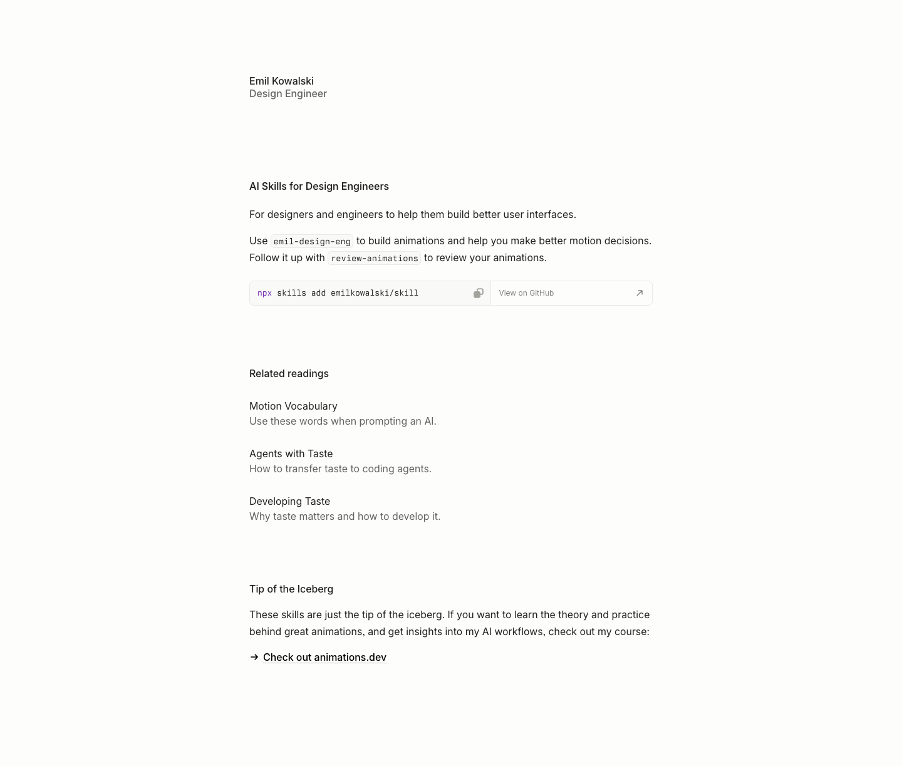

# Emil Kowalski — AI Skills for Design Engineers
> For designers and engineers to help them build better user interfaces.  ·  [emilkowal.ski](https://emilkowal.ski/skill)

## What it is
The /skill page on design engineer Emil Kowalski's personal site, where he publishes 'AI Skills for Design Engineers' — the /emil-design-eng builder skill and the /review-animations reviewer skill — 'a skill file based on the articles written on Emil Kowalski's personal site.' It's the exact page the bookmarked tweet links.

## What it shows
A short, text-first page (~1,223px): a small 'Emil Kowalski / Design Engineer' masthead over the section 'AI Skills for Design Engineers — For designers and engineers to help them build better user interfaces. Use emil-design-eng to…', a 'Related readings' list and a 'Tip of the Iceberg' closer, with a banner noting his animation-course enrollment status.

## How it works
Next.js (next/font 'Sans'/'Mono' + hashed static assets), self-hosted with no third-party analytics; near-zero media (0 img, 4 svg) — a pure reading page.

## How it's designed
Quiet, typographic, warm-minimal — the same house style as animations.dev. From getComputedStyle the canvas is warm off-white (body rgb(253,253,252)) with warm near-black ink (h1 rgb(33,32,28)); the masthead 'h1' is deliberately tiny (16px, weight 550). Type is a custom-named 'Sans' (variable 100–900) with a 'Mono' for code — no colour system beyond the near-monochrome ink-on-cream.

## Design data
- **Palette:** A warm off-white canvas (rgb(253,253,252)) with warm near-black ink (rgb(33,32,28)) — monochrome and text-first, with no accent colour.
- **Palette tokens:** body background: rgb(253, 253, 252) (rendered), body color: rgb(0, 0, 0) (rendered), h1 color: rgb(33, 32, 28) (rendered)
- **Fonts:** A custom-named 'Sans' (variable 100–900) for text and a 'Mono' for code — Emil's minimal two-face system.
- **Fonts loaded:** Sans 100-900 (variable), Mono
- **Tech stack:** Next.js (next/font), self-hosted
- **Media mix:** svg 4
- **Page height:** 1223px (single-screen: False)
- **Responsive:** At 390x844 it stays a single reading column (grows ~1,223 → 1,325px); the narrow measure just fills the width — no nav collapse needed.
- **Headings:** AI Skills for Design Engineers / Related readings / Tip of the Iceberg
- **Extracted:** 2026-07-05 · Playwright MCP, 1440x900 + 390x844 mobile pass, logged_out: true

## Related sites
[[animations.dev]] [[richzou.com]] [[willmanidis.com]] [[alisawuffles.github.io]] [[davidwinalda.com]] [[daviskeene.com]]

## Tags
#category/tools-build #aesthetic/minimal #pattern/personal-site #pattern/text-first #pattern/minimal #pattern/warm-white #pattern/inter #pattern/mono #pattern/nextjs #pattern/ai-skills #pattern/design-engineering #tech/next-js-next-font #tech/self-hosted #color/monochrome #color/warm #font/sans-100-900-variable #font/mono
