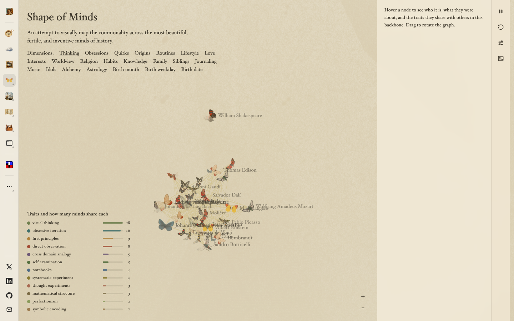

# Shape of Minds
> An attempt to visually map the commonality across the most beautiful, fertile, and inventive minds of history  ·  [evebouffard.com](https://www.evebouffard.com/shapeofminds)

**Vertical:** #vertical/experiment-art  ·  **Vibe:** #vibe/editorial #vibe/organic-warm  ·  **Topics:** #topic/art  ·  **Mode:** #mode/light

## What it is
A generative-art data-visualization project by Eve Bouffard, hosted as a page on her personal site, mapping shared traits (thinking, habits, religion, etc.) across historical geniuses like Einstein, Newton, and da Vinci.

## What it shows
A force-directed network graph where each historical figure is represented by a hand-illustrated butterfly (color/pattern encoding trait clusters), connected by fine web-like lines; selecting a figure (Albert Einstein shown) opens a detail panel with portrait, bio, and tagged traits (spinozist, pantheist, agnostic) plus a left-hand legend ranking traits by how many minds share them.

## How it works
A React app (2 canvas elements — the butterfly graph is canvas-rendered, not SVG/DOM nodes) with a dimension switcher (Thinking, Obsessions, Quirks, Origins, Routines, Lifestyle, Love, Interests, Worldview, Religion, Habits, Knowledge, Family, Siblings, Journaling, Music, Idols, Alchemy) that presumably re-renders the graph per selected trait.

## How it's designed
An aged-paper, naturalist-illustration mode: a warm parchment background (rgb(239,230,208)) with near-black text (rgb(23,23,23)), pairing an elegant display serif (Cormorant Garamond) for the title against a compressed grotesk (roc-grotesk-compressed) and Satoshi for supporting UI — echoing a vintage lepidopterist's specimen board rendered as an interactive knowledge graph.

## Design data
- **Palette:** Warm parchment/cream background (rgb(239,230,208)), near-black text (rgb(23,23,23))
- **Palette tokens:** body-color: rgb(23, 23, 23) (rendered), body-background: rgb(239, 230, 208) (rendered)
- **Fonts:** Cormorant Garamond (display serif, title), roc-grotesk-compressed, Quilon, Satoshi (UI weights)
- **Fonts loaded:** Cormorant Garamond 500
- **Tech stack:** React
- **Keywords:** network-graph, canvas, editorial, data-viz, generative-illustration
- **Media mix:** img 11 · canvas 2 · svg 17
- **Page height:** 900px (single-screen: True)
- **Responsive:** Stays single-screen at 390px with no scroll growth (844px viewport = 844px scroll height), implying the graph canvas simply resizes rather than reflowing to a list.
- **Headings:** Shape of Minds
- **Extracted:** 2026-09-22 · 1440x900 desktop + 390x844 mobile pass, logged_out: true

## Related sites
- [[bird.onethreenine.net]] — shared: experiment-art, organic-warm, art, light
- [[mercuryos.com]] — shared: experiment-art, editorial, light
- [[are.na]] — shared: editorial, art, light
- [[clipart.studio]] — shared: organic-warm, art, light
- [[coldiq.com]] — shared: editorial, organic-warm, light
- [[contralabs.com]] — shared: editorial, art, light
