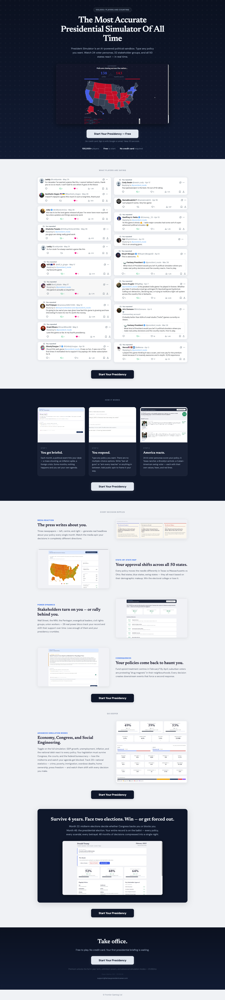

# President Simulator
> An AI-powered political sandbox — type any policy and watch 24 voter personas, 32 stakeholder groups and all 50 states react in real time (derived from the hero; the page ships no meta description).  ·  [fantasypresidentcareer.com](https://fantasypresidentcareer.com/)

**Vertical:** #vertical/tool-app  ·  **Vibe:** #vibe/editorial #vibe/corporate-clean  ·  **Topics:** #topic/ai  ·  **Mode:** #mode/mixed

## What it is
The landing page for 'President Simulator', whose h1 is 'The Most Accurate Presidential Simulator Of All Time' and whose hero subhead reads 'President Simulator is an AI-powered political sandbox. Type any policy you want. Watch 24 voter personas, 32 stakeholder groups, and all 50 states react — in real time.' It is free to start (Clerk sign-in with Google or email), with premium plans (~$19/month per the footer, © Ossman Gaming Ltd). The tweet's account (Fantasy President) is the product's own.

## What it shows
A dark-navy hero with an in-browser electoral-college mockup ('Polls are closing across the nation…', a 138 vs 143 electoral-vote counter over a blue/red US map) and a 'Start Your Presidency — Free' CTA. Below: a big two-column wall of embedded X testimonials ('WHAT PLAYERS ARE SAYING'), a dark 'HOW IT WORKS' trio (You get briefed / You respond / America reacts, each with a UI screenshot), a light 'EVENT DECISION RIPPLE' sequence — 'The press writes about you' (left/centre/right headlines), 'Your approval shifts across all 50 states' (an orange choropleth), 'Stakeholders turn on you — or rally behind you' (28 power blocs), 'Your policies come back to haunt you' — an 'ADVANCED SIMULATION MODES — Economy, Congress, and Social Engineering' dashboard, a dark 'Survive 4 years. Face two elections. Win — or get forced out.' card with a Trump / Feb-2027 dashboard mockup, and a final 'Take office.' CTA.

## How it works
A hand-built client-side app: no meta-framework global is exposed (no Next, Nuxt, React, Vue, Svelte, Framer or Webflow detected). Authentication runs through Clerk (clerk-js loaded from jsDelivr against a clerk.fantasypresidentcareer.com subdomain, Google sign-in). The marketing page is static PNG screenshots and an electoral-college GIF served from its own domain, 17 testimonial PNGs, and an (currently 404) /api/stats endpoint; fonts come from Google Fonts. Analytics/marketing = a Twitter/X Ads conversion pixel and Visitors.now. Media mix is 30 , 6 <svg>, 0 canvas/video/iframe over a 6,376px page (~48 requests).

## How it's designed
A clean civic/editorial system driven almost entirely by CSS custom properties. getComputedStyle reports a light-grey body background rgb(240,242,245) (--bg #f0f2f5) with navy body text rgb(26,26,46) (--text #1a1a2e), while the hero and interstitial bands go dark navy (--navy #1e293b / --primary #1a365d) with a near-white serif h1 rgb(241,245,249) at 54px. The palette literally codes the two parties — --dem #2563eb (blue) and --rep #dc2626 (red) — plus status colours (--success #059669, --warning #d97706, --danger #dc2626) for the reaction meters. Type pairs Newsreader (serif, loaded 600) for the headlines with DM Sans (loaded 400/500/700) for UI and body; Libre Baskerville is declared but unloaded. The primary CTA is a navy pill (--primary #1a365d).

## Design data
- **Palette:** Light-grey canvas (--bg #f0f2f5) and navy text (--text #1a1a2e) with dark-navy hero/section bands (--primary #1a365d); Democrat-blue (--dem #2563eb) and Republican-red (--rep #dc2626) accents drive the maps and charts.
- **Palette tokens:** --bg: #f0f2f5 (var), --text: #1a1a2e (var), --primary: #1a365d (var), --navy: #1e293b (var), --dem: #2563eb (var), --rep: #dc2626 (var), body background: rgb(240, 242, 245) (rendered), body text: rgb(26, 26, 46) (rendered), h1: rgb(241, 245, 249) (rendered), primary button bg: rgb(26, 54, 93) (rendered)
- **Fonts:** Newsreader (serif, loaded 600) for headlines + DM Sans (loaded 400/500/700) for UI and body; Libre Baskerville declared but unloaded.
- **Fonts loaded:** DM Sans 400, DM Sans 500, DM Sans 700, Newsreader 600
- **Tech stack:** Hand-built (no meta-framework), Clerk (auth), Twitter/X Ads pixel, Visitors.now, Google Fonts, jsDelivr (CDN)
- **Keywords:** product-landing, game, political-sim, ai, civic-editorial, serif-display, dm-sans, dem-blue-rep-red, testimonial-wall, light-grey, navy
- **Media mix:** img 30 · svg 6
- **Page height:** 6376px (single-screen: False)
- **Responsive:** At 390x844 the serif h1 scales 54px -> 32px and the multi-column layout (hero stats, testimonial wall, how-it-works, ripple sections) stacks to a single column (scrollHeight 6,376 -> 8,700px), with no horizontal overflow.
- **Headings:** The Most Accurate Presidential Simulator Of All Time / Your Platform / Sign in to President Simulator / Your Careers / President Simulator / Pick Your Era / Character Setup / Presidency Over / 🧪 Sandbox Policy Tester / All Stakeholders / 🗳️ Electioneer / 🎯 Policy Guesser / Tweeter / Tell us about your president / Vice President / Cabinet Selection / Select Your Chief of Staff / Your Cabinet Nominees / Cabinet Confirmed / 🏛️ The Cabinet / 💬 Cabinet DM
- **Links out:** [Start Your Presidency](https://fantasypresidentcareer.com/) · [Support](mailto:support@fantasypresidentcareer.com)
- **Weight:** 48 requests; hosts: fantasypresidentcareer.com, clerk.fantasypresidentcareer.com, cdn.jsdelivr.net, fonts.googleapis.com, fonts.gstatic.com, static.ads-twitter.com, analytics.twitter.com, e.visitors.now
- **Extracted:** 2026-07-08 · Playwright MCP, 1440x900 fullPage + 390x844 mobile probe; logged_out: true.

## Related sites
- [[stitch.withgoogle.com]] — shared: tool-app, corporate-clean, ai
- [[creao.ai]] — shared: editorial, corporate-clean, ai
- [[addyosmani.com]] — shared: editorial, ai, mixed
- [[cofounder.co]] — shared: editorial, ai, mixed
- [[colf.dev]] — shared: tool-app, ai
- [[lelezhang.design]] — shared: tool-app, ai
