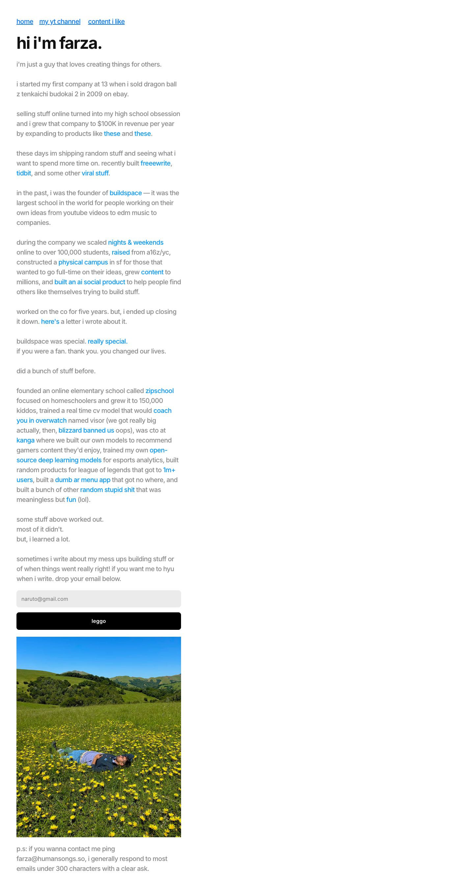

# farza
> hi im farza majeed.  ·  [farza.com](https://farza.com/)

## What it is
The deliberately plain personal site of Farza Majeed — maker, ex-founder of buildspace, and the person behind the consumer AI app 'Clicky' that the bookmarked tweet promotes. The page itself is just his bio; it is the author's portfolio landing, not a product page for Clicky (Clicky isn't linked here).

## What it shows
Almost the whole page is one long autobiographical paragraph written in lowercase, conversational voice — 'hi i'm farza. i'm just a guy that loves creating things for others.' It walks his story (selling Dragon Ball Z games on eBay at 13, growing it to $100K/yr, recent projects freeewrite and tidbit, founding and then closing buildspace after scaling it to 100,000+ students with a16z/YC backing, earlier projects zipschool, the Overwatch CV coach 'visor' that Blizzard banned, DeepLeague, etc.). Scattered blue inline links point out to the referenced tweets, GitHub, Reddit and press. It closes with an email-signup box, a black 'logg' submit button, and a candid photo of him lying in a field of yellow flowers, plus a 'ping farza@humansongs.so' contact line.

## How it works
A single static screen (built in Framer): a tiny top nav ('home / my yt channel / content i like'), the bio prose with embedded outbound links to his X/YouTube/GitHub/Reddit artifacts, and a newsletter capture form ('drop your email below') as the only interactive element. No analytics beyond Framer's own events endpoint.

## How it's designed
Radically minimal and personal — the anti-landing-page. A plain white ground (rgb(255,255,255)) with black body text and bright default-blue inline hyperlinks doing all the visual work; there's no card system, no decoration, just a narrow measure of running text, an email field, a solid black button, and one photograph for warmth. Typography is all Inter — the h1 'hi i'm farza.' at 50px / weight 700 — letting the lowercase copy and the sheer density of links carry the personality.

## Design data
- **Palette:** Plain white ground (rgb(255,255,255)) with black text (h1 rgb(17,17,17)) and bright default-blue inline links — effectively monochrome plus link-blue, warmed by a single field photo.
- **Palette tokens:** body background: rgb(255, 255, 255) (rendered), body text: rgb(0, 0, 0) (rendered), h1: rgb(17, 17, 17) (rendered)
- **Fonts:** All Inter (weights 400/500/600/700 loaded; an Inter Display cut is declared) — no decorative or display webfont; the personality comes from the lowercase copy, not the type.
- **Fonts loaded:** Inter 400, Inter 500, Inter 600, Inter 700
- **Tech stack:** Framer, Google Fonts (Inter)
- **Media mix:** img 1 · iframe 1
- **Page height:** 2699px (single-screen: False)
- **Responsive:** At 390px the layout is already a single centered column, so it just reflows taller — the h1 scales from 50px to 30px and height grows 2699px → 3349px.
- **Headings:** hi i'm farza. / home    my yt channel     content i like
- **Links out:** [my yt channel](https://www.youtube.com/watch?v=2RxDQwPmvtA) · [content i like](https://farza.com/content) · [zipschool](https://zipschool.com/) · [DeepLeague (GitHub)](https://github.com/farzaa/DeepLeague) · [contact](mailto:farza@humansongs.so)
- **Extracted:** 2026-06-06 · playwright-mcp @ 1440x900 + 390x844, logged_out: true

## Related sites
[[willmanidis.com]] [[axiaisacat.indiehacker.bio]] [[daryl.cv]] [[daviskeene.com]] [[nicolasbustamante.com]] [[noahzender.com]]

## Tags
#category/personal #aesthetic/minimal #pattern/framer-site #pattern/personal-bio #pattern/text-first #pattern/minimalist #pattern/single-screen #pattern/lowercase-voice #pattern/inline-link-dense #pattern/newsletter-capture #pattern/anti-landing-page #tech/framer #tech/google-fonts-inter #color/monochrome #color/warm #color/cool #font/inter
