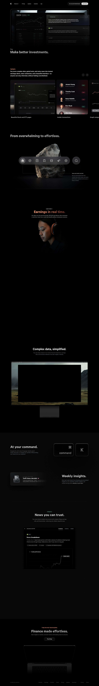

# Fey: Make better investments.
> Make better investments.  ·  [fey.com](https://fey.com)

## What it is
The marketing landing page for Fey, a desktop/web finance-research terminal pitched at the modern retail investor. Its own <h1> states the promise plainly: "Make better investments." — and the meta description frames it as "a new era of effortless financial research at your fingertips ... real-time market intelligence."

## What it shows
A long, cinematic scroll (~9,900px) that walks through the product surface: a dark app hero, then sectioned feature stories headed "From overwhelming to effortless.", "Earnings in real time.", "Screener reimagined.", "Portfolio in sync.", "Complex data, simplified.", "At your command.", "Weekly insights." and "News you can trust.", closing on "Finance made effortless." Each section pairs product UI imagery (43 images, 2 inline videos, 46 SVG icons) with a one-line claim.

## How it works
A Next.js (React) app rendered entirely from fey.com's own origin — scripts, stylesheets and the Calibre/Financier webfonts are all self-hosted, with no third-party analytics or font-CDN hosts detected in the DOM. Custom cubic-bezier easing tokens (--ease-in / --ease-out / --ease-in-out) drive the scroll-tied animations and the two inline product videos.

## How it's designed
Pure dark theme: a true-black body (rgb(0,0,0)) with white text, accented by near-white pill buttons (bg rgb(230,230,230), black label) and the occasional warm-red highlight seen on the 'Earnings in real time' section. The hero <h1> is rendered as ghosted outline text (white at 4.7% opacity, 54px/600) so the product screenshot reads as the real hero. Typography is the custom Calibre grotesque (400 + 600 loaded) for UI with a Financier serif (500) declared for editorial accents. The overall feel is a premium, Apple-product-page cadence: full-bleed dark sections, generous vertical rhythm, and motion that reveals each capability as you scroll.

## Design data
- **Palette:** True-black canvas, white type, near-white pill CTAs, a warm-red earnings accent.
- **Palette tokens:** body-bg: rgb(0, 0, 0) (rendered), body-text: rgb(255, 255, 255) (rendered), button-bg: rgb(230, 230, 230) (rendered), button-text: rgb(0, 0, 0) (rendered), h1-ghost: rgba(255, 255, 255, 0.047) (rendered)
- **Fonts:** Calibre (custom grotesque, 400/600) for UI; Financier serif (500) declared for accents; self-hosted, no font CDN.
- **Fonts loaded:** Calibre 400, Calibre 600
- **Tech stack:** Next.js / React, self-hosted fonts, no third-party analytics detected
- **Media mix:** img 43 · video 2 · svg 46
- **Page height:** 9926px (single-screen: False)
- **Responsive:** At 390x844 the hero <h1> drops 54px to 36px and the page reflows much shorter (9,926px to 7,734px); the nav stays a flex bar (no hamburger element detected).
- **Headings:** Make better investments. / Fey / From overwhelming to effortless. / Earnings in real time. / Screener reimagined. / Portfolio in sync. / Earnings in real time. / Screener reimagined. / Portfolio in sync. / Complex data, simplified. / At your command. / Weekly insights. / News you can trust. / News you can trust. / Finance made effortless.
- **Extracted:** 2026-06-06 · Playwright Chromium, 1440x900 desktop + 390x844 mobile pass; logged_out: true

## Related sites
[[hofai.io]] [[vercel.com]] [[affiliatenetwork.com]] [[animations.dev]] [[apps.ankiweb.net]] [[ashpreetbedi.com]]

## Tags
#category/uncategorized #aesthetic/dark #aesthetic/developer-product #aesthetic/luxury #pattern/dark-theme #pattern/product-landing #pattern/scroll-story #pattern/cinematic #pattern/ghost-headline #pattern/self-hosted-fonts #pattern/nextjs #pattern/fintech #tech/next-js-react #tech/self-hosted-fonts #tech/no-third-party-analytics-detected #color/dark #color/warm #font/calibre
