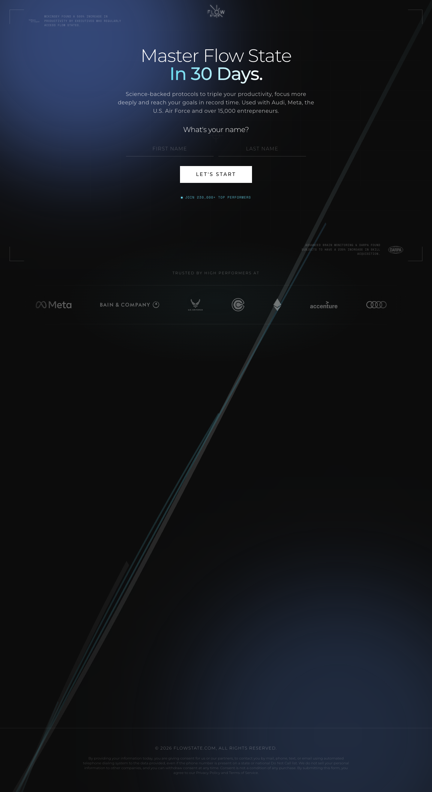

# Flowstate - Master Flow State for Peak Performance
> Master Flow State to Sharpen Focus, Multiply Output, and Operate at Peak Performance.  ·  [flowstate.com](https://flowstate.com/)

**Vertical:** #vertical/startup-product  ·  **Vibe:** #vibe/corporate-clean #vibe/minimal  ·  **Topics:** #topic/productivity  ·  **Mode:** #mode/dark

## What it is
A conversion-funnel landing page for Flowstate, a science-backed flow-state training program for founders and leaders (the 'Meet Rían' section and the description — 'Science-backed training for founders and leaders' — point to Rían Doris / the Flow Research Collective lineage). The hero pitch, verbatim, is 'Master Flow State In 30 Days.'

## What it shows
A dark hero stating the 30-day promise, an inline name-capture step ('What's your name?') that kicks off a multi-step questionnaire, a 'FLOW TRIGGER' section, and a 'Meet Rían' founder bio block. CTAs are solid white pills.

## How it works
A single dark scroll (~2,633px) structured as a quiz/opt-in funnel — the 'What's your name?' input begins a multi-step lead-capture flow. There is no JS framework global exposed; lead/ad tracking runs through the LinkedIn Insight Tag (snap.licdn.com) and the Facebook pixel (connect.facebook.net), with type served from Google Fonts.

## How it's designed
Near-black ground (rendered rgb(13,13,13)) with white text, Montserrat for the big display headings and TWK Everett as the body sans (the --font-sans token), warmed by a cool blue/cyan primary accent defined in HSL (--primary hsl(207 78% 66%), --ring hsl(190 78% 67%)). The stylesheet ships a full shadcn-style token system (--background, --foreground, --primary, --chart-1…5, radius and shadow scales). Buttons are solid white pills with near-black text.

## Design data
- **Palette:** Near-black ground (rgb(13,13,13)), white text, white CTA pills; cool blue/cyan primary accent (hsl(207 78% 66%) / ring hsl(190 78% 67%)).
- **Palette tokens:** body background (rendered): rgb(13,13,13) (rendered), body text (rendered): rgb(255,255,255) (rendered), CTA button bg (rendered): rgb(255,255,255) (rendered), --primary: 207 78% 66% (var), --ring: 190 78% 67% (var)
- **Fonts:** Montserrat (display headings) + TWK Everett (body sans, via --font-sans); of the large declared family list only Montserrat and Space Mono actually load as webfonts.
- **Fonts loaded:** Montserrat (variable 100-900), Space Mono 400
- **Tech stack:** vanilla (no JS framework detected), LinkedIn Insight Tag, Facebook Pixel, Google Fonts
- **Keywords:** dark-mode, quiz-funnel, lead-capture, landing-page, one-page-scroll, shadcn-tokens, personal-brand
- **Media mix:** img 19 · svg 1
- **Page height:** 2633px (single-screen: False)
- **Responsive:** At 390x844 the layout reflows to a single column and the h1 drops to 30px; scrollHeight grows to ~3,089px and the header stays a simple flex bar (no burger menu).
- **Headings:** Master Flow State In 30 Days. / What's your name? / FLOW TRIGGER / Meet Rían
- **Extracted:** 2026-06-05 · playwright-mcp @ 1440x900 (fullPage) + mobile 390x844

## Related sites
- [[gatheros.co]] — shared: startup-product, corporate-clean, minimal, productivity
- [[apps.ankiweb.net]] — shared: startup-product, minimal, productivity
- [[manus.im]] — shared: startup-product, minimal, productivity
- [[simple.ink]] — shared: startup-product, corporate-clean, productivity
- [[vercel.com]] — shared: startup-product, corporate-clean, minimal
- [[affiliatenetwork.com]] — shared: startup-product, corporate-clean, dark
