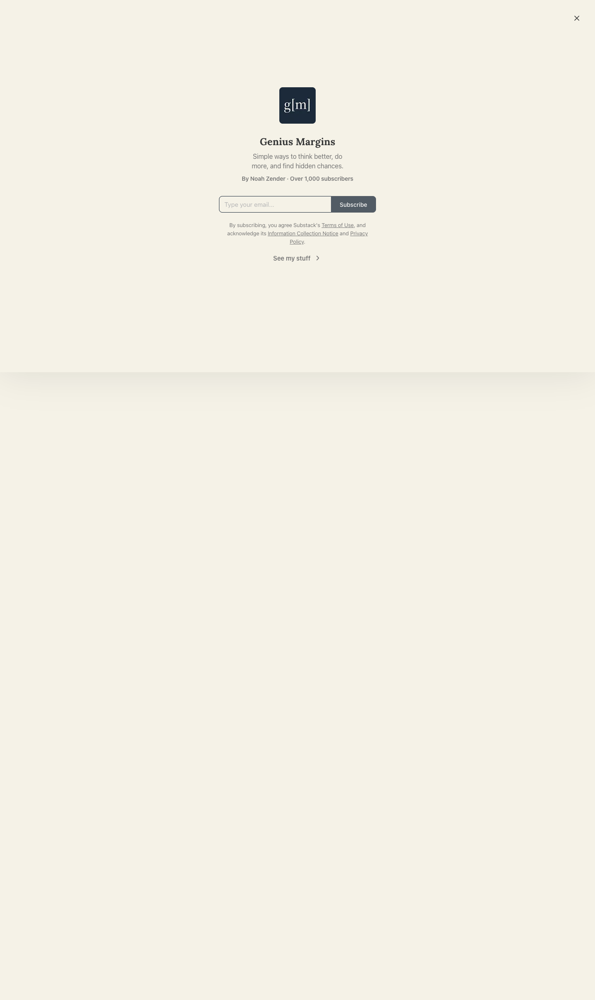

# Genius Margins | Noah Zender | Substack
> Simple ways to think better, do more, and find hidden chances.  ·  [geniusmargins.com](https://www.geniusmargins.com/)

**Vertical:** #vertical/publication-newsletter  ·  **Vibe:** #vibe/minimal #vibe/editorial  ·  **Topics:** #topic/productivity #topic/writing  ·  **Mode:** #mode/light

## What it is
Genius Margins is Noah Zender's newsletter on a custom Substack domain — 'Simple ways to think better, do more, and find hidden chances' — with over 1,000 subscribers. Per the bookmarked tweet, Zender just retired the paid tier and made all 93 essays free, so this homepage is now the free front door to the archive.

## What it shows
The standard Substack publication home; the capture landed on its subscribe splash — a dark navy 'g[m]' logo tile, the 'Genius Margins' wordmark, the tagline, a 'By Noah Zender · Over 1,000 subscribers' line, an email field with a Subscribe button, the Substack terms links, and a 'See my stuff' link through to the post archive.

## How it works
Hosted on Substack (noahzender.substack.com under the geniusmargins.com custom domain), all assets from substackcdn.com, with a subscribe-gate widget overlaying the publication. The page wires up a heavy telemetry stack — Sentry and Datadog RUM for errors/performance, Google Tag Manager and Google Ads tags, and the Cloudflare insights beacon.

## How it's designed
The quiet, serif-forward Substack editorial theme on a cream/off-white ground with dark-slate text (rgb(54,55,55)). Body copy is Spectral at 19px serif; the wordmark and headings use Lora (the h1 is Lora 700, with 500/600/700 actually loaded). A single navy logo tile is the only strong color. Iconography is inline SVG-heavy (94 SVGs) with few raster images (18).

## Design data
- **Palette:** Cream / off-white ground, dark-slate text (#363737), and a single dark-navy logo tile — quiet, near-monochrome editorial.
- **Palette tokens:** body-text: rgb(54, 55, 55) (rendered), h1-color: rgb(54, 55, 55) (rendered)
- **Fonts:** Lora (500/600/700) for the wordmark and headings + Spectral serif body — Substack's default serif theme.
- **Fonts loaded:** Lora 500, Lora 600, Lora 700
- **Tech stack:** Substack, Sentry, Datadog RUM, Google Tag Manager, Google Ads, Cloudflare
- **Keywords:** substack, newsletter, subscribe-splash, serif-editorial, custom-domain, minimal
- **Media mix:** img 18 · svg 94 · iframe 2
- **Page height:** 2418px (single-screen: False)
- **Responsive:** At 390px the centered subscribe card and the post list stack into a single column (~3.9k px).
- **Headings:** Genius Margins
- **Extracted:** 2026-06-06 · playwright-mcp @ 1440x900 + 390x844 mobile; logged_out: true

## Related sites
- [[letters.thedankoe.com]] — shared: publication-newsletter, minimal, editorial, writing
- [[vivekhaldar.com]] — shared: minimal, editorial, productivity, writing, light
- [[interfaces.dev]] — shared: publication-newsletter, minimal, editorial, light
- [[anyblockers.com]] — shared: minimal, editorial, writing, light
- [[manus.im]] — shared: minimal, editorial, productivity, light
- [[noahzender.com]] — shared: minimal, productivity, writing, light
