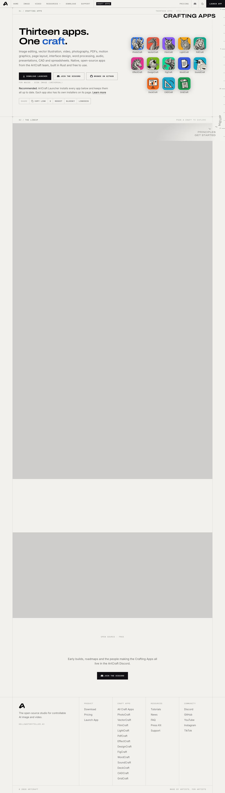

# Crafting Apps: open-source creative tools — ArtCraft
> Thirteen apps. One craft.  ·  [getartcraft.com](https://getartcraft.com/apps)

**Vertical:** #vertical/startup-product  ·  **Vibe:** #vibe/minimal #vibe/technical  ·  **Topics:** #topic/design #topic/engineering  ·  **Mode:** #mode/light

## What it is
The apps index of ArtCraft: a catalog of thirteen native, open-source creative tools (image editing, vector illustration, video, photography, PDFs, motion graphics, page layout, interface design, word processing, audio, presentations, CAD, spreadsheets) built in Rust and free to use.

## What it shows
The h1 pitch is 'Thirteen apps. One craft.' followed by a long scroll of app cards with imagery (41 img elements), plus download-launcher, Discord and GitHub calls to action.

## How it works
Top nav links to Home, Image, Video, Download, Support, Craft Apps and Pricing, with a LAUNCH APP button pointing at app.getartcraft.com and a macOS .dmg launcher served from GitHub releases. The page is a single long scroll (5066px) with share links to X, Reddit and Bluesky.

## How it's designed
A warm off-white ground (--bg #f2f1ee) with near-black ink (#101014) and a single blue accent (--accent #2d81ff). Type is split three ways: Archivo for display (60px h1), Inter for body, Geist Mono for small uppercase labels. Tokens include a faint --scanline and hairline --line borders, giving a quiet instrument-panel feel.

## Design data
- **Palette:** Warm paper off-white #f2f1ee, ink #101014, blue accent #2d81ff, inverted dark #101014
- **Palette tokens:** --bg: #f2f1ee (var), --bg-raised: #faf9f7 (var), --bg-sunken: #e9e8e4 (var), --ink: #101014 (var), --accent: #2d81ff (var), --accent-ink: #1659c4 (var), --invert-bg: #101014 (var), --danger: #b3261e (var), body background: rgb(242, 241, 238) (rendered), h1 color: rgb(0, 0, 0) (rendered)
- **Fonts:** Archivo (display), Inter (body), Geist Mono (labels); Instrument Serif declared but not loaded on this page
- **Fonts loaded:** Archivo 100-900, Inter 100-900, Geist Mono 100-900
- **Tech stack:** Custom CSS (lightningcss), Google Tag Manager, GitHub Releases
- **Keywords:** app-catalog, card-grid, uppercase-mono-labels, single-accent, download-cta
- **Media mix:** img 41 · svg 30
- **Page height:** 5066px (single-screen: False)
- **Responsive:** At 390px the h1 drops from 60px to 36px, grids collapse to a single ~388px column (app tiles to 4x72px), the nav moves behind a menu button, and page height grows from 5066px to 12907px.
- **Headings:** Thirteen apps. One craft.
- **Links out:** [Launch app](https://app.getartcraft.com/) · [Browse on GitHub](https://github.com/storytold) · [Join the Discord](https://discord.gg/artcraft)
- **Weight:** None requests; hosts: getartcraft.com, www.googletagmanager.com
- **Extracted:** 2026-10-17 · Playwright MCP, fullPage 1440x900 + 390x844 mobile text pass, DOM probe; logged_out: true

## Related sites
- [[todesktop.com]] — shared: startup-product, minimal, technical, engineering, light
- [[designengineer.tools]] — shared: minimal, technical, design, engineering, light
- [[itshover.com]] — shared: minimal, technical, design, engineering, light
- [[lenis.dev]] — shared: startup-product, technical, design, engineering
- [[transitions.dev]] — shared: minimal, technical, design, engineering, light
- [[componentry.dev]] — shared: minimal, technical, design, engineering
