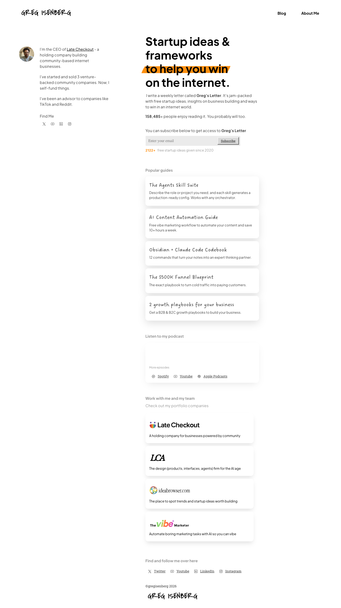

# Greg Isenberg
> Startup ideas & frameworks to help you win on the internet.  ·  [gregisenberg.com](http://gregisenberg.com/)

**Vertical:** #vertical/publication-newsletter  ·  **Vibe:** #vibe/editorial  ·  **Topics:** #topic/startups #topic/marketing  ·  **Mode:** #mode/light

## What it is
The personal hub / newsletter landing of Greg Isenberg (CEO of Late Checkout). The h1 reads 'Startup ideas & frameworks to help you win on the internet.' and the meta pitch promises 'high quality insights on internet communities, building products communities love and startups' via a weekly email. NOTE: the bookmark is Greg's 17-takeaways SF thread — the site is the author's portfolio, not the subject of the tweet.

## What it shows
A clean newsletter capture page: a slab-serif headline, email signup, links to his Blog and About Me, his ventures (Late Checkout holding co, Late Checkout Agency, IdeaBrowser, The Vibe Marketer), digital products (The Agents Skill Suite, AI Content Automation Guide, Obsidian + Claude Code Codebook, The $500K Funnel Blueprint, growth playbooks), and podcast links (Spotify, YouTube, Apple Podcasts for 'Where It Happens').

## How it works
Built on Framer (assets on framerusercontent.com, events.framer.com telemetry). Two embedded iframes (newsletter/embed widgets). Nav links to /blog and /about-me; product CTAs hit /skills-suite, /ai-content-automation, /obsidian-codes, /funnels, /growth-guides; ventures and podcasts link out. Tracking via a Facebook pixel (connect.facebook.net) and Humblytics (app.humblytics.com).

## How it's designed
A bright, editorial newsletter look on a white ground (rgb(255,255,255)) with black body text (rgb(0,0,0)) and classic unstyled-blue links (rgb(0,0,238)). Headlines use Eudoxus Sans Bold (h1 at 48px) over Roboto Slab body text — a slab/sans pairing that reads warm and bloggy. Light on imagery for a creator page (7 img, 5 svg, 2 iframes). As a Framer site it exposes no JS framework global; styling is inline Framer CSS (no external stylesheet hosts).

## Design data
- **Palette:** Bright editorial: white ground rgb(255,255,255), black text rgb(0,0,0), default-blue links rgb(0,0,238).
- **Palette tokens:** body-bg: rgb(255, 255, 255) (rendered), body-text: rgb(0, 0, 0) (rendered), link: rgb(0, 0, 238) (rendered)
- **Fonts:** Eudoxus Sans Bold for headlines (h1 48px) with Roboto Slab for body (400/500); served via Framer.
- **Fonts loaded:** Roboto Slab 400, Eudoxus Sans Bold
- **Tech stack:** Framer, Humblytics, Facebook Pixel
- **Keywords:** newsletter-landing, framer, creator-hub, slab-serif, light-theme, product-links, podcast-links, email-capture
- **Media mix:** img 7 · svg 5 · iframe 2
- **Page height:** 2564px (single-screen: False)
- **Responsive:** At 390x844 the layout reflows to a single column with no <nav> element present; total height stays similar (~2564px to ~2957px) and the h1 shrinks slightly from 48px to 31px.
- **Headings:** Startup ideas & frameworks to help you win on the internet.
- **Links out:** [Late Checkout](https://www.latecheckout.studio/) · [IdeaBrowser](https://www.ideabrowser.com/) · [Where It Happens (Spotify)](https://open.spotify.com/show/6aB0v6amo3a8hgTCjlTlvh)
- **Extracted:** 2026-06-05 · playwright-mcp @ 1440x900 + 390x844 mobile; logged_out: true (redirects to www.gregisenberg.com)

## Related sites
- [[bigplayers.co]] — shared: publication-newsletter, startups, marketing
- [[claude.com]] — shared: publication-newsletter, editorial, light
- [[crsanchez.es]] — shared: publication-newsletter, marketing, light
- [[ddlabstudio.com]] — shared: editorial, startups, marketing
- [[geniusmargins.com]] — shared: publication-newsletter, editorial, light
- [[interfaces.dev]] — shared: publication-newsletter, editorial, light
